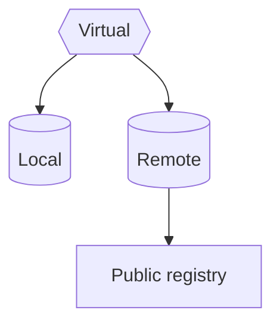
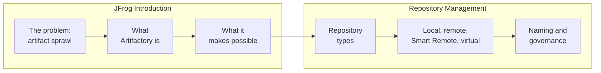

<div align="center">

# 🐸 JFrog Knowledge Bundle

### JFrog training, one concept at a time.<br/>Written for people. Structured for AI agents.

[](https://github.com/GoogleCloudPlatform/knowledge-catalog/blob/main/okf/SPEC.md)
[](LICENSE)
[](#-roadmap)
[](#-contributing)

[**Why this exists**](#-why-this-exists) · [**Start learning**](#-start-learning) · [**How it works**](#-how-it-works) · [**Use it**](#-use-it) · [**Roadmap**](#-roadmap) · [**Contribute**](#-contributing)

</div>

---

## 💡 Why this exists

Learning JFrog usually means stitching together product docs, slide decks, recorded sessions and whatever a colleague remembers. The knowledge is out there, but it is scattered, it goes out of date without telling you, and an AI assistant can't tell which parts to trust.

This repository takes a different approach. Every idea you need to learn gets **one small Markdown file**: what it is, how it works, an example, and where the information came from. The files link to each other, so you can follow your curiosity instead of a fixed slide order.

<table>
<tr>
<td width="33%" valign="top">

### 🎯 One file, one idea

Each concept is small enough to read in a few minutes and complete enough to stand on its own.

</td>
<td width="33%" valign="top">

### 🔗 Linked, not stacked

Concepts point to related concepts with ordinary Markdown links. Start anywhere and follow the trail.

</td>
<td width="33%" valign="top">

### 🛡️ Trust you can see

Each file records who wrote it, who verified it, when it is due for review, and its sources where it has them.

</td>
</tr>
</table>

## 📚 Start learning

<table>
<tr>
<td width="50%" valign="top">

### 1️⃣ [JFrog Introduction](jfrog-introduction/index.md)

<a href="jfrog-introduction/index.md"></a>

Why artifact management matters, what Artifactory is, and what it makes possible. **8 concepts**, each with a diagram and illustrations.

**Begin with:** [Artifact sprawl](jfrog-introduction/artifact-sprawl.md)

</td>
<td width="50%" valign="top">

### 2️⃣ [Repository Management](repository-management/index.md)



The repository types, how each behaves, and how to name and organize them. **6 concepts**, each with a diagram.

**Begin with:** [Repository types](repository-management/repository-types.md)

</td>
</tr>
</table>

### The learning path



Every concept page opens with a one-line takeaway and a diagram, and ends with previous and next links, so you can read a topic straight through.

## 🧭 How it works

The training content follows the [**Open Knowledge Format (OKF) v0.2**](https://github.com/GoogleCloudPlatform/knowledge-catalog/blob/main/okf/SPEC.md), Google Cloud's open, vendor-neutral specification for packaging knowledge as linked Markdown files with YAML metadata. There is no database and no proprietary tooling: if you can read Markdown, you can read this bundle.

### The layout

```text
jfrog-knowledge-bundle/        ← the OKF bundle root
├── index.md                   ← table of contents, declares okf_version: "0.2"
├── log.md                     ← what changed and when, newest first
├── README.md                  ← you are here
├── assets/images/<topic>/     ← illustrations used by the concepts
└── <topic>/
    ├── index.md               ← what's in this topic
    └── <concept>.md
```

In OKF, the **file path is the concept's identity**. `index.md` and `log.md` are reserved names; every other `.md` file in the bundle is a concept.

### Anatomy of a concept

Each concept file opens with a short YAML header, followed by the lesson itself:

```markdown
---
type: Reference
title: A short, human-friendly title
description: One sentence that says what you will learn here.
tags: [artifactory, repositories]
status: stable
sources:
  - id: jfrog-docs
    resource: https://jfrog.com/help/
    title: JFrog Help Center
generated:
  by: human:bhagatabhijeet
  at: 2026-10-10T00:00:00+00:00
verified:
  - by: human:bhagatabhijeet
    at: 2026-10-10T00:00:00+00:00
stale_after: 2027-04-10T00:00:00+00:00
---

The explanation, with claims tied to their source.[^jfrog-docs]

# Examples

Commands and configuration you can copy and run.
```

Only `type` is required by the spec. This bundle fills in the rest on purpose, because that is where the trust comes from.

### Reading the trust signals

| What you see | What it means |
|---|---|
| No `verified` entry | **Unverified.** Treat it as a draft. |
| `verified` by a tool or agent only | **Machine-confirmed.** Checked automatically, not yet by a person. |
| `verified` by a `human:` actor | **Human-reviewed.** A person has confirmed it. |
| `status: draft` / `stable` / `deprecated` | Where the concept is in its life. |
| `stale_after` in the past | Due for review. The product may have moved on. |

## 🚀 Use it

### If you are learning

1. Open [`index.md`](index.md) and pick a topic.
2. Read a concept. Follow the links that interest you.
3. Check the header whenever you need to know how far to trust a page or where to read more.

### If you are building with AI agents

Point your agent, retrieval pipeline or knowledge catalog at the repository root, which is the bundle root.

```bash
git clone https://github.com/bhagatabhijeet/jfrog-knowledge-bundle.git
```

- Every concept has a stable identity (its path) and typed metadata, so retrieval can be precise.
- `sources`, `generated` and `verified` let an agent cite its answer and weigh how reliable it is.
- `status` and `stale_after` let an agent skip or flag content that is out of date.
- Any OKF v0.2 consumer can read the bundle without custom code.

## 🗺️ Roadmap

The bundle is being built topic by topic. Each topic appears here, and in [`index.md`](index.md), as it lands.

| Topic | Status |
|---|---|
| Bundle scaffolding (`index.md`, `log.md`) | ✅ Done |
| [JFrog Introduction](jfrog-introduction/index.md) | 🚧 Draft: 8 concepts, awaiting human review |
| [Repository Management](repository-management/index.md) | 🚧 Draft: 6 concepts, awaiting human review |

Watch or star the repository to follow along.

## 🤝 Contributing

Corrections, new concepts and better examples are all welcome.

1. **One concept per file.** If a page explains two ideas, split it.
2. **Always set `type`**, and add `title`, `description` and `tags`.
3. **Cite your sources** in `sources`, and tie claims to them with footnotes.
4. **Sign your work.** Set `generated.by` to `human:<your-github-id>` for content you wrote yourself.
5. **Link generously** to related concepts, using bundle-relative paths that start with `/`.
6. **Record the change** in `log.md`.

A bundle is conformant when every concept file has parseable frontmatter with a non-empty `type`, and the reserved files keep their structure. Please check that before opening a pull request.

## 📄 License

Released under [CC0 1.0 Universal](LICENSE). Use it, adapt it and teach from it, with no permission needed.

The images in `assets/images/` are not covered by the CC0 licence. They remain the property of JFrog Ltd.

---

<div align="center">

This is an independent community project. It is not affiliated with or endorsed by JFrog Ltd.<br/>
JFrog and Artifactory are trademarks of JFrog Ltd.

**If this helps you learn, a ⭐ helps others find it.**

</div>
