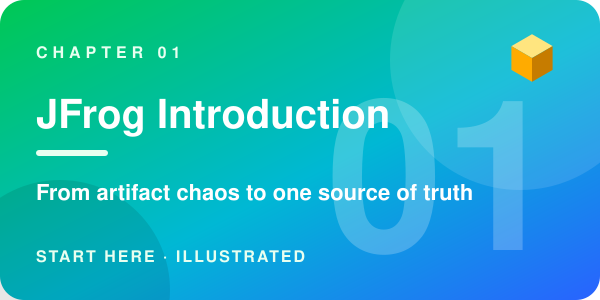
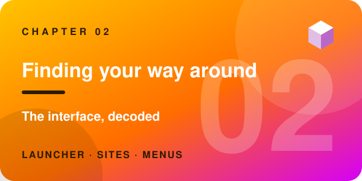
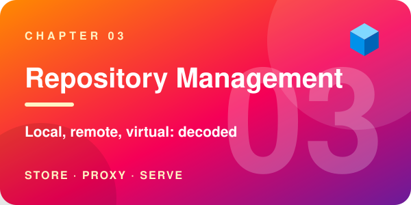
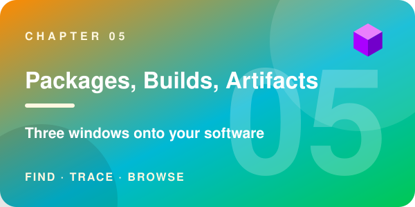
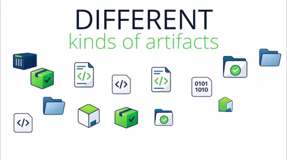
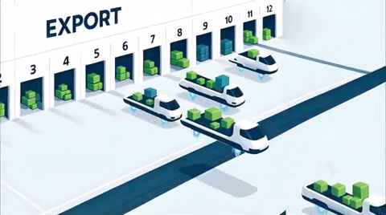
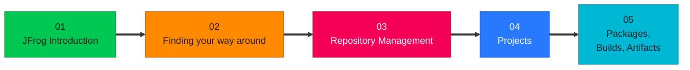
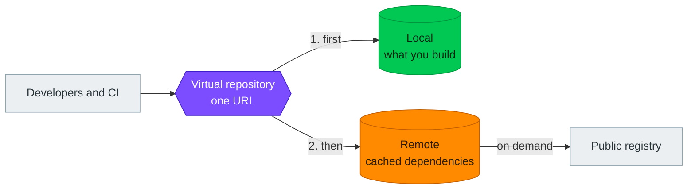
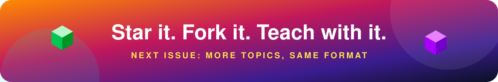

<div align="center">


<br/><br/>

[](#-in-this-issue)
[](#-why-you-will-keep-reading)
[](#-the-learning-path)
[](#-under-the-hood)
[](#-use-it)
[](#-contribute)

[](https://github.com/GoogleCloudPlatform/knowledge-catalog/blob/main/okf/SPEC.md)
[](LICENSE)
[](#-contribute)

</div>

> **JFrog training, one concept at a time.** Each idea gets one short page with a one-line takeaway, a diagram and a worked example. People can read it in minutes. AI agents can read the same files and know how far to trust them.

**Jump to a chapter:**
[01 · JFrog Introduction](jfrog-introduction/index.md) ·
[02 · Finding your way around](platform-navigation/index.md) ·
[03 · Repository Management](repository-management/index.md) ·
[04 · Projects](projects/index.md) ·
[05 · Packages, Builds, Artifacts](artifactory-views/index.md)


## 📰 In this issue

| If you are... | Start with |
|---|---|
| 🌱 New to JFrog | Chapter 01, then read straight through |
| 🖥️ Just signed in and lost | Chapter 02 |
| 🧱 Setting up repositories or a team | Chapters 03 and 04 |
| 🔎 Using Artifactory day to day | Chapter 05 |

<table>
<tr>
<td width="42%" valign="top">

<a href="jfrog-introduction/index.md"></a>

The ideas behind everything else: what an artifact is, why teams lose track of them, and what Artifactory does about it.

</td>
<td width="58%" valign="top">

| | Concept |
|:-:|---|
| **01** | [What is an artifact?](jfrog-introduction/what-is-an-artifact.md) |
| **02** | [What is an artifact repository?](jfrog-introduction/what-is-an-artifact-repository.md) |
| **03** | [Artifact sprawl: the problem Artifactory solves](jfrog-introduction/artifact-sprawl.md) |
| **04** | [Why not Git for artifacts? Why Artifactory?](jfrog-introduction/why-not-git-for-artifacts.md) |
| **05** | [What JFrog Artifactory is](jfrog-introduction/what-is-artifactory.md) |
| **06** | [Artifactory editions: Open Source and SaaS](jfrog-introduction/artifactory-editions.md) |
| **07** | [Universal package support and the single source of truth](jfrog-introduction/universal-package-support.md) |
| **08** | [Remote repositories: proxying and caching open source dependencies](jfrog-introduction/remote-repositories.md) |
| **09** | [Build once, promote everywhere](jfrog-introduction/build-once-promote-everywhere.md) |
| **10** | [Checksum-based storage: how Artifactory keeps binaries](jfrog-introduction/checksum-based-storage.md) |
| **11** | [Deployment options and federation](jfrog-introduction/deployment-and-federation.md) |
| **12** | [Software supply chain security: Xray, build metadata and the SBOM](jfrog-introduction/supply-chain-security.md) |
| **13** | [Access management in Artifactory](jfrog-introduction/access-management.md) |

</td>
</tr>
</table>

<table>
<tr>
<td width="42%" valign="top">

<a href="platform-navigation/index.md"></a>

Your first hour in JFrog SaaS: what the screen is telling you, where things live, and which menu does what.

</td>
<td width="58%" valign="top">

| | Concept |
|:-:|---|
| **14** | [Intro to Artifactory SaaS](platform-navigation/intro-to-artifactory-saas.md) |
| **15** | [The top bar, decoded](platform-navigation/the-top-bar.md) |
| **16** | [Subscriptions, sites and JPDs](platform-navigation/subscriptions-sites-and-jpds.md) |
| **17** | [The launcher: moving between sites and subscriptions](platform-navigation/the-launcher.md) |
| **18** | [MyJFrog: the account portal](platform-navigation/myjfrog-portal.md) |
| **19** | [Platform or Administration?](platform-navigation/platform-and-administration.md) |
| **20** | [A tour of the left menu: what JFrog can do](platform-navigation/the-left-menu.md) |
| **21** | [Integrations: connecting JFrog to your tools](platform-navigation/integrations.md) |

</td>
</tr>
</table>

<table>
<tr>
<td width="42%" valign="top">

<a href="repository-management/index.md"></a>

Where your software actually lives: the repository types, when to use each, and how to set them up properly.

</td>
<td width="58%" valign="top">

| | Concept |
|:-:|---|
| **22** | [Repository types in Artifactory](repository-management/repository-types.md) |
| **23** | [Local repositories](repository-management/local-repositories.md) |
| **24** | [Remote repositories](repository-management/remote-repositories.md) |
| **25** | [Virtual repositories](repository-management/virtual-repositories.md) |
| **26** | [Smart Remote repositories](repository-management/smart-remote-repositories.md) |
| **27** | [Why the package type matters](repository-management/why-package-type-matters.md) |
| **28** | [Repository naming conventions](repository-management/repository-naming-conventions.md) |
| **29** | [Walkthrough: set up .NET repositories in JFrog SaaS](repository-management/set-up-dotnet-repositories.md) |

</td>
</tr>
</table>

<table>
<tr>
<td width="42%" valign="top">

<a href="projects/index.md"></a>

How a team gets its own space: people, roles, repositories and a storage budget, all in one place.

</td>
<td width="58%" valign="top">

| | Concept |
|:-:|---|
| **30** | [What is a JFrog Project?](projects/what-is-a-project.md) |
| **31** | [Project roles and members](projects/project-roles-and-members.md) |
| **32** | [Project resources, environments and quotas](projects/project-resources.md) |
| **33** | [Walkthrough: create a project in JFrog SaaS](projects/set-up-a-project.md) |

</td>
</tr>
</table>

<table>
<tr>
<td width="42%" valign="top">

<a href="artifactory-views/index.md"></a>

The three screens you will open every day, explained in depth, and how they differ.

</td>
<td width="58%" valign="top">

| | Concept |
|:-:|---|
| **34** | [Packages, Builds, Artifacts: which is which?](artifactory-views/three-windows.md) |
| **35** | [Packages: the catalog of everything you hold](artifactory-views/packages.md) |
| **36** | [Builds: the logbook of your CI](artifactory-views/builds.md) |
| **37** | [Packages vs Builds: the difference](artifactory-views/packages-vs-builds.md) |
| **38** | [Artifacts: the file explorer](artifactory-views/artifacts.md) |

</td>
</tr>
</table>


## ✨ Why you will keep reading

<table>
<tr>
<td width="25%" valign="top" align="center">

### 🎯

**One page, one idea**

Short enough for a coffee break, complete enough to stand alone.

</td>
<td width="25%" valign="top" align="center">

### 🎨

**A picture on every page**

Each concept opens with a one-line takeaway and a diagram.

</td>
<td width="25%" valign="top" align="center">

### 🔗

**Linked, not stacked**

Follow *previous* and *next*, or wander through the cross-links.

</td>
<td width="25%" valign="top" align="center">

### 🔒

**Trust you can see**

Every page says who wrote it, who checked it and when it expires.

</td>
</tr>
</table>

<div align="center">

<a href="jfrog-introduction/artifact-sprawl.md"></a>
<a href="jfrog-introduction/universal-package-support.md"></a>
<a href="jfrog-introduction/build-once-promote-everywhere.md"></a>

<sub>A taste of the illustrations inside chapter 01. Click one to open its page.</sub>

</div>


## 📍 The learning path



The ideas come first, then the screen, then the things you set up, then the screens you use every day.

And the one picture worth remembering from chapter 03:




## 🧭 Under the hood

The bundle follows the [**Open Knowledge Format (OKF) v0.2**](https://github.com/GoogleCloudPlatform/knowledge-catalog/blob/main/okf/SPEC.md), Google Cloud's open, vendor-neutral way to package knowledge as linked Markdown files with YAML metadata. There is no database and no special tooling: if you can read Markdown, you can read this bundle.

### 🚦 Read the trust signals

| Signal in the page header | What it tells you |
|---|---|
| 🔴 No `verified` entry | **Unverified.** Treat it as a draft. |
| 🟡 `verified` by a tool or agent only | **Machine-confirmed.** Checked automatically, not yet by a person. |
| 🟢 `verified` by a `human:` actor | **Human-reviewed.** A person has confirmed it. |
| 🔖 `status: draft` / `stable` / `deprecated` | Where the page is in its life. |
| ⏰ `stale_after` in the past | Due for review. The product may have moved on. |

<details>
<summary><b>📁 How the repository is laid out</b></summary>

<br/>

```text
jfrog-knowledge-bundle/        ← the OKF bundle root
├── index.md                   ← table of contents, declares okf_version: "0.2"
├── log.md                     ← what changed and when, newest first
├── README.md                  ← you are here (repo front page, not a concept)
├── assets/images/<topic>/     ← illustrations used by the concepts
├── assets/readme/             ← cover artwork for this page
└── <topic>/
    ├── index.md               ← what's in this topic
    └── <concept>.md
```

In OKF, the **file path is the concept's identity**. `index.md` and `log.md` are reserved names; every other `.md` file in the bundle is a concept.

</details>

<details>
<summary><b>🔬 Anatomy of a concept page</b></summary>

<br/>

Each concept file opens with a short YAML header, followed by the page itself:

```markdown
---
type: Concept
title: A short, human-friendly title
description: One sentence that says what you will learn here.
tags: [artifactory, repositories]
status: stable
sources:
  - id: jfrog-docs
    resource: https://docs.jfrog.com/artifactory/docs/repository-management
    title: JFrog Artifactory documentation
generated:
  by: human:bhagatabhijeet
  at: 2026-10-10T00:00:00+00:00
verified:
  - by: human:bhagatabhijeet
    at: 2026-10-10T00:00:00+00:00
stale_after: 2027-04-10T00:00:00+00:00
---

The explanation, with claims tied to their source.[^jfrog-docs]

# Examples

Commands and configuration you can copy and run.
```

Only `type` is required by the spec. The other fields are where the trust comes from.

</details>


## 🚀 Use it

<table>
<tr>
<td width="50%" valign="top">

### 📖 If you are learning

1. Pick a chapter from [In this issue](#-in-this-issue).
2. Read a page. Follow the links that interest you.
3. Check the header when you need to know how far to trust a page.

</td>
<td width="50%" valign="top">

### 🤖 If you are building with AI agents

Point your agent, retrieval pipeline or knowledge catalog at the repository root.

```bash
git clone https://github.com/bhagatabhijeet/jfrog-knowledge-bundle.git
```

</td>
</tr>
</table>

What an agent gets from the format:

- 🆔 **Stable identity.** Every concept is addressed by its path and carries typed metadata, so retrieval can be precise.
- 📎 **Citable answers.** `sources`, `generated` and `verified` let an agent cite a page and weigh how reliable it is.
- ⏳ **Freshness.** `status` and `stale_after` let an agent skip or flag content that is out of date.
- 🔌 **No custom code.** Any OKF v0.2 consumer can read the bundle as it is.


## 📅 Roadmap

| Chapter | Status |
|---|---|
| 📗 01 · [JFrog Introduction](jfrog-introduction/index.md) | 🚧 Draft, awaiting human review |
| 📒 02 · [Finding your way around](platform-navigation/index.md) | 🚧 Draft, awaiting human review |
| 📙 03 · [Repository Management](repository-management/index.md) | 🚧 Draft, awaiting human review |
| 📘 04 · [Projects](projects/index.md) | 🚧 Draft, awaiting human review |
| 📓 05 · [Packages, Builds, Artifacts](artifactory-views/index.md) | 🚧 Draft, awaiting human review |
| 📕 More topics | ⏳ Coming, one chapter at a time |

Watch or star the repository to catch each new chapter.

## 🤝 Contribute

Corrections, new concepts and better examples are all welcome.

1. 🎯 **One concept per file.** If a page explains two ideas, split it.
2. 🔖 **Always set `type`**, and add `title`, `description` and `tags`.
3. 📎 **Cite your sources** in `sources`, and tie claims to them with footnotes.
4. 📝 **Sign your work.** Set `generated.by` to `human:<your-github-id>` for content you wrote yourself.
5. 🔗 **Link generously** to related concepts, using bundle-relative paths that start with `/`.
6. 📒 **Record the change** in `log.md`.

A bundle is conformant when every concept file has parseable frontmatter with a non-empty `type`, and the reserved files keep their structure. Please check that before opening a pull request.

## 📄 License

Released under [CC0 1.0 Universal](LICENSE). Use it, adapt it and teach from it, with no permission needed.

**Credit is welcome, never required.** If this work helps you, a mention is appreciated:

> JFrog Knowledge Bundle by [bhagatabhijeet](https://github.com/bhagatabhijeet/jfrog-knowledge-bundle)

GitHub's **Cite this repository** button gives the same details in citation formats.

The images in `assets/images/` are not covered by the CC0 license. They remain the property of JFrog Ltd.

<br/>

<div align="center">



<sub>This is an independent community project. It is not affiliated with or endorsed by JFrog Ltd.<br/>
JFrog and Artifactory are trademarks of JFrog Ltd.</sub>

</div>
