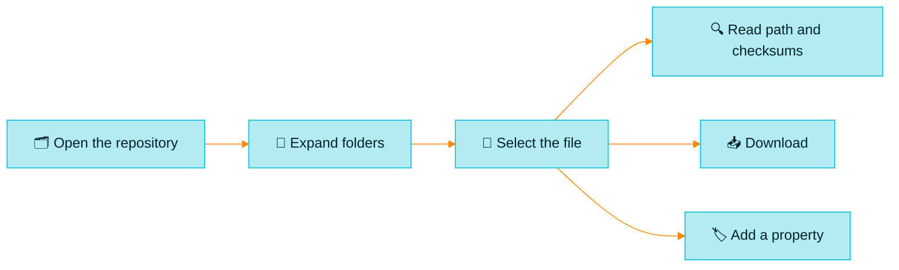

> [!TIP]
> **In one line:** Artifacts is the file explorer of Artifactory: every repository, every folder and every file, exactly as stored.

**Artifactory → Artifacts** opens the artifact browser. Where Packages shows you names and Builds shows you runs, this view shows you the actual files and where they sit.


# What an artifact is

An artifact is any stand-alone file in Artifactory, identified by a unique checksum.[^docs-objects] A jar, a wheel, a Docker layer, a zip, a text file: here, they are all artifacts.

For the bigger picture, see [what is an artifact?](/jfrog-introduction/what-is-an-artifact.md)

# What it is for

| Purpose | What that looks like |
|---|---|
| 🗂️ **Browse** | Walk through a repository, folder by folder |
| 🔍 **Inspect** | Look at one file's path, size, checksums and properties |
| 📥 **Download** | Fetch a single file by hand |
| 📤 **Upload** | Deploy a file through the browser |
| 🏷️ **Label** | Add properties to files and folders so they can be found and acted on |
| 🧭 **Verify** | Confirm that what you expected is really there |

# What it contains

Everything. This is the one view that hides nothing.

| You will see | What it is |
|---|---|
| 🟢 **Local repositories** | Files your organization uploaded |
| 🟠 **Remote repository caches** | Copies of what you have fetched from outside. See [remote repositories](/repository-management/remote-repositories.md) |
| 🟣 **Virtual repositories** | A combined view of the repositories behind them |
| 🗃️ **Build-info repositories** | The stored records behind [Builds](/artifactory-views/builds.md) |
| 📁 **Files that are not packages** | Zips, installers and anything else in Generic repositories |

> [!NOTE]
> You only see repositories you have **read** permission on.[^docs-browse] If a colleague's tree looks different from yours, that is why.

# The two halves of the screen

## Left: the repository tree

A tree of repositories that opens into folders and then files. Expand folders and select an artifact to inspect it.[^docs-browse]

The folder layout depends on the repository's package type. A Maven repository is arranged by group, artifact and version; an npm repository by package name.

## Right: the details of what you selected

Select a file and its details appear. In practice you will see:

| Detail | Why it matters |
|---|---|
| 📍 **Repository path** | The file's full address. This is what you paste into scripts |
| 📏 **Size** | How much space it takes |
| 🕘 **Created / deployed by** | When it arrived, and who or what put it there |
| 🧬 **Checksums** | SHA-256, SHA-1 and MD5: the file's fingerprints |
| 🏷️ **Properties** | Labels attached to the file |

The checksums are not decoration. Artifactory stores each file under its SHA-1 checksum. See [checksum-based storage](/jfrog-introduction/checksum-based-storage.md).

# Uploading a file

In the UI you can deploy artifacts one at a time or in batches.[^docs-deploy]

1. On the **Platform** tab, go to **Artifactory → Artifacts**.
2. Open the action menu and select **Deploy (Upload)**.
3. Choose the **Target Repository**.
4. Choose **Single Deploy** (one file, the default) or **Multiple Deploy**.
5. Drop or select the files.
6. *(Optional)* Set a custom **Target Path**.
7. Deploy.

| Option | Use it when |
|---|---|
| 📐 **Deploy According to Layout** | You want the file placed according to the repository's configured layout |
| 🗜️ **Deploy as Bundle Artifact** | You are uploading a `.zip`, `.tar`, `.tar.gz` or `.tgz` and want Artifactory to unpack it on arrival |
| ☕ **Deploy as Maven Artifact** | It is a Maven artifact and you want to set its group ID, version, classifier and type |

> [!WARNING]
> **The UI uploads files up to 100 MB.** For anything larger, use the JFrog CLI, a package manager client or a multi-part upload.[^docs-deploy]

> [!IMPORTANT]
> **Upload to the right kind of repository.** Each repository type has built-in logic for its own package format. Loose files such as images and text belong in a Generic repository; putting them in a typed repository can affect indexing and performance.[^docs-deploy] See [why the package type matters](/repository-management/why-package-type-matters.md).

Day to day, your CI should do the uploading. Manual upload is for one-off cases.

# Properties: labels on your files

Properties are customizable, searchable text fields you can attach to artifacts and folders.[^docs-properties]

| Fact | Detail |
|---|---|
| 🏷️ **What they are for** | Search, promotion, state management and organizing information |
| ✍️ **Where you can add them** | Local repositories and the local caches of remote repositories |
| 👀 **Where you can only read them** | Virtual repositories |
| 🛠️ **How to add them** | The UI, the REST API, the CLI, or at upload time |

## Examples

```text
build.name   = payments-api
build.number = 142
qa.status    = approved
```

A property such as `qa.status = approved` lets a pipeline later find "everything QA has approved". The names shown are illustrative.

# Finding a file without clicking

The tree is slow when you do not know where to look. Search instead.

```bash
# Everything under a path in a repository
jf rt search "pay-maven-dev-local/com/acme/payments-api/*"
```

The JFrog CLI searches by repository and path pattern.[^docs-browse] If you know the *package name* and not the path, [Packages](/artifactory-views/packages.md) is quicker.

# Three everyday journeys



| Journey | Steps |
|---|---|
| ✅ **"Did my upload arrive?"** | Open the repository → expand to the path → check the file, its size and its deploy time |
| 🧬 **"Is this the same file I have locally?"** | Select the file → compare its SHA-256 with `sha256sum` on your copy |
| 🧰 **"I need that one installer"** | Find it in the tree → Download |

# What Artifacts does not do

| It will not tell you | Go here instead |
|---|---|
| Which versions of a package exist, at a glance | [Packages](/artifactory-views/packages.md) |
| The command to install something | [Packages](/artifactory-views/packages.md) |
| Which build produced a file, with its dependencies | [Builds](/artifactory-views/builds.md) |

# Handle with care

> [!WARNING]
> **Do not drag single files out of a multi-file package.** Some packages are made of several artifacts, and Artifactory tracks them as a group. Manually moving one artifact out of such a package removes that context and can cause problems.[^docs-objects]

| ❌ Avoid | ✅ Do instead |
|---|---|
| Hand-moving files inside package repositories | Use your package client, or promote through a build |
| Uploading large files through the browser | Use the JFrog CLI |
| Hunting for a package by clicking folders | Search in Packages |
| Deleting to "free space" and expecting it at once | Space returns after garbage collection. See [checksum-based storage](/jfrog-introduction/checksum-based-storage.md) |

# Related

- [Packages, Builds, Artifacts: which is which?](/artifactory-views/three-windows.md)
- [Repository types in Artifactory](/repository-management/repository-types.md)
- [Checksum-based storage](/jfrog-introduction/checksum-based-storage.md)

[^docs-objects]: JFrog documentation, "Understand Artifacts and Packages".
[^docs-browse]: JFrog documentation, "Browse Artifacts in a Federated Repository".
[^docs-deploy]: JFrog documentation, "Deploy Artifacts".
[^docs-properties]: JFrog documentation, "JFrog Properties".

---

⬅️ [Packages vs Builds: the difference](/artifactory-views/packages-vs-builds.md) · 📚 [Chapter 05 index](/artifactory-views/index.md)
