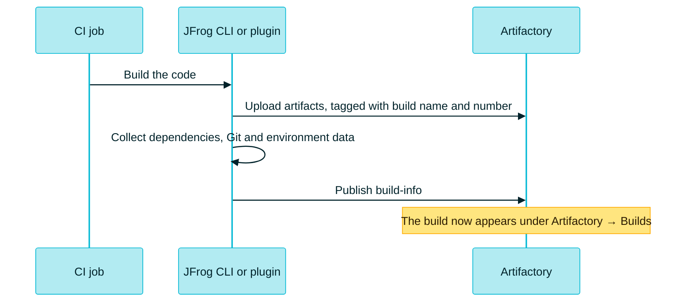

> [!TIP]
> **In one line:** Builds is the logbook of your CI: for every run, what it produced, what it consumed and where it came from.

**Artifactory → Builds** shows the builds your CI system has published. Each one is backed by a record called **build-info**.


# What a build is

A build is an output that represents the build step of CI, with details of the method and dependencies involved in building the package.[^docs-objects]

**Build-info** is the metadata record behind it. It identifies a run by **build name** and **build number**, and lists the modules, artifacts and dependencies that belong to that run.[^docs-build-info]

> [!IMPORTANT]
> **Artifacts answer "what was stored". Build-info answers "which job produced it".**[^docs-build-info]

# What it is for

| Purpose | The question you can answer |
|---|---|
| 🧾 **Traceability** | "Which run produced this jar, and from which commit?" |
| 🧩 **Bill of materials** | "Exactly which dependencies went into build 142?" |
| 🔀 **Comparison** | "What changed between build 141 and 142?" |
| 🚀 **Promotion** | "Move everything build 142 made to the QA repository" |
| 🔬 **Security** | "Did Xray find anything in this build?" |
| 🧹 **Housekeeping** | "Drop build records older than 90 days" |

A published record lets you list CI runs, compare modules, and promote by build identity. Browsing repositories alone does not give you that identity.[^docs-build-info]

# What it contains


A build-info record can include:[^docs-build-info]

| Part | Contents | Always there? |
|---|---|:-:|
| 🪪 **Identity** | Build name and build number | ✅ |
| ⏱️ **Run details** | Start time, duration, build tool and CI tool, with versions | ✅ |
| 📤 **Produced** | Modules, with their artifacts, checksums and paths | ✅ |
| 📥 **Consumed** | Resolved dependencies and their scopes | ✅ |
| 🌿 **Source** | Version control details and related issues | Optional |
| 🌡️ **Environment** | Environment properties and JVM system properties | Optional, off by default |

# The Builds page

The list has **one row per build**, not one per run. In a current SaaS site the columns include:

| Column | Meaning |
|---|---|
| **Build Name** | The name your CI job publishes under |
| **Build Repository** | Where the build-info is stored. Usually `artifactory-build-info`,[^docs-build-info] or `<project>-build-info` for a project |
| **Last Build ID** | The number of the most recent run |
| **Last Build Time** | When that run happened |
| **Release Bundles** | Release Bundles created from the build |

Above the table are a **date filter** (such as *Last 7 Days*), a **search** box, a control for choosing columns, and a **Create Release Bundle** button for the builds you tick.

> [!NOTE]
> The column names above are from a current SaaS site. JFrog's documentation lists them as *Build Name*, *Last Build Number*, *Published Modules*, *Last Build Time*, *Project* and *Build Repository*,[^docs-build-info] so expect small differences between releases, and use the column chooser to show the ones you want.

# Inside one build run

Click a **build name**, then a **build number**. The run opens with a set of tabs.[^docs-inspect]

| Your question | Where to look |
|---|---|
| ⏱️ When and where did it run? | The header: start time, duration, build tool, CI, build URL |
| 📤 What did it produce? | **Published Modules**: module ID, artifact count, checksums |
| 📥 What did it consume? | The dependency lists of each module |
| 🌿 Which source produced it? | **VCS**, when Git metadata was collected |
| 🎫 Which work items relate to it? | **Issues**, when collected |
| 🌡️ What was the environment? | **Environment**: environment and system variables |
| 🔬 Is it secure? | **Xray Data** |
| 🔀 How does it differ from another run? | **Diff** |
| 🚀 Where has it been promoted? | **Release History** |
| 📜 What evidence is attached? | **Evidence** |
| 🧾 Can I see the raw record? | **Build Info JSON** |

What you see depends on what the publishing integration collected and which services are enabled.[^docs-inspect]

# How builds get here

Builds do not appear by themselves. Your CI must **publish** them.



A package extractor, the JFrog CLI or a CI wrapper collects metadata during the job, ties it to one name and number, and publishes it. JFrog provides collection paths for Gradle, Ivy, Maven, npm, Go, pip, NuGet and Docker.[^docs-build-info]

## Examples

A minimal JFrog CLI flow. The build name and number are what tie the steps together:

```bash
# Upload the artifact, recording it against this build
jf rt upload "target/*.jar" pay-maven-dev-local/ --build-name=payments-api --build-number=142

# Add Git details to the record
jf rt build-add-git payments-api 142

# Publish the build-info to Artifactory
jf rt build-publish payments-api 142
```

The commands are standard JFrog CLI usage, shown as an illustration. Maven and Gradle have their own plugins.[^docs-build-info]

# What you can do with a published build

| Operation | Use it when | Careful |
|---|---|---|
| ➕ **Append** | A release build must reference upstream builds that were already published | The source build must have been published |
| 🚀 **Promote** | You want this build's artifacts copied or moved to another repository, with an optional status | It is not the same as Release Lifecycle Management |
| 🧹 **Retention** | You want to drop old build *records* by age or count | Decide separately whether the artifacts should also go |
| 🗑️ **Delete build information** | You want to remove the records | Removing the record does not by itself remove the artifacts |

These are the four operations JFrog documents for published builds.[^docs-manage]

Promotion is the practical face of [build once, promote everywhere](/jfrog-introduction/build-once-promote-everywhere.md).

# When something looks wrong

| Symptom | Likely cause | What to check |
|---|---|---|
| 🚫 The build is not listed | Build-info was not published, or the project context differs | That the publish step completed, and the build name and project key |
| 📭 A module has no artifacts | The package step did not link its outputs to this build | That the build name and number match in every step |
| 🌿 No dependencies or VCS data | That data was not collected | The collection settings of your integration |
| 🌡️ The Environment tab shows 0 variables | Collection is off by default | Nothing: it still means a successful publish |
| 🪟 A tab is missing | No data for it, or the feature is not available to you | Permissions, edition and enabled services |

This table follows JFrog's troubleshooting guidance.[^docs-inspect]

> [!NOTE]
> **A project can hide a build.** A project key scopes which builds appear in the list, so a mismatch looks exactly like a missing publish.[^docs-build-info] Switch the project list to *All Projects* before you panic.

# Related

- [Packages, Builds, Artifacts: which is which?](/artifactory-views/three-windows.md)
- [Build once, promote everywhere](/jfrog-introduction/build-once-promote-everywhere.md)
- [Software supply chain security](/jfrog-introduction/supply-chain-security.md)
- [Project resources](/projects/project-resources.md) - the project build-info repository.

[^docs-objects]: JFrog documentation, "Understand Artifacts and Packages".
[^docs-build-info]: JFrog documentation, "About Build Info".
[^docs-inspect]: JFrog documentation, "Inspect Builds".
[^docs-manage]: JFrog documentation, "Manage Builds".

---

⬅️ [Packages](/artifactory-views/packages.md) · 📚 [Topic index](/artifactory-views/index.md) · [Artifacts](/artifactory-views/artifacts.md) ➡️
