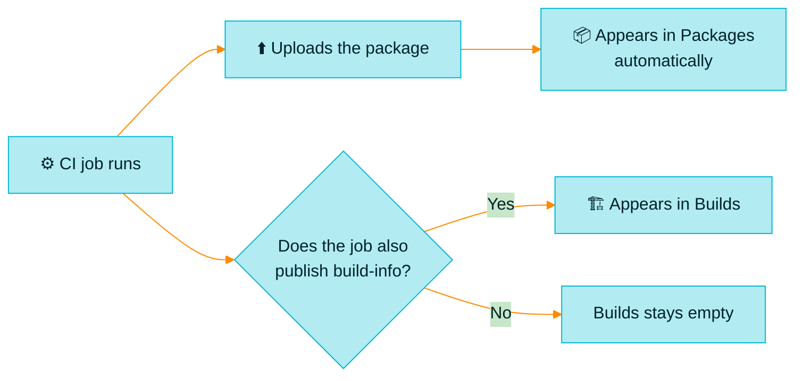
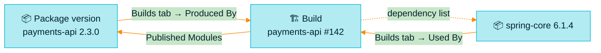

> [!TIP]
> **In one line:** Packages shows you the *result*: what exists and how to get it. Builds shows you the *process*: how it was made, and from what.

**Packages** and **Builds** sit next to each other in the menu and often show the same names, so people assume they are two lists of the same thing. They are not. One is a catalog of products. The other is a logbook of the work that made them.

# The difference in one table

| | 📦 Packages | 🏗️ Builds |
|---|---|---|
| **A row is** | One package, such as `payments-api` | One build job, such as `payments-api` |
| **Click it and you get** | Its **versions**: `2.2.9`, `2.3.0`, `2.3.1` | Its **runs**: `#140`, `#141`, `#142` |
| **Identified by** | Name + version | Name + number |
| **Represents** | A thing that exists and can be installed | An event that happened at a moment in time |
| **Question** | *What do we have?* | *How was it made?* |
| **Everyday comparison** | A shop catalog | A factory logbook |

In JFrog's own definitions, a package is the name defined in package metadata, while a build is an output representing the build step of CI, with details of the method and dependencies involved.[^docs-objects]

# Why the same name appears in both

`payments-api` can show up in both lists, and that is the heart of the confusion.

| In Packages, `payments-api` means | In Builds, `payments-api` means |
|---|---|
| The **product**: a library or service that has versions | The **CI job** that builds it |
| Named by the package's own metadata | Named by whoever set up the pipeline |

The two names match only because someone chose to call the job after the package. They do not have to. A job called `nightly-release` can produce a package called `payments-api`.

# How an entry gets there

This is the most practical difference of all.

| | 📦 Packages | 🏗️ Builds |
|---|---|---|
| **An entry appears when** | A package is stored in a repository of the matching type | Your CI **publishes build-info** |
| **Automatic?** | ✅ Yes. Artifactory indexes it for you | ❌ No. Your pipeline must do it on purpose |
| **If you do nothing special** | Packages still fills up | Builds stays empty |

> [!IMPORTANT]
> **An empty Builds page does not mean nothing was built.** It means no pipeline published a build record. Your packages can be arriving perfectly well without it. Publishing build-info is a separate, deliberate step.[^docs-build-info]

# What each one includes

| | 📦 Packages | 🏗️ Builds |
|---|---|---|
| 🏢 **Software your team built** | ✅ Yes | ✅ Yes, if build-info is published |
| 🌍 **Open source you downloaded** | ✅ Yes. Cached packages are listed too | ❌ No build row of its own |
| 🧩 **Open source, as a dependency** | Listed as its own package | ✅ Listed *inside* your build, under what it consumed |
| 🗜️ **Loose files that are not packages** | ❌ No | ✅ Possible, if a build uploaded them |

So `express` is a package you hold, but there is no `express` build, because your CI never built it. It appears in Builds only as a line in the dependency list of the builds that used it.

# What you find inside

| Open one and you see | 📦 A package version | 🏗️ A build run |
|---|---|---|
| **Headline facts** | Published date, download count, licenses[^docs-packages] | Start time, duration, build tool, CI system[^docs-inspect] |
| **Security** | Vulnerabilities for this version | Xray data for this run |
| **How to get it** | ✅ An install command to copy[^docs-packages] | ❌ Not its job |
| **What went into it** | ❌ Not directly | ✅ Every dependency it consumed[^docs-build-info] |
| **Where it came from** | The builds that produced it | The Git commit, branch and issues[^docs-inspect] |
| **Where the files are** | The repositories holding it | The modules and artifacts it published |
| **Compare with another** | Switch versions | A **Diff** between two runs[^docs-inspect] |

# One is a state, the other is a history

| | 📦 Packages | 🏗️ Builds |
|---|---|---|
| **Kind of information** | The current state of your shelves | A record of events over time |
| **Grows when** | A *new version* is published | *Any run* is published, even one that changes nothing |
| **Typical count** | A few versions per package | Hundreds or thousands of runs per job |
| **You tidy it by** | Removing old versions | Retention rules on old build records[^docs-manage] |

A nightly job that runs 300 times on unchanged code can leave 300 build records and no new package version.

# They point at each other

You rarely stay in one. Each has a doorway to the other.

| From | Go to | To find out |
|---|---|---|
| 📦 A package version | **Builds → Produced By**[^docs-packages] | Which run created this version |
| 📦 A package version | **Builds → Used By**[^docs-packages] | Which of our builds depend on this version |
| 🏗️ A build run | **Published Modules**[^docs-inspect] | Which packages and files this run created |
| 🏗️ A build run | Its dependency lists | Which packages this run pulled in |

# Which do I open? Worked examples

| The situation | Open | Why |
|---|---|---|
| "I need to add `lodash` to my project" | 📦 Packages | You want a version and an install command |
| "What is the latest version of our SDK?" | 📦 Packages | Versions live here |
| "Is this version safe and properly licensed?" | 📦 Packages | Vulnerabilities and licenses per version |
| "Version 2.3.0 is broken. Which commit made it?" | 🏗️ Builds | The run records its source |
| "What changed between yesterday's build and today's?" | 🏗️ Builds | The Diff tab |
| "List every dependency that went into the release" | 🏗️ Builds | The run's consumed list |
| "Promote this release to the QA repository" | 🏗️ Builds | Promotion works on a build |

## A security alert, start to finish

A vulnerability is announced in `log-lib 1.4.2`. You use both views, in order.

| Step | Where | What you do |
|:-:|---|---|
| 1 | 📦 Packages | Search `log-lib`, open version `1.4.2`. *Do we even have it?* |
| 2 | 📦 Packages | Open **Builds → Used By**. *Which of our builds pulled it in?* |
| 3 | 🏗️ Builds | Open each of those builds. *Which services, and which runs?* |
| 4 | 🏗️ Builds | Open **Published Modules**. *Which of our package versions contain it?* |
| 5 | 📦 Packages | Open those versions. *Have they shipped in a Release Bundle?* |

Neither view could answer all five on its own.

# Misunderstandings to clear up

| ❌ People think | ✅ What is true |
|---|---|
| "Builds is just another list of packages" | It is a list of CI jobs and their runs |
| "A build number is a version number" | `#142` counts runs. `2.3.0` is a version. Several runs can produce the same version, or none |
| "My package is there, so the build must be too" | Only if the pipeline published build-info |
| "Builds is empty, so something is broken" | Usually no pipeline is publishing build-info yet |
| "Deleting a build deletes the package" | Removing the record does not by itself remove the artifacts[^docs-manage] |
| "Packages shows only what we built" | It also shows open source you have cached |

# Remember it like this

> [!NOTE]
> **Packages is the noun. Builds is the verb.** A package *is* something. A build is something that *happened*.

# Related

- [Packages: the catalog of everything you hold](/artifactory-views/packages.md)
- [Builds: the logbook of your CI](/artifactory-views/builds.md)
- [Packages, Builds, Artifacts: which is which?](/artifactory-views/three-windows.md)

[^docs-objects]: JFrog documentation, "Understand Artifacts and Packages".
[^docs-packages]: JFrog documentation, "Viewing Packages".
[^docs-build-info]: JFrog documentation, "About Build Info".
[^docs-inspect]: JFrog documentation, "Inspect Builds".
[^docs-manage]: JFrog documentation, "Manage Builds".

---

⬅️ [Builds: the logbook of your CI](/artifactory-views/builds.md) · 📚 [Topic index](/artifactory-views/index.md) · [Artifacts: the file explorer](/artifactory-views/artifacts.md) ➡️
