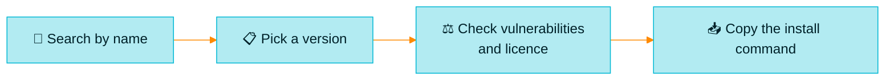

> [!TIP]
> **In one line:** Packages is your organization's catalogue: every package you hold, by name and version, with the command to install it.

**Artifactory → Packages** lists the packages stored in *all* your repositories in one place.[^docs-packages] You do not need to know which repository something is in, or what the file is called. You only need its name.

# What it is for

| Purpose | What that looks like |
|---|---|
| 🔎 **Find** | "Do we have `lodash`? Which versions?" |
| 📥 **Install** | Copy a ready-made install command for your client |
| ⚖️ **Judge** | See a version's vulnerabilities and licences before you use it |
| 🧭 **Trace** | See which builds produced a version and which builds use it |

The list gives quick access to summary information about the latest version of each package, and lets you drill down into earlier versions.[^docs-packages]

# What it contains

A **package** is identified by the name in its own metadata, such as `package.json` for npm.[^docs-objects] That is why this view speaks the language of each ecosystem: *tags* for Docker images, *versions* for everything else.[^docs-packages]

| You will find here | Example |
|---|---|
| 📦 Packages **your teams built** | `payments-api`, published by your CI |
| 🌍 Open source packages **you have pulled in** | `express`, cached from the npm registry |
| 🐳 Container images | `web-ui`, with one entry per tag |

Anything that is not a recognized package, such as a loose zip in a Generic repository, will not appear here. Look for it in [Artifacts](/artifactory-views/artifacts.md).

# The list: finding a package

To open it, select the **Platform** tab and go to **Artifactory → Packages**. At first it shows every package, sorted by name, with **Recently Viewed** and **All Packages** tabs at the top and filters on the right.[^docs-packages]

| Filter | How it behaves |
|---|---|
| 🧩 **Package Type** | Choose one or several, such as Docker and Maven |
| 🔤 **Package Name** | Full or partial. `thon` finds `Python` |
| 📝 **Description** | Searches the text of each package's metadata description |
| 🏷️ **Keywords** | One keyword at a time |
| 📅 **Created On** | Last 7, 30 or 90 days, or a custom range. It uses the creation date of the package's *first* version |

These are the filters JFrog documents.[^docs-packages]

## Save a view you use often

Filter the list, click **Save New View**, and give it a short name. It then sits beside *All Packages* as its own tab.[^docs-packages]

| Good to know | Detail |
|---|---|
| 🔢 Limit | Up to 8 custom views |
| 💾 Where they live | In your browser's cache, so they do not follow you to another machine |
| 🕘 Recently Viewed | Keeps your 10 most recently opened packages |

# The details: everything about one package

Click any row and the **Package Details** screen opens on the latest version or tag.[^docs-packages]

## On the left: this version at a glance

| Field | What it tells you |
|---|---|
| **Version / Tag** | Which version you are looking at |
| **Published Date** | When this version was published |
| **Version Downloads** | How many times this version has been downloaded |
| **Vulnerabilities** | The Xray scan result, if the version has been scanned |
| **Licenses** | The licences covering the package |

## Choosing a version

| Way | Best for |
|---|---|
| ⚡ **Quick version selector** | You know roughly which version you want. Type to search the drop-down |
| 📋 **All Versions** | Comparing. It lists every version with its vulnerabilities and where it is stored |

Tick **Release versions only** to hide pre-releases.[^docs-packages]

## The install command

Every version comes with an installation command you can copy.[^docs-packages]

- 🔀 **Several clients?** Pick yours, such as Docker or Podman, and the command changes to match.
- 🗄️ **In several repositories?** Pick the repository, and the command changes to match.
- 🔑 **Needs a token?** For clients that authenticate explicitly, a *Generate Token* prompt appears first.

## On the right: the information tabs

| Tab | What is in it | Why you care |
|---|---|---|
| ℹ️ **Info** | Details of the version. For Docker and OCI, the manifest | The facts |
| 📖 **Readme** | The package's readme, if it has one | How to use it |
| 🗄️ **Repositories** | Every repository holding this version, with **Show in Artifacts Tree** | Jump to the actual file |
| 🏗️ **Builds** | **Produced By**: the builds that made it. **Used By**: the builds that depend on it | Impact analysis |
| 🎁 **Release Bundles** | The Release Bundles containing this version | Has it shipped? |
| 📜 **Evidence** | Evidence files attached to this version | Proof for audits |
| 🔬 **Xray Data** | Security data for this version | Is it safe? |

These are the tabs JFrog documents for the screen.[^docs-packages]

> [!NOTE]
> **The "Used By" view is the one to remember.** When a vulnerability is announced in a library, it tells you in seconds which of your builds pulled that version in.

# Three everyday journeys

| Journey | Steps |
|---|---|
| 🆕 **"I need a library"** | Filter by name → open it → check vulnerabilities and licence → copy the install command |
| 🚨 **"Is this vulnerable version in use?"** | Open the package → pick the version → **Builds → Used By** |
| 🗺️ **"Where is it physically?"** | Open the package → **Repositories** → **Show in Artifacts Tree** |

# What Packages does not do

| You cannot | Go here instead |
|---|---|
| Upload a file | [Artifacts](/artifactory-views/artifacts.md) |
| Browse a repository's folders | [Artifacts](/artifactory-views/artifacts.md) |
| See how a build ran | [Builds](/artifactory-views/builds.md) |
| See files that are not packages | [Artifacts](/artifactory-views/artifacts.md) |

# If a package is missing

| Likely reason | What to check |
|---|---|
| 🧩 It was uploaded to a repository of the **wrong package type** | Wrong-type packages are not indexed. See [why the package type matters](/repository-management/why-package-type-matters.md) |
| 📁 A **project** is selected that does not include it | Switch the project list to *All Projects* |
| 🔐 You lack **read permission** on its repository | Ask an administrator |
| 🧮 An active **filter** is hiding it | Look for the green dot beside a filter |

The reasons are practical guidance; only the filter indicator is from JFrog's documentation.[^docs-packages]

# Related

- [Packages, Builds, Artifacts: which is which?](/artifactory-views/three-windows.md)
- [Universal package support](/jfrog-introduction/universal-package-support.md)
- [Why the package type matters](/repository-management/why-package-type-matters.md)

[^docs-objects]: JFrog documentation, "Understand Artifacts and Packages".
[^docs-packages]: JFrog documentation, "Viewing Packages".

---

⬅️ [Packages, Builds, Artifacts: which is which?](/artifactory-views/three-windows.md) · 📚 [Topic index](/artifactory-views/index.md) · [Builds](/artifactory-views/builds.md) ➡️
