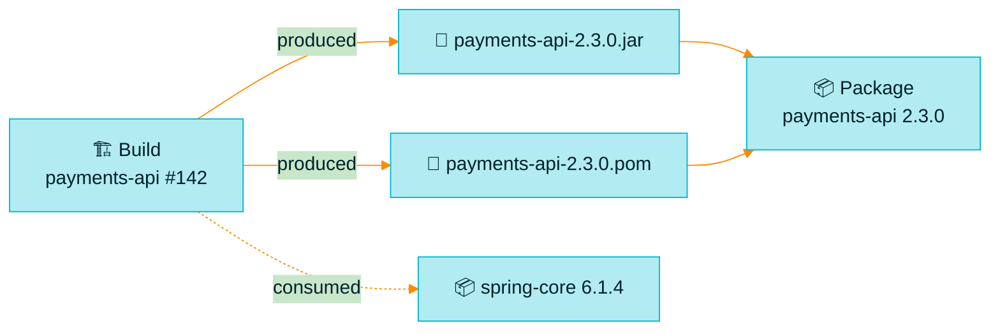
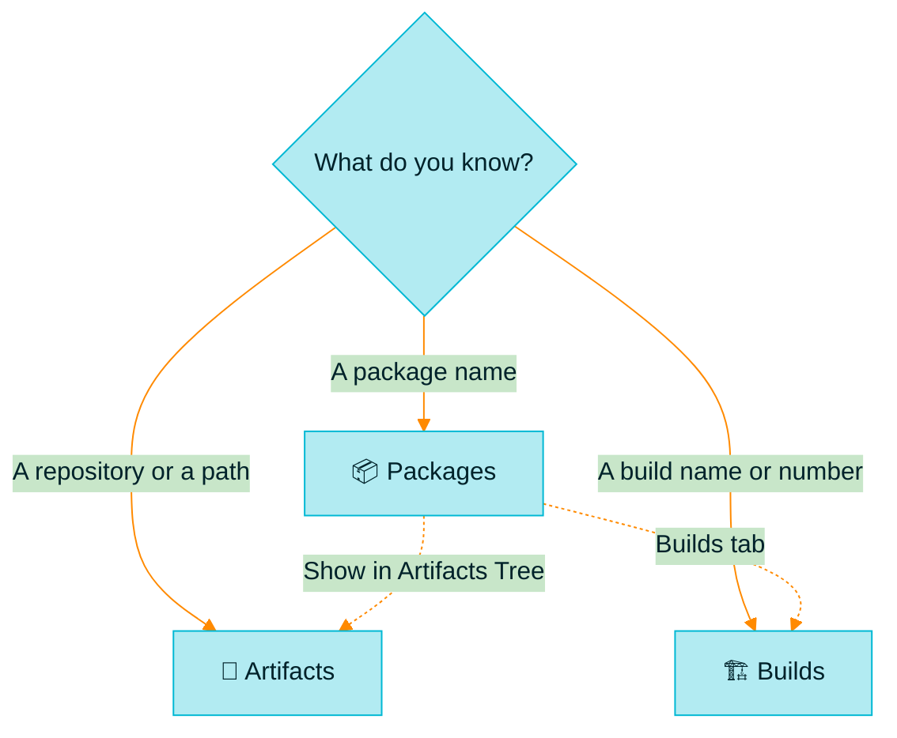

> [!TIP]
> **In one line:** Packages tells you *what you have*, Builds tells you *who made it*, Artifacts shows you *where the file is*.

Under **Artifactory** in the left menu sit three entries that newcomers constantly mix up. They are not three different stores. They are three windows onto the same software.

# The four things Artifactory keeps

Artifactory manages a handful of object types. Three of them have their own menu entry.[^docs-objects]

| Object | JFrog's definition | Menu entry |
|---|---|---|
| 📄 **Artifact** | Any stand-alone file in Artifactory, identified by a unique checksum | [Artifacts](/artifactory-views/artifacts.md) |
| 📦 **Package** | The name as defined in package metadata, such as `package.json` for npm or `manifest.json` for Docker | [Packages](/artifactory-views/packages.md) |
| 🏗️ **Build** | An output that represents the build step of CI, with details of the method and dependencies involved | [Builds](/artifactory-views/builds.md) |
| 🎁 **Release Bundle** | An immutable set of content that represents a release candidate | Release Lifecycle |

# How they relate

| Relationship | In plain words |
|---|---|
| 📦 → 📄 **A package is made of artifacts** | A package can contain a single artifact, or several.[^docs-objects] |
| 🏗️ → 📄 **A build produces artifacts** | The build record lists exactly which files a run created. |
| 🏗️ → 📦 **A build consumes packages** | The same record lists the dependencies the run pulled in. |

# One example, three views

Say your CI builds version 2.3.0 of a service called `payments-api`.

| Open | You see | You can answer |
|---|---|---|
| 📦 **Packages** | `payments-api`, with version `2.3.0` at the top | "Is 2.3.0 out? How do I install it?" |
| 🏗️ **Builds** | `payments-api`, last build ID `142` | "Which run made 2.3.0, and from what?" |
| 📄 **Artifacts** | `pay-maven-dev-local/com/acme/payments-api/2.3.0/payments-api-2.3.0.jar` | "Where exactly is the file, and what is its checksum?" |

# Which one do I open?

| Your question starts with... | Open |
|---|---|
| "Do we have...", "which version of...", "how do I install..." | 📦 [Packages](/artifactory-views/packages.md) |
| "Which build...", "what went into...", "what changed between..." | 🏗️ [Builds](/artifactory-views/builds.md) |
| "Where is the file...", "what is in this repository...", "let me upload..." | 📄 [Artifacts](/artifactory-views/artifacts.md) |

> [!NOTE]
> You are never stuck in one view. A package's details link to the builds that made it and to its place in the Artifacts tree.[^docs-packages]

# Who lives where

| Role | Spends most time in |
|---|---|
| 👩‍💻 **Developer** | Packages |
| 🚀 **Release or DevOps engineer** | Builds |
| 🛠️ **Administrator** | Artifacts |

This is a typical pattern, not a rule. Everyone uses all three sooner or later.

# Related

- [A tour of the left menu](/platform-navigation/the-left-menu.md)
- [What is an artifact?](/jfrog-introduction/what-is-an-artifact.md)

[^docs-objects]: JFrog documentation, "Understand Artifacts and Packages".
[^docs-packages]: JFrog documentation, "Viewing Packages".

---

⏮️ [Previous chapter: Projects](/projects/index.md) · 📚 [Chapter 05 index](/artifactory-views/index.md) · [Packages: the catalog of everything you hold](/artifactory-views/packages.md) ➡️
