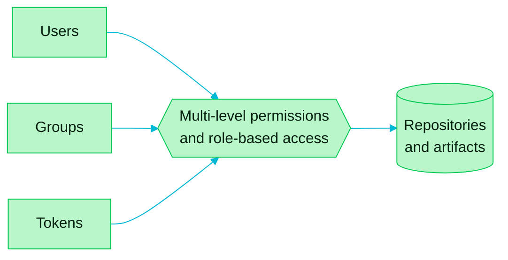

> [!TIP]
> **In one line:** Who can do what is decided by permissions and roles, attached to users, groups and tokens.

Artifactory makes access management and user control more secure by managing multi-level permissions and role-based access.

# What access is tied to

Permissions and roles are tied to three kinds of identity.

| Identity | What it is | Typical use |
|---|---|---|
| 👤 **Users** | One person's account | A developer signing in |
| 👥 **Groups** | A set of users managed together | A whole team given the same access at once |
| 🔑 **Tokens** | A credential that stands in for a user or a service | A CI pipeline uploading builds |

The three identities are JFrog's. The descriptions are a plain-language guide.

# The idea behind it

| Principle | What it means |
|---|---|
| 🎭 **Role-based** | You grant a *role*, such as developer or viewer, not a long list of individual permissions |
| 🪜 **Multi-level** | Access can be set broadly or narrowly, as the situation needs |
| 🔐 **Least access** | People and pipelines get what their job needs, and no more |

> [!NOTE]
> On the JFrog Platform today, access is organized through **Projects** and their roles. See [project roles and members](/projects/project-roles-and-members.md) for how it works in practice.

# Related

- [Project roles and members](/projects/project-roles-and-members.md)
- [What is a JFrog Project?](/projects/what-is-a-project.md)
- [Software supply chain security](/jfrog-introduction/supply-chain-security.md)

---

⬅️ [Software supply chain security: Xray, build metadata and the SBOM](/jfrog-introduction/supply-chain-security.md) · 📚 [Topic index](/jfrog-introduction/index.md)
