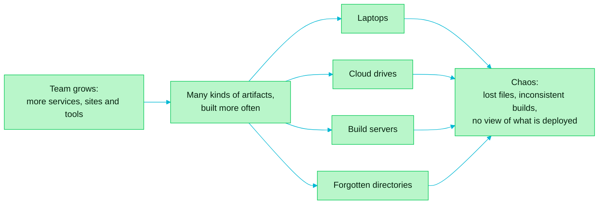

> [!TIP]
> **In one line:** Without one home for its build outputs, a growing team loses track of what it built and what it shipped.

Software delivery succeeds when it gets faster, more secure and higher in quality at the same time. What gets in the way is the sheer number of artifacts, libraries, packages and dependencies a team has to manage, across many languages and tools, while still being sure each one is authentic and intact.

# The Complexoft story

This topic follows Complexoft, a fictional startup, through two stages.

| Stage | What it looked like |
|---|---|
| Early days | The team wrote code, ran a build and distributed it. Everything lived in Git and a few shared folders, and everyone knew where things were. |
| After growth | More features, more services, more developers across multiple sites, and more tools and technologies. Builds ran more often and produced many kinds of artifacts. |

# How sprawl happens

Growth multiplies the kinds of output a team produces: binaries, packages, containers and builds.

With no single home for them, these artifacts pile up wherever they were last used:

- developer laptops
- cloud drives
- build servers
- old directories nobody remembers

# What it costs

- **Lost files.** The team cannot find the right version of an artifact.
- **Inconsistent builds.** The same build does not produce the same result twice.
- **Environment drift.** Different environments behave differently.
- **No visibility.** Nobody has a clear picture of what is actually being deployed.

# Where to go next

[What JFrog Artifactory is](/jfrog-introduction/what-is-artifactory.md) explains how a single artifact repository removes each of these problems.

---

📚 [Topic index](/jfrog-introduction/index.md) · [What JFrog Artifactory is](/jfrog-introduction/what-is-artifactory.md) ➡️
