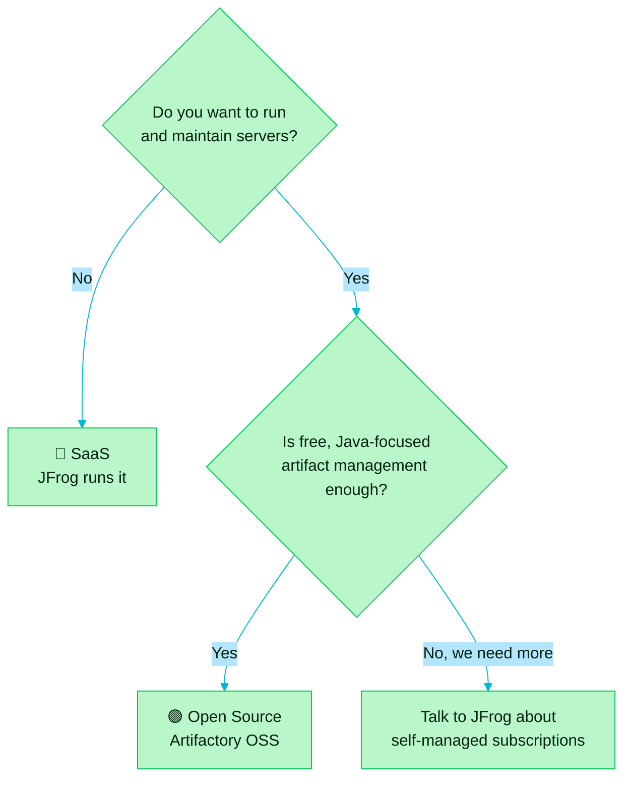

> [!TIP]
> **In one line:** Open Source means you run Artifactory. SaaS means JFrog runs it for you.

JFrog Artifactory comes in two versions: an **Open Source** edition and a **SaaS** edition. The product idea is the same in both. What changes is who operates it, where it lives and how much of the platform you get.


# 🟢 Open Source: Artifactory OSS

Artifactory began as an open source project, created to speed up development cycles using binary repositories.[^jfrog-oss-download] That edition is still available as a free download.

| | |
|---|---|
| 💸 **Cost** | Free. |
| 🖥️ **Where it runs** | On infrastructure you provide and look after. |
| ☕ **What it manages** | Java binary artifacts, centrally.[^jfrog-open-source] |
| 🔧 **Upkeep** | Yours: installation, upgrades and backups. |

# Examples

Four ways to install Artifactory OSS:[^jfrog-oss-download]

```bash
# RPM-based Linux
sudo yum update && sudo yum install jfrog-artifactory-oss

# Debian-based Linux
sudo apt-get update && sudo apt-get install jfrog-artifactory-oss

# Docker
docker pull releases-docker.jfrog.io/jfrog/artifactory-oss:latest

# Kubernetes, with Helm
helm install -name artifactory jfrog/artifactory-oss
```

The RPM and Debian commands need JFrog's package repository added first; the download page has the full steps.

# 🔵 SaaS: Artifactory in the cloud

In the SaaS edition, JFrog runs Artifactory for you as a fully managed service.[^jfrog-cloud]

| | |
|---|---|
| ☁️ **Where it runs** | On AWS, Google Cloud or Microsoft Azure. |
| 🤖 **Upkeep** | JFrog's: automated updates, maintenance and infrastructure management. |
| 💳 **Cost** | A subscription, with predictable spend and no large upfront investment. |
| 🛒 **How to buy** | Directly, or through the AWS, Google Cloud and Azure marketplaces. |
| 🎯 **What you gain** | Your team stops managing infrastructure and focuses on building and shipping. |

# How to choose



| If you... | Lean towards |
|---|---|
| 🧪 are learning, or running a small Java team | 🟢 Open Source |
| 🔒 must keep everything on your own servers at no licence cost | 🟢 Open Source |
| 🏃 want to start in minutes with nothing to install | 🔵 SaaS |
| 🧰 use many package types and want the full platform | 🔵 SaaS |
| 😴 do not want to be paged for upgrades and outages | 🔵 SaaS |

> [!NOTE]
> **Good to know.** These two are the ends of the range, not the whole of it. JFrog also offers paid self-managed deployments, which give greater control, and hybrid setups that combine SaaS with self-managed environments, for example to meet regulatory or data-sensitivity needs.[^jfrog-cloud] There is also a JFrog Free Cloud Subscription.[^jfrog-open-source]

# Related

- [What JFrog Artifactory is](/jfrog-introduction/what-is-artifactory.md)
- [Deployment options and federation](/jfrog-introduction/deployment-and-federation.md) - hybrid, multi-cloud and self-hosted, and sharing artifacts across sites.
- [Universal package support](/jfrog-introduction/universal-package-support.md)

[^jfrog-oss-download]: JFrog, "Download Artifactory OSS".
[^jfrog-open-source]: JFrog, "Downloads and Open Source Solutions".
[^jfrog-cloud]: JFrog, "Artifactory in the cloud".

---

⬅️ [What JFrog Artifactory is](/jfrog-introduction/what-is-artifactory.md) · 📚 [Topic index](/jfrog-introduction/index.md) · [Checksum-based storage: how Artifactory keeps binaries](/jfrog-introduction/checksum-based-storage.md) ➡️
