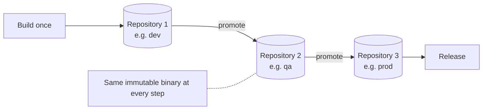

> [!TIP]
> **In one line:** Build the binary one time, then move that exact binary from repository to repository. Never rebuild it for a later stage.

Build once, promote everywhere is the release approach Artifactory is built around: a binary is built a single time, and that same immutable binary is then promoted from one repository to the next.

# The idea

| Term | Meaning here |
|---|---|
| Build once | The binary is produced by one build, not rebuilt for each stage. |
| Immutable | The binary does not change after it is built. |
| Promote | The same binary moves across repositories as it advances towards release. |

# Why it matters

- It accelerates software delivery and releases.
- What gets released is the very binary that was built, which addresses the inconsistent builds described in [artifact sprawl](/jfrog-introduction/artifact-sprawl.md).

# Related

- [What JFrog Artifactory is](/jfrog-introduction/what-is-artifactory.md)

---

⬅️ [What JFrog Artifactory is](/jfrog-introduction/what-is-artifactory.md) · 📚 [Topic index](/jfrog-introduction/index.md) · [Universal package support and the single source of truth](/jfrog-introduction/universal-package-support.md) ➡️
