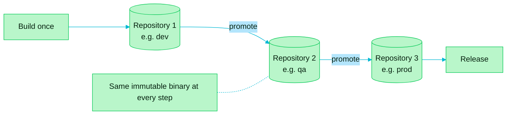

> [!TIP]
> **In one line:** Build the binary one time, then move that exact binary from repository to repository. Never rebuild it for a later stage.

Build once, promote everywhere is the release approach Artifactory is built around: a binary is built a single time, and that same immutable binary is then promoted from one repository to the next.

# The idea

| Term | Meaning here |
|---|---|
| 🔨 **Build once** | The binary is produced by one build, not rebuilt for each stage. |
| 🔒 **Immutable** | The binary does not change after it is built. |
| 🚀 **Promote** | The same binary moves across repositories as it advances toward release. |

# Why it matters

- It accelerates software delivery and releases.
- What gets released is the very binary that was built, which addresses the inconsistent builds described in [artifact sprawl](/jfrog-introduction/artifact-sprawl.md).

# Rebuild or promote?

| | ❌ Rebuild for each stage | ✅ Build once, promote |
|---|---|---|
| What reaches production | A *new* binary, built later | The *same* binary that passed testing |
| Can stages differ? | Yes. A dependency may have changed in between | No. It is byte-for-byte identical |
| Speed | A full build every time | A move between repositories |
| "What did we ship?" | Hard to prove | The binary and its checksum answer it |

# What it looks like in practice

A team usually keeps one repository per stage, and a release walks through them.

| Stage | Repository (example) | Who can write |
|---|---|---|
| 🌱 Development | `payments-maven-dev-local` | Developers and CI |
| 🧪 Testing | `payments-maven-qa-local` | The promotion step only |
| 🏭 Production | `payments-maven-prod-local` | Release managers only |

The repository names follow the [naming conventions](/repository-management/repository-naming-conventions.md). The stages are a common pattern, not a rule.

> [!NOTE]
> **Promotion is cheap.** Artifactory stores each binary once and keeps paths in a database, so moving a binary between repositories does not copy the file. See [checksum-based storage](/jfrog-introduction/checksum-based-storage.md).

# Related

- [Builds: the logbook of your CI](/artifactory-views/builds.md) - promotion works on a published build.
- [Checksum-based storage](/jfrog-introduction/checksum-based-storage.md) - why promoting costs almost nothing.
- [Artifact sprawl](/jfrog-introduction/artifact-sprawl.md) - the inconsistent builds this approach removes.
- [What JFrog Artifactory is](/jfrog-introduction/what-is-artifactory.md)

---

⬅️ [Remote repositories: proxying and caching open source dependencies](/jfrog-introduction/remote-repositories.md) · 📚 [Chapter 01 index](/jfrog-introduction/index.md) · [Checksum-based storage: how Artifactory keeps binaries](/jfrog-introduction/checksum-based-storage.md) ➡️
