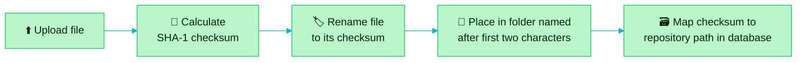
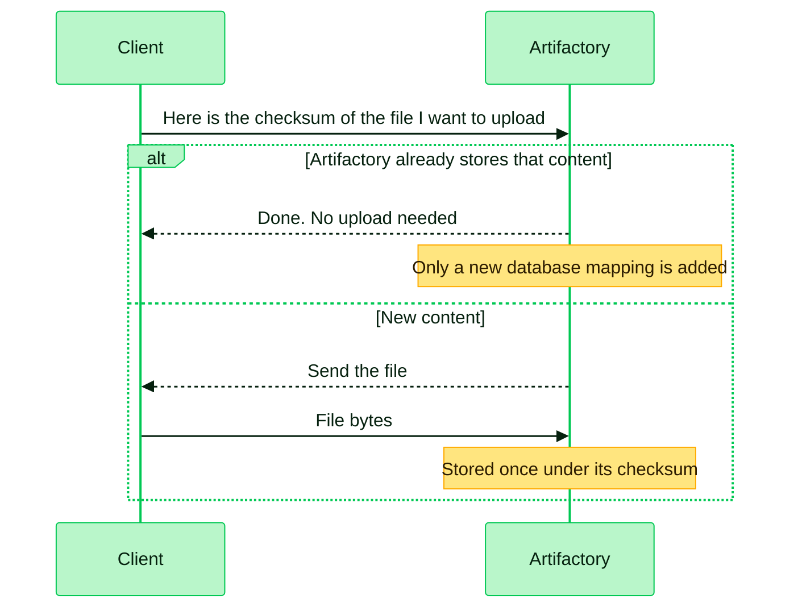
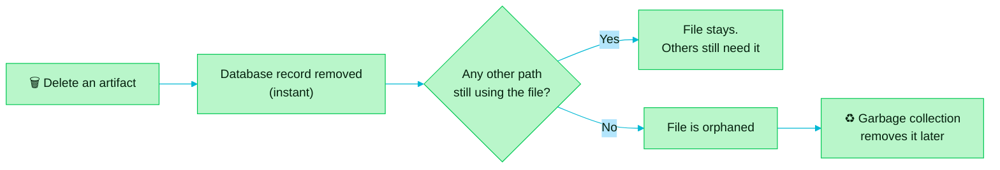

> [!TIP]
> **In one line:** Artifactory files each binary under its fingerprint, not its name, so the same content is never stored twice.

Artifactory stores binaries by checksum. This design improves storage efficiency and the speed of everyday operations.[^docs-checksum-storage] It applies to all binaries in all Artifactory repositories.[^docs-checksum-storage]


# First, what is a checksum?

A checksum is a short fingerprint calculated from a file's content.

| Property | What it means |
|---|---|
| 🧬 **Same content, same checksum** | Two files with identical bytes always produce the same value, whatever they are called. |
| 💥 **Any change, new checksum** | Alter a single byte and the value is completely different. |
| 🔁 **Repeatable** | Anyone can recalculate it and compare, which is how a download is verified. |

Artifactory uses the **SHA-1** checksum as the file's storage name, and also records **SHA-256** (see below).

# What happens when you upload a file



| Step | What Artifactory does |
|:-:|---|
| 1 | Receives the upload and calculates the file's SHA-1 checksum. |
| 2 | Renames the file to its checksum value. |
| 3 | Stores it in a directory named after the first two characters of the checksum. |
| 4 | Creates a database mapping between the checksum and the repository path you uploaded to. |

That is the storage process as JFrog documents it.[^docs-checksum-storage]

# Examples

A file with checksum `ac3f5e56...` goes in directory `ac`. One with `dfe12a4b...` goes in `df`. Two files whose checksums both begin with `d4` share the `d4` directory.[^docs-checksum-storage]

```text
filestore/
├── ac/
│   └── ac3f5e56...        ← guava-31.jar (uploaded to two paths, stored once)
├── d4/
│   ├── d4a3b2c1...        ← layer.tar
│   └── d4e7f891...        ← another file whose checksum starts with d4
└── df/
    └── dfe12a4b...        ← lodash-4.17.tgz
```

Meanwhile the database remembers the human-friendly side:

| Repository path (database) | Points to (filestore) |
|---|---|
| `libs-release/guava-31.jar` | `ac/ac3f5e56...` |
| `libs-snapshot/guava-31.jar` (a copy) | `ac/ac3f5e56...` (the same file) |
| `docker-local/layer.tar` | `d4/d4a3b2c1...` |
| `npm-local/lodash-4.17.tgz` | `df/dfe12a4b...` |

To see a checksum for yourself, calculate one locally:

```bash
sha1sum app-1.0.jar
sha256sum app-1.0.jar
```

# Two layers, one clever trick

| Layer | Holds | Think of it as |
|---|---|---|
| 🗃️ **Database** | Repository paths, names and metadata, each pointing at a checksum | The library catalog |
| 🗄️ **Filestore** | The binaries themselves, named by checksum | The shelves |

Because the path is only a catalog entry, many operations become database transactions and never touch the file itself.[^docs-checksum-storage]

# What you gain

| Benefit | How checksum storage delivers it |
|---|---|
| ♻️ **Deduplication** | Each binary is stored "once and once only". Upload the same content again, even to a different path, and Artifactory only adds another database mapping.[^docs-checksum-implementation] |
| ⚡ **Instant copy and move** | Copy and move just add or remove database references, so they perform like a database transaction.[^docs-checksum-implementation] |
| 🚚 **Transfers that skip the work** | Before moving a file between locations, Artifactory sends checksum headers. If a matching file already exists at the destination, no data is transferred, even when the paths differ. This covers upload, download and replication.[^docs-checksum-implementation] |
| 🔎 **Fast checksum search** | Finding a file by checksum is a database query.[^docs-checksum-implementation] |
| 🧱 **Any layout** | The database sits between the filestore and the layout you see, so Artifactory can present Maven, npm, NuGet or a custom layout over the same storage.[^docs-checksum-implementation] |
| 🏎️ **Less filesystem strain** | Fewer filesystem write-lock operations, because the work happens in the database.[^docs-checksum-implementation] |
| 💾 **Lower storage cost** | Deduplication directly reduces storage use.[^docs-checksum-storage] |

# Uploading something Artifactory already has



# What happens when you delete

Deleting is also a database transaction: it removes the database record. The underlying file is **not** removed straight away, even when the last reference to it is gone. Artifactory's garbage collection clears out orphaned files in the background.[^docs-checksum-implementation]



> [!NOTE]
> This is why freeing disk space is not immediate after a delete: the space comes back when garbage collection runs.

# SHA-1 and SHA-256

| | SHA-1 | SHA-256 |
|---|---|---|
| Role | The storage key: files are named and filed by it.[^docs-checksum-storage] | Calculated at deployment and stored in the database.[^docs-sha256] |
| Since | Always | Native from Artifactory 5.5.[^docs-sha256] |
| Where you meet it | Filestore names, checksum search | AQL queries, download headers, deploy and search REST APIs, and the artifact's General Information tab.[^docs-sha256] |

Artifacts uploaded before SHA-256 support may lack a SHA-256 value until the database is migrated; new uploads get one automatically.[^docs-sha256]

# Why this matters to you

- 🚀 **Promotion is cheap.** [Build once, promote everywhere](/jfrog-introduction/build-once-promote-everywhere.md) moves the same binary between repositories. With checksum storage that is a database change, not a file copy.
- 🛡️ **Integrity is built in.** A binary's name *is* its fingerprint, so the content at a given checksum can always be re-verified.
- 💰 **Growth costs less.** The same library pulled into ten repositories still occupies the disk once.

# Related

- [What JFrog Artifactory is](/jfrog-introduction/what-is-artifactory.md)
- [What is an artifact repository?](/jfrog-introduction/what-is-an-artifact-repository.md)
- [Remote repositories: proxying and caching](/jfrog-introduction/remote-repositories.md)

[^docs-checksum-storage]: JFrog documentation, "Checksum-Based Storage".
[^docs-checksum-implementation]: JFrog documentation, "Checksum-Based Storage Implementation".
[^docs-sha256]: JFrog documentation, "SHA-256 Support".

---

⬅️ [Artifactory editions: Open Source and SaaS](/jfrog-introduction/artifactory-editions.md) · 📚 [Topic index](/jfrog-introduction/index.md) · [Build once, promote everywhere](/jfrog-introduction/build-once-promote-everywhere.md) ➡️
