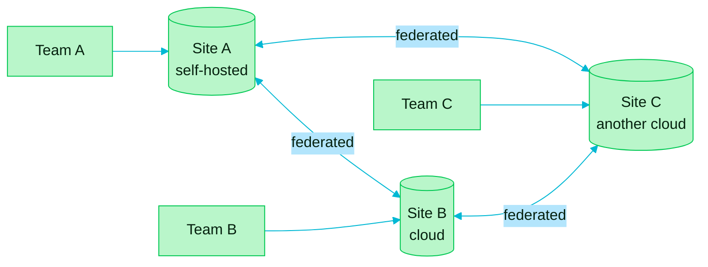

> [!TIP]
> **In one line:** Install Artifactory where it suits you, and federate so every site works from the same artifacts.

Artifactory supports geographically distributed teams in two ways: a choice of installation models, and the ability to federate artifacts across multiple sites.

# Installation models

| Model | In plain words |
|---|---|
| 🖥️ **Self-hosted** | You run Artifactory on your own infrastructure |
| ☁️ **Multi-cloud** | Artifactory runs on more than one cloud provider |
| 🔀 **Hybrid** | A mix: some of it in the cloud, some of it on your own infrastructure |

The model names are JFrog's. The one-line descriptions are a plain-language guide.

# Federation

Artifacts can be federated across multiple sites, so teams in different locations access the same artifacts without conflict.

# Why federate?

| Without federation | With federation |
|---|---|
| Each site has its own copy, and they drift apart | Every site sees the same artifacts |
| Teams wait for files to be sent across | The artifact is already there |
| "Which site has the right version?" | They all do |

> [!NOTE]
> On JFrog SaaS, each location is a **site**. See [subscriptions, sites and JPDs](/platform-navigation/subscriptions-sites-and-jpds.md) for how sites are organized, and [Artifactory editions](/jfrog-introduction/artifactory-editions.md) for who runs what.

# Related

- [Subscriptions, sites and JPDs](/platform-navigation/subscriptions-sites-and-jpds.md)
- [Artifactory editions: Open Source and SaaS](/jfrog-introduction/artifactory-editions.md)
- [Repository types in Artifactory](/repository-management/repository-types.md) - federated repositories are the fourth type.
- [Artifact sprawl](/jfrog-introduction/artifact-sprawl.md) - "more developers across multiple sites" is one of the causes this addresses.

---

⬅️ [Remote repositories: proxying and caching open source dependencies](/jfrog-introduction/remote-repositories.md) · 📚 [Topic index](/jfrog-introduction/index.md) · [Software supply chain security: Xray, build metadata and the SBOM](/jfrog-introduction/supply-chain-security.md) ➡️
