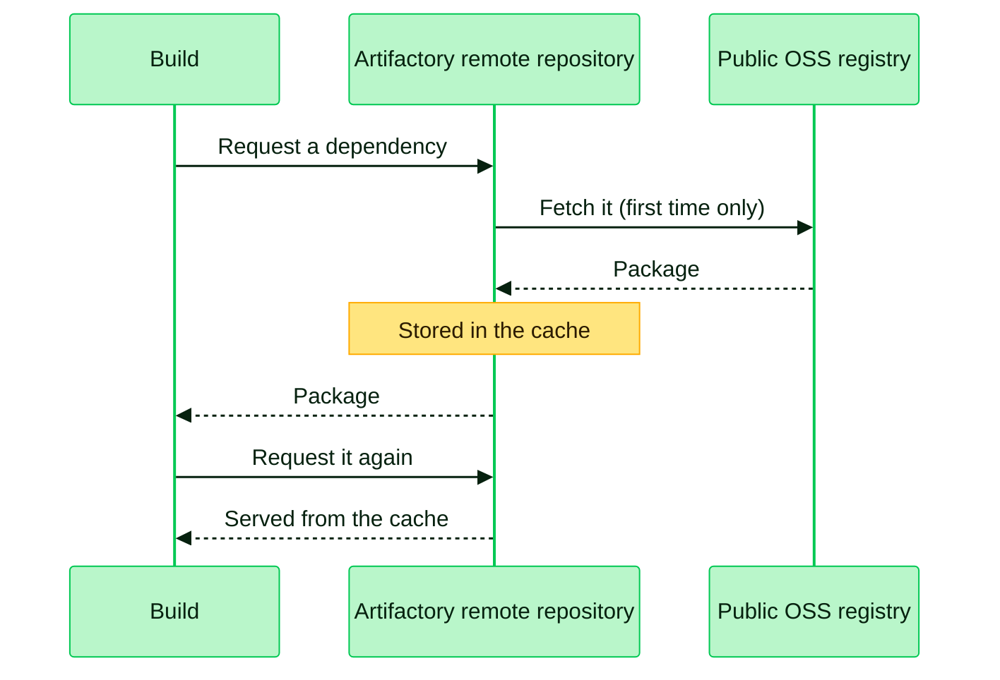

> [!TIP]
> **In one line:** A remote repository keeps a local copy of the open source packages you use, so builds are faster and keep working when the public source is down.

A remote repository in Artifactory proxies and caches external open source (OSS) dependencies. Builds ask Artifactory for a dependency, and Artifactory serves it from its cache.

# Benefits

| Benefit | Why |
|---|---|
| Faster builds | Dependencies come from the cache, which dramatically improves build speed. |
| Lower network latency | Fewer round trips to external sources. |
| Reliable access | A cached package stays available even when the public OSS package becomes unavailable. |

# Related

- [Universal package support](/jfrog-introduction/universal-package-support.md) - the single source of truth these cached packages feed.
- [What JFrog Artifactory is](/jfrog-introduction/what-is-artifactory.md)

---

⬅️ [Universal package support and the single source of truth](/jfrog-introduction/universal-package-support.md) · 📚 [Topic index](/jfrog-introduction/index.md) · [Deployment options and federation](/jfrog-introduction/deployment-and-federation.md) ➡️
