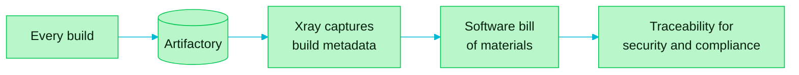

> [!TIP]
> **In one line:** Because every build goes through Artifactory, Xray can record what is in it, and that record is your SBOM and audit trail.

Artifactory lays the foundation for a company's software supply chain security. JFrog Xray builds on it by capturing the metadata from every build.

# What Xray does with build metadata

| Step | Result |
|---|---|
| 📥 Captures metadata from every build | A record of what went into each build |
| 🧾 Forms a software bill of materials (SBOM) | An inventory of the build's contents |
| 🔎 Provides traceability | Evidence for security and compliance purposes |

# What is an SBOM?

A **software bill of materials** is an ingredients list for software: every component that went into a build, and its version.

| With an SBOM you can answer | Example |
|---|---|
| ❓ "Are we affected?" | A flaw is announced in a library. Which of our releases contain it? |
| 📜 "Can we prove it?" | An auditor asks what was in the release shipped in March |
| ⚖️ "Are we allowed to use this?" | Which licenses are inside our product? |

# Where to see it in the product

| What you want | Where to look |
|---|---|
| Vulnerabilities in a package version | [Packages](/artifactory-views/packages.md) |
| What a build consumed | [Builds](/artifactory-views/builds.md) |
| The security tools themselves | [Xray, Curation and Catalog](/platform-navigation/the-left-menu.md) |

# Related

- [A tour of the left menu](/platform-navigation/the-left-menu.md) - Xray, Curation, Catalog and AppTrust explained.
- [Builds: the logbook of your CI](/artifactory-views/builds.md) - the record Xray reads.
- [Access management](/jfrog-introduction/access-management.md) - the other half of securing the repository.

---

⬅️ [Deployment options and federation](/jfrog-introduction/deployment-and-federation.md) · 📚 [Chapter 01 index](/jfrog-introduction/index.md) · [Access management in Artifactory](/jfrog-introduction/access-management.md) ➡️
