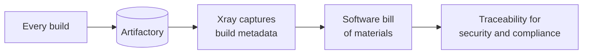

> [!TIP]
> **In one line:** Because every build goes through Artifactory, Xray can record what is in it, and that record is your SBOM and audit trail.

Artifactory lays the foundation for a company's software supply chain security. JFrog Xray builds on it by capturing the metadata from every build.

# What Xray does with build metadata

| Step | Result |
|---|---|
| Captures metadata from every build | A record of what went into each build |
| Forms a software bill of materials (SBOM) | An inventory of the build's contents |
| Provides traceability | Evidence for security and compliance purposes |

# Related

- [What JFrog Artifactory is](/jfrog-introduction/what-is-artifactory.md) - traceability starts with every build being stored.
- [Access management](/jfrog-introduction/access-management.md) - the other half of securing the repository.

---

⬅️ [Deployment options and federation](/jfrog-introduction/deployment-and-federation.md) · 📚 [Topic index](/jfrog-introduction/index.md) · [Access management in Artifactory](/jfrog-introduction/access-management.md) ➡️
