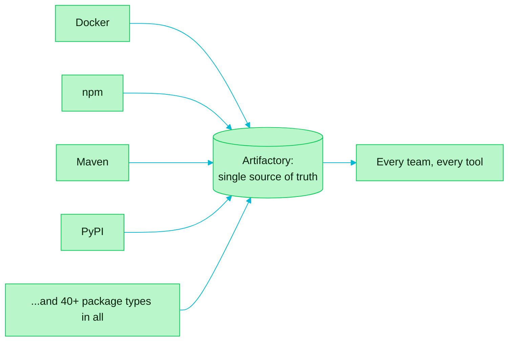

> [!TIP]
> **In one line:** One repository manager for every package type means one place to look, for every technology.

Artifactory handles over 40 types of packages. A team therefore does not need a different solution for each technology or tool: everything is managed in one system.

# Single source of truth

Because every package type lives in the same place, a company can rely on Artifactory as its single source of truth for all open source packages. Packages are kept organized and available for further use.

# What changes for the team

| ❌ Without it | ✅ With it |
|---|---|
| A separate store or tool per technology | One system for all package types |
| Packages scattered and hard to find | Packages organized and ready for reuse |
| No agreed place to look | One source of truth |

# A few of the package types

| Ecosystem | Package type | What it looks like |
|---|---|---|
| ☕ Java | Maven, Gradle | `.jar`, `.war` |
| 🟩 JavaScript | npm | `.tgz` packages |
| 🐍 Python | PyPI | `.whl` wheels |
| 🟦 .NET | NuGet | `.nupkg` packages |
| 🐳 Containers | Docker | Images and tags |
| ⎈ Kubernetes | Helm | Charts |
| 📁 Anything else | Generic | Any file at all |

These are examples. The full list is much longer.

> [!IMPORTANT]
> **One system does not mean one repository.** Each repository holds a single package type, chosen when it is created. See [why the package type matters](/repository-management/why-package-type-matters.md).

# Related

- [Why the package type matters](/repository-management/why-package-type-matters.md)
- [Packages: the catalog of everything you hold](/artifactory-views/packages.md) - where you browse them all.
- [Remote repositories](/jfrog-introduction/remote-repositories.md) - how external open source packages get into that single source.
- [What JFrog Artifactory is](/jfrog-introduction/what-is-artifactory.md)

---

⬅️ [Build once, promote everywhere](/jfrog-introduction/build-once-promote-everywhere.md) · 📚 [Topic index](/jfrog-introduction/index.md) · [Remote repositories: proxying and caching open source dependencies](/jfrog-introduction/remote-repositories.md) ➡️
