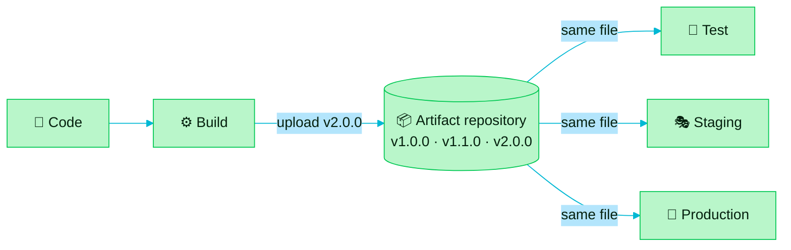

> [!TIP]
> **In one line:** Git remembers every version of your code. An artifact repository remembers every version of what you built from it.

An **artifact repository** is a server where we keep multiple versions of our [artifacts](/jfrog-introduction/what-is-an-artifact.md).

# What it does

A software artifact repository is a centralized storage system that manages and tracks build outputs and dependencies, so teams can safely build and deploy applications.[^jfrog-artifact-repository]

| Job | What that means |
|---|---|
| 🏠 **Host** | One central place for every artifact your builds produce. |
| 🗂️ **Version** | Each new build adds a new version. Older versions stay available. |
| ⚡ **Cache** | Keeps copies of the outside dependencies your builds download. |
| 🚚 **Serve** | Hands the exact version requested to developers, pipelines and environments. |

# Where it sits in the pipeline

The repository stores what the build produces and makes it available to every later stage. That way, the version that was tested and approved is the same one that gets deployed.[^jfrog-artifact-repository]

# Why teams use one

| Benefit | What you get |
|---|---|
| ⏱️ **Efficiency** | Streamlined build and deployment, with less time and effort spent. |
| 🤝 **Consistency** | Version-controlled artifacts, so everyone works with the same components. |
| 🔒 **Security** | Central storage and access controls protect sensitive artifacts. |
| 🔎 **Traceability** | Logs and version histories that help with debugging and compliance. |

All four are benefits JFrog lists for artifact repositories.[^jfrog-artifact-repository]

# Three kinds of repository

An artifact repository server usually offers three kinds of repository, deployed on-premises, in the cloud or as a hybrid.[^jfrog-artifact-repository]

| Kind | In plain words | Read more |
|---|---|---|
| 🟢 **Local** | Stores the artifacts your own teams build. | [Local repositories](/repository-management/local-repositories.md) |
| 🟠 **Remote** | Proxies and caches dependencies from public registries on the internet. | [Remote repositories](/repository-management/remote-repositories.md) |
| 🟣 **Virtual** | Combines local and remote repositories into one unified view. | [Virtual repositories](/repository-management/virtual-repositories.md) |

# Habits that keep it healthy

- 🏷️ **Structure it.** Use a clear, consistent naming convention, and organize artifacts by project, version and type.
- 🤖 **Automate it.** Let automated build and release processes upload and fetch artifacts, to cut human error.
- 🛡️ **Secure it.** Scan for vulnerabilities, enforce strong access control, and audit access regularly.

These are JFrog's recommended practices for managing an artifact repository.[^jfrog-artifact-repository]

> [!NOTE]
> JFrog Artifactory is an artifact repository manager of exactly this kind. First, see what happens to a team that does not have one: [artifact sprawl](/jfrog-introduction/artifact-sprawl.md).

# Related

- [What is an artifact?](/jfrog-introduction/what-is-an-artifact.md)
- [What JFrog Artifactory is](/jfrog-introduction/what-is-artifactory.md)
- [Repository types in Artifactory](/repository-management/repository-types.md)

[^jfrog-artifact-repository]: JFrog, "What is a Software Artifacts Repository?".

---

⬅️ [What is an artifact?](/jfrog-introduction/what-is-an-artifact.md) · 📚 [Chapter 01 index](/jfrog-introduction/index.md) · [Artifact sprawl: the problem Artifactory solves](/jfrog-introduction/artifact-sprawl.md) ➡️
