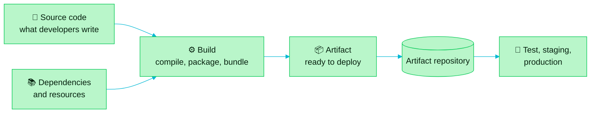

> [!TIP]
> **In one line:** Source code is what you write. An artifact is what you ship.

An **artifact** is a ready-to-deploy file that contains the compiled code, along with all the resources and dependencies required to run an application.

# What is inside

| Ingredient | What it is |
|---|---|
| 🧩 Compiled code | Your source code, turned into something a machine or runtime can execute. |
| 🖼️ Resources | Configuration files, templates, images and other files the application needs. |
| 📚 Dependencies | The libraries your code relies on, bundled in or declared so they can be fetched. |

Put together, the artifact is one self-contained, versioned file that can be handed to any environment and run.

# A worked example: from code to artifact

The story is the same in every language:

1. ✍️ **Write.** A developer writes source code in a language such as Node.js, Python, Java or .NET.
2. ⚙️ **Build.** The developer runs that language's build tool, such as Maven, Gradle or MSBuild. The tool compiles the code together with its dependencies.
3. 📦 **Get a binary.** The build produces a binary. **That binary is the artifact.**

| Language | Build tool | Example command | Artifact |
|---|---|---|---|
| ☕ Java | Maven, Gradle | `mvn package` | `.jar`, `.war`, `.ear` |
| 🟩 Node.js | npm | `npm pack` | `.tar.gz` |
| 🐍 Python | build, setuptools | `python -m build` | `.whl`, `.tar.gz` |
| 🟦 .NET | MSBuild | `dotnet build` | `.dll` |

> [!IMPORTANT]
> The language and the tool change. The pattern never does: **source code + dependencies → build tool → artifact.**

# Spot the artifact

Every ecosystem has its own artifact formats. If you have built software, you have already produced one.

| Ecosystem | Typical artifacts |
|---|---|
| ☕ Java | `.jar`, `.war`, `.ear` |
| 🟩 Node.js | `.tar.gz` |
| 🟦 .NET | `.dll` |
| 🐍 Python | `.whl`, `.tar.gz` |

# More than the final binary

In the wider sense, artifacts are everything produced during the software development lifecycle that a team needs to keep. That includes compiled code, libraries, dependencies, configuration files, documentation and build outputs.[^jfrog-artifact-repository]

# Source code or artifact?

| | 📝 Source code | 📦 Artifact |
|---|---|---|
| Made by | A developer, by hand | A build, automatically |
| Purpose | To be read and changed | To be deployed and run |
| Changes | All the time | Never: a new build makes a new artifact |
| Question it answers | "What did we write?" | "What exactly did we ship?" |

> [!NOTE]
> A team that can always answer **"what exactly did we ship?"** is in control of its releases. That takes one reliable place to keep every artifact, which is where the rest of this chapter goes next.

# Why artifacts need their own home

- **Correct versions for everyone.** Version-controlled artifacts mean every team member works with the same components.[^jfrog-artifact-repository]
- **The tested file is the released file.** Keeping artifacts in a repository ensures the version approved for release is the same one used for build and deployment.[^jfrog-artifact-repository]
- **Traceability.** A repository records which artifacts exist, their version history and who produced them, which matters for debugging, fixing vulnerabilities and compliance.[^jfrog-artifact-repository]

# Related

- [What is an artifact repository?](/jfrog-introduction/what-is-an-artifact-repository.md) - the server that keeps every version.
- [Artifact sprawl: the problem Artifactory solves](/jfrog-introduction/artifact-sprawl.md) - what happens when artifacts have no home.
- [What JFrog Artifactory is](/jfrog-introduction/what-is-artifactory.md) - the home.
- [Build once, promote everywhere](/jfrog-introduction/build-once-promote-everywhere.md) - why an artifact is never rebuilt.

[^jfrog-artifact-repository]: JFrog, "What is a Software Artifacts Repository?".

---

📚 [Chapter 01 index](/jfrog-introduction/index.md) · [What is an artifact repository?](/jfrog-introduction/what-is-an-artifact-repository.md) ➡️
