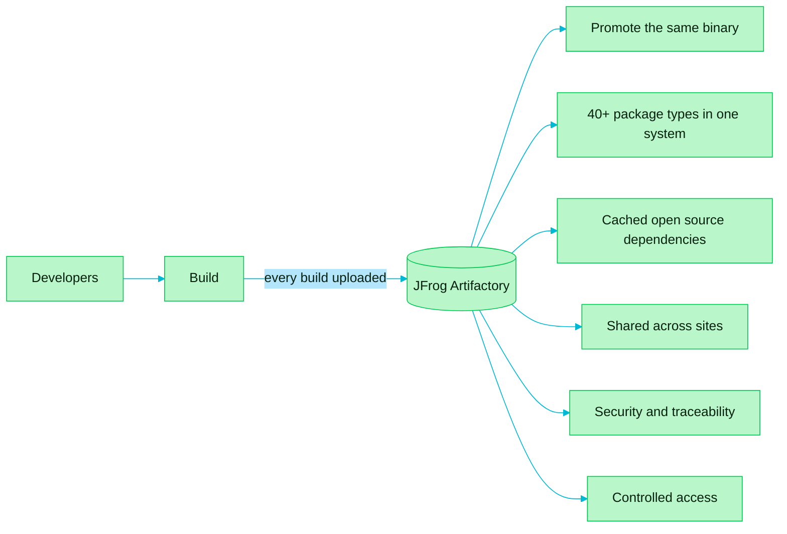

> [!TIP]
> **In one line:** Artifactory is the single, organized store that every build uploads to, so nothing is lost and everything is traceable.

JFrog Artifactory gives a team one organized place to store and manage all of its artifacts. It is the answer to [artifact sprawl](/jfrog-introduction/artifact-sprawl.md).

# How it works

Every build the team runs is uploaded straight into Artifactory. That one habit has three effects:

| Effect | Meaning |
|---|---|
| Nothing gets lost | Each artifact has a known home, not a laptop or a forgotten folder. |
| Nothing is replaced by accident | A stored artifact is not silently overwritten by a later one. |
| Everything is traceable | Any artifact can be traced back to how and when it was created. |

# What it makes possible

Each capability below builds on that central store:

- [Build once, promote everywhere](/jfrog-introduction/build-once-promote-everywhere.md) - faster, safer releases.
- [Universal package support](/jfrog-introduction/universal-package-support.md) - one system for every technology.
- [Remote repositories](/jfrog-introduction/remote-repositories.md) - fast, reliable access to open source dependencies.
- [Deployment options and federation](/jfrog-introduction/deployment-and-federation.md) - the same artifacts for teams at every site.
- [Software supply chain security](/jfrog-introduction/supply-chain-security.md) - build metadata, SBOM and traceability.
- [Access management](/jfrog-introduction/access-management.md) - permissions tied to users, groups and tokens.

# The outcome

For Complexoft, builds became reliable, deployments became predictable, and the team gained a clear view of, and control over, its software delivery process. Artifactory helped it deliver trusted releases at speed and scale.

---

⬅️ [Artifact sprawl: the problem Artifactory solves](/jfrog-introduction/artifact-sprawl.md) · 📚 [Topic index](/jfrog-introduction/index.md) · [Build once, promote everywhere](/jfrog-introduction/build-once-promote-everywhere.md) ➡️
