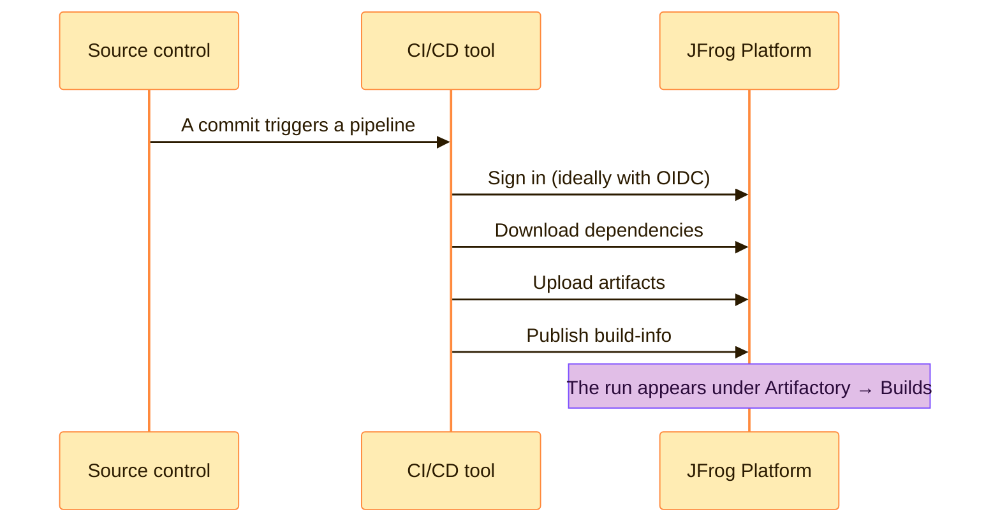

> [!TIP]
> **In one line:** Integrations is the catalog of every tool JFrog can plug into, with a guide for connecting each one.

No team uses JFrog alone. Code lives in GitHub or GitLab, builds run in Jenkins or GitHub Actions, people sign in through a company directory. **Integrations** is where the platform shows you everything it can connect to.

# What it is for

The JFrog Platform integrates with the tools around it, such as GitHub, Jira and Jenkins, and with build technologies such as Maven and Gradle. These integrations simplify installation and configuration, so that security and distribution become part of your existing development environment.[^docs-integrations]

| Purpose | What that means for you |
|---|---|
| 🔎 **Discover** | See, in one place, what JFrog can connect to |
| 🧭 **Get set up** | Open a tile to reach the guide for that tool |
| 🧩 **Fit in** | Make JFrog part of the workflow your team already has, not a separate stop |
| 🤖 **Automate** | Let pipelines, bots and assistants talk to JFrog without a person in between |

# The page

Open the **Platform** tab and click **Integrations**. Two entries appear beneath it.

| Entry | What it is |
|---|---|
| 🧰 **Tools & Integrations** | The catalog: a grid of tiles, one per tool |
| 🧪 **GraphQL Playground** | A place to try queries against the platform's GraphQL API |

## Finding an integration

| Control | How to use it |
|---|---|
| 🔍 **Search for integrations** | Type a tool's name |
| 🏷️ **Categories** | Tick one or more to narrow the grid |
| ☁️ **Cloud Vendor** | Show only what applies to AWS, GCP or Azure |
| ↗️ **A tile** | Click it to open that integration. The arrow means it opens outside the page |

# What is in the catalog

The catalog holds over a hundred integrations, sorted into categories.

| Category | Examples | What connecting gives you |
|---|---|---|
| 📦 **Packages** | Docker, Maven, npm, Helm, Conan, Cargo, Swift, Pub | Your package client pulls from and publishes to Artifactory |
| ⚙️ **CI/CD** | Jenkins, GitHub Actions, GitLab CI, Azure DevOps, Bamboo, Bitbucket Pipelines | Pipelines upload artifacts and publish [build-info](/artifactory-views/builds.md) |
| 🌿 **Source Control** | GitHub | Traceability from code to binary |
| 🔐 **Authentication** | SAML, LDAP, OAuth, OpenID Connect, Crowd | People and pipelines sign in with identities you already manage |
| ☁️ **Cloud Native** | AWS PrivateLink, Azure PrivateLink, GCP Private Service Connect, AWS AssumeRole | Private network paths and cloud identities for reaching JFrog |
| 🛡️ **Security** | Frogbot | Security findings where developers work |
| 📜 **Evidence** | GitHub Evidence, GitLab Evidence | Attestations from your CI attached to what you built |
| 🤖 **AI/MLOps** | Hugging Face ML | Machine learning models managed like other packages |
| 💻 **IDE** | JFrog MCP Server | AI coding assistants that can query your platform |

The category names and example tiles are from a current SaaS site. The "what connecting gives you" column is a plain-language summary.

# A closer look at the ones you will meet first

## 🌿 GitHub

The JFrog and GitHub integration is powered by the JFrog App for GitHub. Among other things it brings:[^docs-github]

| Capability | In plain words |
|---|---|
| 🧾 **Job summary** | Traceability from code to cloud, shown in the GitHub Actions run |
| 🔑 **OIDC authentication** | Pipelines sign in to JFrog without stored passwords |
| 📜 **Attestation to evidence** | GitHub build attestations are uploaded to JFrog as evidence |
| 🐸 **Frogbot rollout** | Deploy JFrog's source code scanning across many repositories at once |

## ⚙️ CI/CD tools

Whatever runs your builds, the pattern is the same: the pipeline uploads what it built and publishes a build record.

## 🛡️ Frogbot

Frogbot is a Git-based bot that detects and fixes vulnerabilities in your pull requests and commits. It uses software composition analysis, static application security testing, infrastructure-as-code scanning and secrets detection to catch risks before they reach production.[^docs-frogbot]

## 🔐 Sign-in integrations

SAML, LDAP, OAuth and OpenID Connect let people use the identities your company already manages. OpenID Connect also lets *pipelines* authenticate without a stored secret. See [access management](/jfrog-introduction/access-management.md).

## 💻 JFrog MCP Server

A remote server that connects AI coding assistants, in tools such as VS Code and Cursor, to your JFrog Platform, so they can answer with real information from it.[^docs-mcp]

# The GraphQL Playground

Beneath Integrations sits the **GraphQL Playground**. JFrog's **OneModel GraphQL** lets you get information from several JFrog products and services through a single endpoint, and ask only for the data you need.[^docs-graphql]

| Without it | With it |
|---|---|
| Several REST calls to different services | One query |
| You match the results together yourself | Connected information comes back together |

For example, a single query can return Release Bundles along with the evidence attached to them.[^docs-graphql]

| Use the Playground when | Example |
|---|---|
| You are exploring what data exists | "What can I ask about a package?" |
| You are writing a script or dashboard | Try the query here before coding it |

It is available from Artifactory 7.104.1.[^docs-graphql]

# Other ways JFrog connects

Not every connection is a tile. These are the building blocks behind them.

| Mechanism | What it is | Typical use |
|---|---|---|
| ⌨️ **JFrog CLI** | A command-line tool for automating the platform | Inside any CI job |
| 🔌 **REST API** | Programmatic access to the platform | Custom scripts and tools |
| 🧬 **GraphQL** | One endpoint across products | Dashboards and reports |
| 🪝 **Webhooks** | An automatic notification sent when a chosen event happens | Tell Slack, Jira or Jenkins that something occurred |
| 🤖 **MCP Server** | A bridge for AI assistants | Ask about packages and security from your editor |

A webhook has three parts: the triggering event, the information about it, and the address it is sent to.[^docs-webhooks]

# Do not confuse the two "Integrations"

There are two places with this name, in the two different menus.

| | 🟦 Platform → Integrations | 🟧 Administration → Manage Integrations |
|---|---|---|
| **What it is** | A catalog of what *can* be connected | The integrations *actually configured* on your site |
| **Who uses it** | Anyone exploring | Administrators |
| **Where** | Platform tab, left menu | Select **All Projects**, then **Administration → General Management → Manage Integrations**[^docs-platform-int] |
| **Tabs** | Tools & Integrations, GraphQL Playground | OpenID Connect, GitHub, External Applications[^docs-platform-int] |

> [!NOTE]
> **Browsing is not connecting.** The catalog shows you what is possible and points you to the guide. Setting an integration up usually needs an administrator.

# Three everyday journeys

| Journey | Steps |
|---|---|
| 🆕 **"We use GitLab CI. Can it talk to JFrog?"** | Integrations → filter **CI/CD** → open the **GitLab CI** tile |
| 🔐 **"Can people sign in with our company account?"** | Integrations → filter **Authentication** → open **SAML** or **LDAP** |
| ☁️ **"Can we reach JFrog privately from our cloud?"** | Integrations → **Cloud Vendor** → your provider → open the private link tile |

# Who uses it

| Role | Why they come here |
|---|---|
| 🛠️ **Platform administrator** | To see what can be connected, and set it up |
| 🚀 **DevOps engineer** | To wire a CI/CD tool to JFrog |
| 🛡️ **Security engineer** | To bring scanning into pull requests |
| 👩‍💻 **Developer** | To connect a package client, an IDE or an AI assistant |

# Related

- [A tour of the left menu](/platform-navigation/the-left-menu.md)
- [Builds: the logbook of your CI](/artifactory-views/builds.md)
- [Platform or Administration?](/platform-navigation/platform-and-administration.md)

[^docs-integrations]: JFrog documentation, "Get Started with JFrog Integrations".
[^docs-github]: JFrog documentation, "JFrog Integration with GitHub".
[^docs-frogbot]: JFrog documentation, "Frogbot".
[^docs-mcp]: JFrog documentation, "JFrog MCP Server for SaaS".
[^docs-graphql]: JFrog documentation, "JFrog OneModel GraphQL".
[^docs-webhooks]: JFrog documentation, "Webhooks".
[^docs-platform-int]: JFrog documentation, "JFrog Platform Integrations".

---

⬅️ [A tour of the left menu: what JFrog can do](/platform-navigation/the-left-menu.md) · 📚 [Topic index](/platform-navigation/index.md) · [MyJFrog: the account portal](/platform-navigation/myjfrog-portal.md) ➡️
