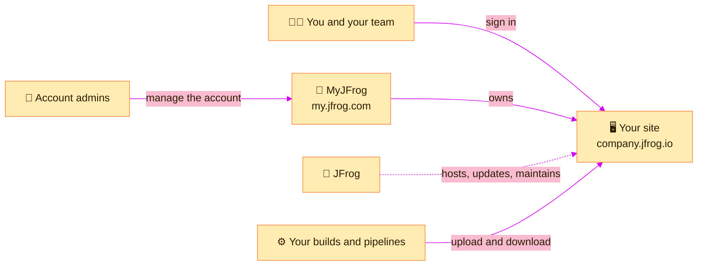

> [!TIP]
> **In one line:** Artifactory SaaS is Artifactory that JFrog runs for you in the cloud. You sign in and use it; they keep it running.

**SaaS** stands for *software as a service*. With Artifactory SaaS, also called JFrog Cloud, you do not install or maintain anything. JFrog runs it as a fully managed service, and you reach it in a browser.[^jfrog-cloud]


# What "fully managed" means

| JFrog takes care of | So you do not have to |
|---|---|
| ☁️ **Hosting** on AWS, Google Cloud or Microsoft Azure[^jfrog-cloud] | Buy or run servers |
| 🔄 **Automated updates**[^jfrog-cloud] | Plan and perform upgrades |
| 🛠️ **Maintenance and infrastructure management**[^jfrog-cloud] | Keep the service healthy |
| 💳 **A subscription** with predictable spend and no large upfront investment[^jfrog-cloud] | Budget for hardware |

What stays with you is everything *inside*: which repositories exist, who can use them, and what you upload.

# What you actually get

Three things, which the rest of this chapter explains one by one.

| You get | What it is | Read more |
|---|---|---|
| 🖥️ **A site** | Your own running JFrog Platform, at an address like `company.jfrog.io`[^docs-topology] | [Subscriptions, sites and JPDs](/platform-navigation/subscriptions-sites-and-jpds.md) |
| 🪪 **MyJFrog** | The account portal at `my.jfrog.com`, for the subscription, usage and billing[^docs-myjfrog] | [MyJFrog: the account portal](/platform-navigation/myjfrog-portal.md) |
| 🧰 **The platform's capabilities** | Artifactory plus the tools around it, in the left menu | [A tour of the left menu](/platform-navigation/the-left-menu.md) |



# What is inside your site

Artifactory is the centre, and other capabilities sit around it.


| Capability | What it does |
|---|---|
| 📦 **Artifactory** | Stores and serves every package and binary. See [what Artifactory is](/jfrog-introduction/what-is-artifactory.md). |
| 🔬 **Xray** | Scans what you store for vulnerabilities and licence risks |
| 🚪 **Curation** and 📚 **Catalog** | Control and research the open source you bring in |
| 🚦 **AppTrust** | Governs which releases may go to production |
| 🔌 **Integrations** | Connects JFrog to your other tools |

Which of these you have depends on your subscription.[^docs-working] The [left menu tour](/platform-navigation/the-left-menu.md) covers each one.

# Your first five minutes

| Step | Do this | You will learn |
|:-:|---|---|
| 1 | Open your site address and sign in | Where your JFrog lives |
| 2 | Read the top bar, left to right | [The top bar, decoded](/platform-navigation/the-top-bar.md) |
| 3 | Click **Platform**, then **Artifactory → Packages** | What your teams already store |
| 4 | Click **Artifactory → Artifacts** | How repositories are laid out |
| 5 | Click **Administration** | Whether you are an admin: [Platform or Administration?](/platform-navigation/platform-and-administration.md) |

# Reading the version numbers

A JFrog SaaS site shows several version lines, for example:

```text
Artifactory Cloud: 7.173.10
Xray Cloud: 3.156.8
Access Cloud: 7.206.4
Frontend: 1.771.0
```

Each line is a separate service that makes up the platform, with its own release number.

| Line | The service behind it |
|---|---|
| **Artifactory Cloud** | The repository manager: storing and serving packages |
| **Xray Cloud** | Security scanning |
| **Access Cloud** | Sign-in, users, permissions, tokens and projects |
| **Frontend** | The web interface you are looking at |

> [!NOTE]
> You never upgrade these yourself. On SaaS they move forward automatically, which is why the numbers change between visits. Quote the **Artifactory** number when you check whether a documented feature applies to you. The descriptions of the four services are a plain-language guide, not JFrog's own wording.

# SaaS or self-hosted?

| | ☁️ SaaS | 🖥️ Self-hosted |
|---|---|---|
| Who runs it | JFrog | You |
| Upgrades | Automatic | You plan them |
| Start-up time | Sign in and go | Install first |
| Control over infrastructure | Less | Greater[^jfrog-cloud] |

Some organizations combine the two in a hybrid setup, for example to meet regulatory or data-sensitivity needs.[^jfrog-cloud] See [Artifactory editions](/jfrog-introduction/artifactory-editions.md).

# Where to go next

- 🧭 **Learn the screen:** [The top bar, decoded](/platform-navigation/the-top-bar.md)
- 🧰 **Learn the capabilities:** [A tour of the left menu](/platform-navigation/the-left-menu.md)
- 📦 **Learn Artifactory itself:** [JFrog Introduction](/jfrog-introduction/index.md)
- 🧱 **Set something up:** [Create a project](/projects/set-up-a-project.md), then [create repositories](/repository-management/set-up-dotnet-repositories.md)

# Related

- [Artifactory editions: Open Source and SaaS](/jfrog-introduction/artifactory-editions.md)
- [MyJFrog: the account portal](/platform-navigation/myjfrog-portal.md)

[^jfrog-cloud]: JFrog - Artifactory in the cloud.
[^docs-working]: JFrog documentation - Working with JFrog.
[^docs-topology]: JFrog documentation - Manage Your Cloud Topology.
[^docs-myjfrog]: JFrog documentation - MyJFrog Admin Interface.

---

📚 [Topic index](/platform-navigation/index.md) · [The top bar, decoded](/platform-navigation/the-top-bar.md) ➡️
