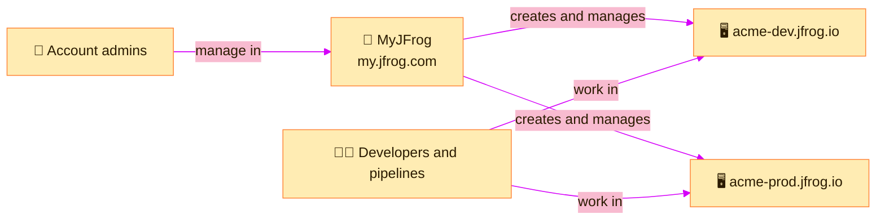

> [!TIP]
> **In one line:** Your site is where you *work*. MyJFrog is where you *manage the account* that the site belongs to.

**MyJFrog** is the central portal for managing your JFrog account. You reach it at `my.jfrog.com`.[^docs-myjfrog]

It is easy to confuse with your site, because both are "JFrog in the browser". They are different places with different jobs.

# Two front doors

| | 🪪 MyJFrog | 🖥️ Your site |
|---|---|---|
| **Address** | `my.jfrog.com` | `<server-name>.jfrog.io` |
| **What it is** | The account and subscription portal | The JFrog Platform itself |
| **What you manage** | The subscription, and the servers in it | Repositories, artifacts, projects and users of that site |
| **Who uses it** | Admin users of the account[^docs-working] | Developers, pipelines and admins, every day |
| **How many** | One per subscription | One or more per subscription |

# What MyJFrog is for

JFrog lists five jobs for the portal.[^docs-myjfrog]

| Job | What you can do |
|---|---|
| 🧾 **Manage your subscription** | View, upgrade or downgrade your plan; see billing history and invoices |
| 📈 **Monitor cloud usage** | Track storage, data transfer and security scanning, to stay on top of cost |
| 🔐 **Configure security and settings** | Custom domain names, audit logs and user management |
| 🗺️ **Manage topology** | Define and manage JFrog Platform Deployments, bridges and federations |
| 🔔 **Administer your environment** | Add users, assign roles and set up notifications for important alerts |

# Which door for which task?

| I want to... | Go to |
|---|---|
| 💳 See what we are being charged | 🪪 MyJFrog |
| 📈 Check how much storage or data transfer we have used | 🪪 MyJFrog |
| 🖥️ Add another site to our subscription | 🪪 MyJFrog → Topology |
| 🌐 Put our site on our own domain name | 🪪 MyJFrog |
| 🧱 Create a repository | 🖥️ Your site → Administration |
| 📁 Create a project | 🖥️ Your site → Administration |
| 📦 Upload or download an artifact | 🖥️ Your site → Platform |

# Getting there

- Go straight to `my.jfrog.com`, or
- Open the [launcher](/platform-navigation/the-launcher.md) from your site. It lists MyJFrog alongside your sites, and MyJFrog has the same launcher to bring you back.[^docs-myjfrog]

> [!NOTE]
> Not everyone can sign in to MyJFrog. It is for the people who administer the account. If you only build and publish software, you may never need it.

# Related

- [Subscriptions, sites and JPDs](/platform-navigation/subscriptions-sites-and-jpds.md)
- [Artifactory editions: Open Source and SaaS](/jfrog-introduction/artifactory-editions.md)
- [Project resources, environments and quotas](/projects/project-resources.md) - storage quotas inside a site.

[^docs-myjfrog]: JFrog documentation, "MyJFrog Admin Interface".
[^docs-working]: JFrog documentation, "Working with JFrog".

---

⬅️ [Integrations: connecting JFrog to your tools](/platform-navigation/integrations.md) · 📚 [Topic index](/platform-navigation/index.md)
