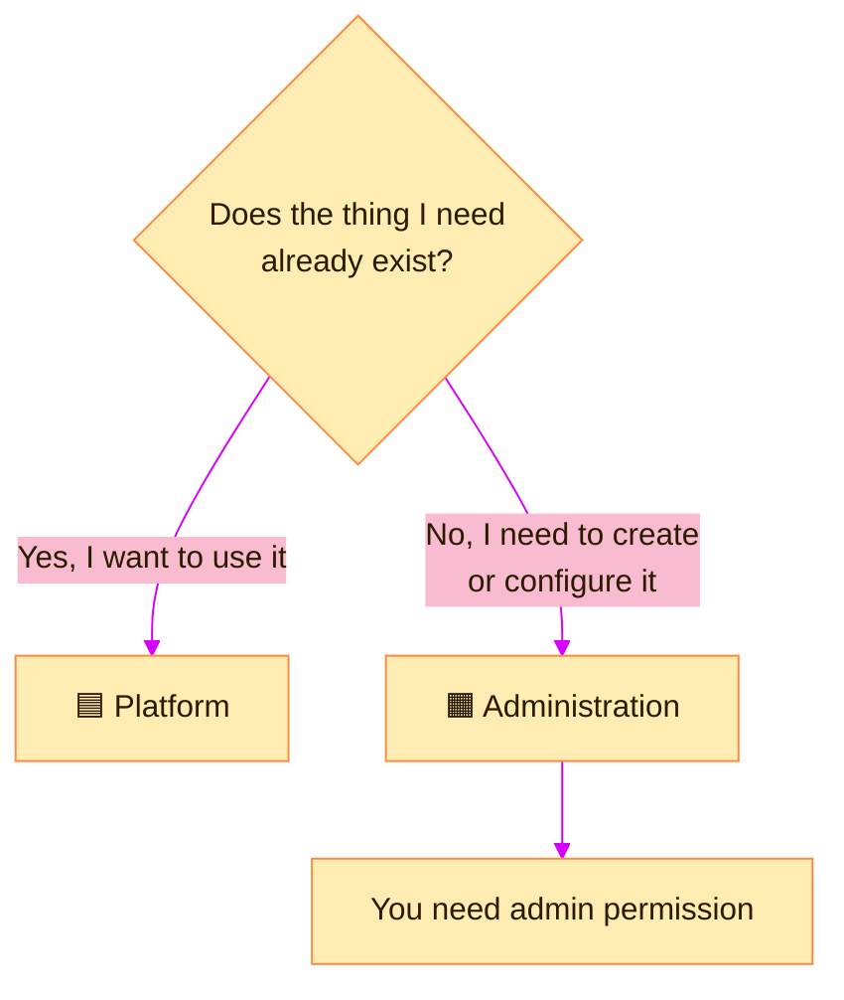

> [!TIP]
> **In one line:** Platform is where you *use* things. Administration is where you *set things up*.

The **Platform** and **Administration** options on the top bar toggle between two main menus.[^docs-interface] Click one and the whole left-hand menu changes.

# What each one is for

| | 🟦 Platform | 🟧 Administration |
|---|---|---|
| **Purpose** | Work with repositories, packages and Release Bundles, and manage projects.[^docs-interface] | General configuration of the site and settings for its services.[^docs-interface] |
| **Mindset** | "I need to find, use or publish something." | "I need to create, configure or grant something." |
| **Who lives here** | Everyone | Platform Admins and Project Admins |
| **How often** | All day | Now and then |

# Where do I go for...?

| I want to... | Go to | Then |
|---|---|---|
| 🔎 Browse or download an artifact | 🟦 Platform | Artifactory → Artifacts |
| 📦 Find a package and its versions | 🟦 Platform | Packages |
| 🏗️ Look at a build | 🟦 Platform | Builds |
| 🧱 **Create a repository** | 🟧 Administration | Repositories → Create a Repository |
| 📁 **Create a project** | 🟧 Administration | All Projects → + Create New |
| 👥 Manage users and access | 🟧 Administration | Security |
| ⚙️ Change a setting for the whole site | 🟧 Administration | The relevant settings section |

Exact menu names can shift between releases; the split between the two menus does not.

# Ask yourself one question

# Why Administration may look empty to you

Administration is the admin's workshop. What you see there depends on your role.

| You are a... | What Administration offers you |
|---|---|
| 👑 **Platform Admin** | Everything for the site |
| 🔵 **Project Admin** | The options for your own project, such as its repositories and members |
| 👩‍💻 **Developer** | Little or nothing. That is by design |

See [who can create repositories](/repository-management/set-up-dotnet-repositories.md) and [project roles](/projects/project-roles-and-members.md).

# The project list changes both menus

Whichever menu you are in, the **project list** narrows it. Choose a project and you see only that project's resources; choose **All Projects** to see across the site.[^docs-interface]

> [!IMPORTANT]
> **Three things decide what is on your screen:** the *site* you are on, the *project* you selected, and the *menu* you chose. If something seems to be missing, check those three before anything else.

# Related

- [The top bar, decoded](/platform-navigation/the-top-bar.md)
- [What is a JFrog Project?](/projects/what-is-a-project.md)
- [Walkthrough: set up .NET repositories](/repository-management/set-up-dotnet-repositories.md)

[^docs-interface]: JFrog documentation, "JFrog Platform Interface".

---

⬅️ [MyJFrog: the account portal](/platform-navigation/myjfrog-portal.md) · 📚 [Chapter 02 index](/platform-navigation/index.md) · [A tour of the left menu: what JFrog can do](/platform-navigation/the-left-menu.md) ➡️
