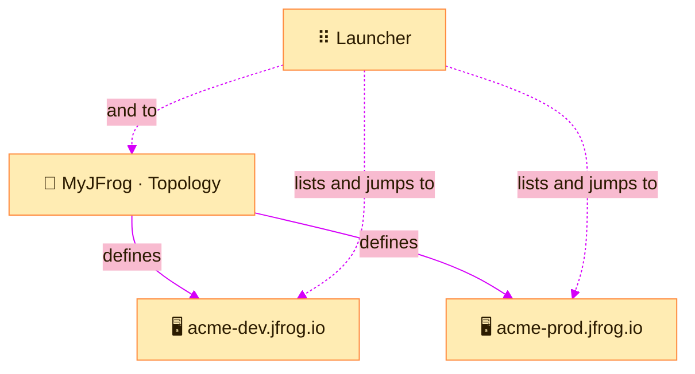

> [!TIP]
> **In one line:** A subscription is what you pay for. A site is a running JFrog Platform inside it. One subscription can have several sites.

The words *subscription* and *site* in the launcher describe how your company's JFrog account is laid out.

# The three levels

| Level | What it is | Everyday comparison |
|---|---|---|
| 🏢 **Organization** | Your company's whole relationship with JFrog | The company |
| 🧾 **Subscription** | A plan the company has bought. An organization can have more than one.[^docs-navigate] | A lease on a building |
| 🖥️ **Site** | A running JFrog Platform within a subscription | An office inside that building |

# What exactly is a site?

A site is a **JFrog Platform Deployment**, shortened to **JPD**. The words *site*, *server* and *JPD* all point at the same thing: one running instance of the JFrog Platform.

| Property | What it tells you |
|---|---|
| 🏷️ **Server name** | The unique name of the instance. Its address is `<server-name>.jfrog.io`.[^docs-topology] |
| 🧩 **Type** | What the server is for (see below).[^docs-topology] |
| ☁️ **Provider** | The cloud provider hosting it.[^docs-topology] |
| 🌍 **Region** | The geographical region of that provider's cloud.[^docs-topology] |
| 🚦 **Status** | *In Progress* (setting up), *Active*, *Inactive* or *Pending*.[^docs-topology] |

So the name you see in the top bar, just before the `|`, is the server name of the site you are on.

## Kinds of site

| Type | Purpose |
|---|---|
| 🟢 **Platform** | A full JFrog Platform instance. This is where teams do their work.[^docs-topology] |
| 🔵 **Distribution Edge** | An edge device that supports software download and distribution.[^docs-topology] |
| 🟣 **Smart Archiving** | The dedicated archive of a JFrog Platform.[^docs-topology] |

# Why have more than one site?

| Reason | Example |
|---|---|
| 🚦 **Separate stages** | A dev site for experiments and a prod site for releases |
| 🌍 **Be near your teams** | One site in Europe, one in the United States |
| 📦 **Deliver to the edge** | An Edge site close to where software is downloaded |

The examples are common patterns, not rules. Many companies run happily on one site.

# Where sites are managed

Sites are added and managed in the **Topology** page of the MyJFrog portal, not inside a site itself.[^docs-topology]

> [!NOTE]
> The Topology page is available only on Enterprise X subscriptions with multiple JPDs, and on Enterprise+ and Enterprise+ Hybrid subscriptions. It is open to the Primary Admin, Admin and Technical Member roles.[^docs-topology]

# Related

- [The launcher](/platform-navigation/the-launcher.md) - how you move between sites.
- [MyJFrog: the account portal](/platform-navigation/myjfrog-portal.md)
- [Deployment options and federation](/jfrog-introduction/deployment-and-federation.md)

[^docs-navigate]: JFrog documentation, "Move Between Sites in Your Subscription".
[^docs-topology]: JFrog documentation, "Manage Your Cloud Topology".

---

⬅️ [The top bar, decoded](/platform-navigation/the-top-bar.md) · 📚 [Chapter 02 index](/platform-navigation/index.md) · [The launcher: moving between sites and subscriptions](/platform-navigation/the-launcher.md) ➡️
