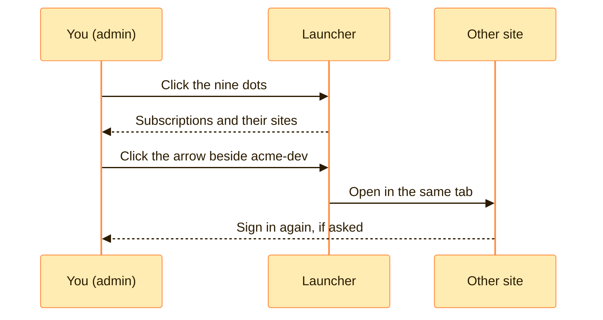

> [!TIP]
> **In one line:** The nine dots are a map of every JFrog site your organization has, with a button to travel to each.

At the far left of the top bar is a grid of nine dots. That is the **site launcher**. Click it and the **Launcher** pane slides open.[^docs-interface]

# What the drawer shows

| You see | It means |
|---|---|
| 🧾 **Subscriptions** | Your organization's subscriptions.[^docs-navigate] |
| 🖥️ **Sites** | The active sites configured in the selected subscription. These are the ones defined in **MyJFrog → Topology**.[^docs-navigate] |
| ✅ **A green checkmark** | The site, or MyJFrog instance, you opened the Launcher from. It is your "you are here".[^docs-navigate] |
| ➡️ **An arrow icon** | Click it to move to that site.[^docs-navigate] |

# Moving to another site

1. Click the **nine-dot launcher** on the top bar.
2. If your organization has several subscriptions, click the one you want to see.
3. Click the **arrow icon** beside the site you want.

The site opens in the **same browser tab**, and you may be asked to sign in again.[^docs-navigate]

# Who has the launcher

Admin users. In organizations with several sites or MyJFrog subscriptions, it is admins who can switch between them this way.[^docs-navigate]

> [!NOTE]
> If a colleague cannot find the nine dots, nothing is broken. They are probably not an admin user.

# Good habits

| Habit | Why |
|---|---|
| 👀 **Check the site name after you jump** | Dev and prod look identical. The name in the top bar is the only quick tell. |
| 🔖 **Bookmark the sites you use daily** | Each site has its own `<name>.jfrog.io` address, so a bookmark is faster than the drawer. |
| 🔐 **Expect to sign in again** | Each site checks your access for itself. |

The habits are practical advice, not JFrog requirements.

# Related

- [Subscriptions, sites and JPDs](/platform-navigation/subscriptions-sites-and-jpds.md)
- [MyJFrog: the account portal](/platform-navigation/myjfrog-portal.md) - it appears in the launcher too.
- [The top bar, decoded](/platform-navigation/the-top-bar.md)

[^docs-interface]: JFrog documentation, "JFrog Platform Interface".
[^docs-navigate]: JFrog documentation, "Move Between Sites in Your Subscription".

---

⬅️ [Subscriptions, sites and JPDs](/platform-navigation/subscriptions-sites-and-jpds.md) · 📚 [Topic index](/platform-navigation/index.md) · [Platform or Administration?](/platform-navigation/platform-and-administration.md) ➡️
