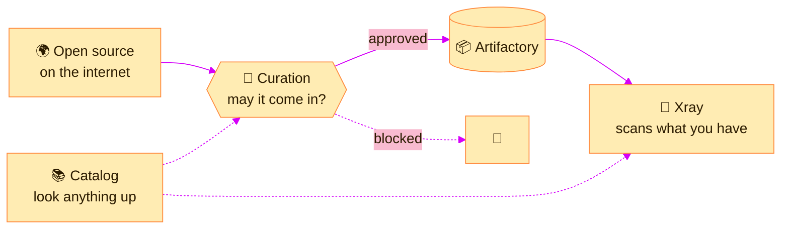

> [!TIP]
> **In one line:** The left menu is JFrog's whole product range in one column: store it, secure it, govern it, ship it.

Click **Platform** on the top bar and a menu runs down the left of the screen. Each entry is a capability of the JFrog Platform. This page describes every one of them.

> [!IMPORTANT]
> **Your menu may not match your colleague's.** The items shown depend on your organization's subscription and your own role.[^docs-working] The picture below lists every item you are likely to meet; expect to see only some of them.

# Two menus, same platform

Here are two real menus from two JFrog SaaS sites. Neither is wrong.

| Menu A | Menu B |
|---|---|
| AppTrust 👑 | |
| **Artifactory**: Packages, Builds, Artifacts, Release Lifecycle | **Artifactory**: Packages, Builds, Artifacts, Release Lifecycle |
| Xray | Xray |
| Curation 👑, Catalog 👑 | |
| | Distribution |
| AI/ML 👑 | AI/ML |
| Connect 👑 | Connect ↗ |
| | Pipelines |
| Integrations | Integrations |
| JFrog MCP ↗ | |

The **Artifactory** block and **Xray** are in both. Everything else comes and goes with the plan. An arrow ↗ means the item opens outside the menu.

# Read it in groups

Eighteen items is a lot. Six groups is not.

| Group | Menu items | The question it answers |
|---|---|---|
| 🟢 **Store and release** | Artifactory: Packages, Builds, Artifacts, Release Lifecycle | *Where is our software, and what is in it?* |
| 🚚 **Deliver** | Distribution | *How does a release reach other sites?* |
| 🔴 **Secure** | Xray, Curation, Catalog | *Is what we use safe?* |
| 🟡 **Govern** | AppTrust | *May this release go to production?* |
| 🟣 **AI and devices** | AI/ML, Connect | *What about our models and our devices?* |
| 🟠 **Connect your tools** | Integrations, JFrog MCP | *How does JFrog fit with everything else?* |
| ⚙️ **Automate (retired)** | Pipelines | *How did JFrog run CI/CD itself?* |

At the very top, the **All Projects** selector narrows the whole menu to one [project](/projects/what-is-a-project.md).[^docs-interface] **Get Started** and **Best Practices** are guides for finding your feet.

# 🟢 Artifactory: the heart of it

Artifactory manages four kinds of object, and the menu has one entry for each.[^docs-objects]

| Object | What it is | Menu entry |
|---|---|---|
| 📄 **Artifact** | Any stand-alone file in Artifactory, identified by a unique checksum | Artifacts |
| 📦 **Package** | The name defined in package metadata, such as `package.json` for npm | Packages |
| 🏗️ **Build** | An output representing the build step of CI, with its method and dependencies | Builds |
| 🎁 **Release Bundle** | An immutable set of content that represents a release candidate | Release Lifecycle |

A package can contain one artifact or many.[^docs-objects]

## 📦 Packages

*In depth: [Packages: the catalog](/artifactory-views/packages.md).*

A list of every package stored in every repository. You see a summary of the latest version of each and can drill into earlier versions, filter by type and name, and for some package types copy an install command.[^docs-packages]

| Use it when | Example |
|---|---|
| You know the package name, not the file path | "Which versions of `lodash` do we have?" |
| You want to install something | Copy the install command for a package |
| You are comparing versions | See what changed between `1.2.0` and `1.3.0` |

## 🏗️ Builds

*In depth: [Builds: the logbook of your CI](/artifactory-views/builds.md).*

The record of your CI runs. **Build-info** identifies a run by build name and build number, and lists the modules, artifacts and dependencies that belong to it.[^docs-build-info]

> [!NOTE]
> **Artifacts answer "what was stored". Build-info answers "which job produced it".**[^docs-build-info]

| Use it when | Example |
|---|---|
| Something broke and you need its origin | "Which build produced this jar?" |
| You are promoting a release | Promote by build identity, not by folder |
| You are auditing | List exactly which dependencies went into build 142 |

## 📄 Artifacts

*In depth: [Artifacts: the file explorer](/artifactory-views/artifacts.md).*

The repository tree: every repository, every folder, every file. This is where you browse, upload and download directly.

| Use it when | Example |
|---|---|
| You know the repository and path | Browse `pay-nuget-dev-local` |
| You need a file's details | Checksums, properties, who deployed it |
| You are uploading by hand | Deploy a file through the UI |

See [checksum-based storage](/jfrog-introduction/checksum-based-storage.md) for what is behind this view.

## 🎁 Release Lifecycle

Release Lifecycle Management controls the flow of **Release Bundles**: a set of artifacts that defines a release candidate is wrapped in a signed bundle, then promoted toward production.[^docs-rlm]

> [!WARNING]
> **Being retired.** JFrog ended feature development for Release Lifecycle Management on 31 July 2026, with end of life scheduled for 31 January 2028.[^docs-rlm] If you are starting fresh, look at **AppTrust** for governing releases.

# 🔴 Security: three tools, three moments

JFrog's security products cover different points in a package's life.[^docs-security]

| Tool | When it acts | What it does |
|---|---|---|
| 🚪 **Curation** | *Before* a package gets in | Controls which open source packages can be used, by enforcing security and license policies before they are downloaded. JFrog calls it the first line of defense.[^docs-curation] |
| 🔬 **Xray** | *After* it is in | Scans source code and binaries for vulnerabilities, malicious packages, license risks and operational issues.[^docs-xray] |
| 📚 **Catalog** | *Any time* | A central catalog of open source packages and CVEs, enriched with security, compliance and operational-risk insight.[^docs-catalog] |

Xray connects back to the introduction chapter: it is what builds the [SBOM and traceability](/jfrog-introduction/supply-chain-security.md).

# 🟡 AppTrust: may this release ship?

AppTrust is JFrog's solution for application risk governance. It puts evidence-based policy gates into your software lifecycle, so that only verified, compliant application versions reach production.[^docs-apptrust]

| Idea | Meaning |
|---|---|
| 🧩 **Application** | A first-class object that groups your packages, images and build artifacts, with an owner and a business criticality.[^docs-apptrust] |
| 🔖 **Application version** | Created each time you build, bundling those artifacts.[^docs-apptrust] |
| 🚦 **Lifecycle gates** | At each stage, such as Dev → QA → Staging → Production, the version must pass policy checks. Failures are blocked.[^docs-apptrust] |
| 🏅 **Trusted Release** | A signed attestation given to a version that satisfied every policy.[^docs-apptrust] |

# 🟣 AI/ML and Connect

| Item | What it is for |
|---|---|
| 🤖 **AI/ML** | Bringing AI into the same supply chain: a catalog of models, a registry of approved MCP servers, a registry of agent skills, and tools for building and running machine learning models.[^docs-aiml] |
| 📡 **Connect** | Managing IoT and edge devices: pushing over-the-air updates to fleets of devices, monitoring them, and reaching them remotely.[^jfrog-connect] |

# 🟠 Integrations and JFrog MCP

| Item | What it is for |
|---|---|
| 🔌 **Integrations** ([in depth](/platform-navigation/integrations.md)) | Connecting JFrog to the tools around it: GitHub, Jira, Jenkins, build tools such as Maven and Gradle, and the JFrog CLI.[^docs-integrations] |
| 🧠 **JFrog MCP** | A server that lets AI coding assistants, such as those in VS Code or Cursor, work with your JFrog Platform. On SaaS it is available on all subscription levels.[^docs-mcp] The arrow beside it means it opens outside the menu. |

# 🚚 Distribution

JFrog Distribution provisions the distribution of software releases. It manages **Release Bundles** and how they are delivered: their content, permission levels and target destinations.[^docs-distribution]

| It gives you | Meaning |
|---|---|
| 📦 **One coherent release** | Release binaries travel as a single signed Release Bundle |
| 🌍 **Many destinations** | Deliver to multiple remote locations, including Edge nodes, and update them as new versions appear |
| ✅ **Verified on arrival** | The target checks that the bundle is signed correctly and safe to use |

| Use it when | Example |
|---|---|
| A release must reach several sites | Ship version 4.2 to data centers in three regions |
| Receivers must trust what arrives | Each destination verifies the signature before using it |

> [!NOTE]
> Distribution is part of the **Enterprise+** license, so it appears only in menus on that plan.[^docs-distribution]

# ⚙️ Pipelines

Pipelines was JFrog's own CI/CD orchestration product: it ran the steps that build, test and release software.

> [!WARNING]
> **Retired.** JFrog Pipelines reached end of life on **1 May 2026** and no longer receives updates, bug fixes or security patches. Both SaaS and self-managed deployments are affected, and JFrog tells customers to complete their migration to an alternative CI/CD solution.[^docs-pipelines-eol]

| If you see Pipelines in your menu | What to do |
|---|---|
| 🆕 You are starting something new | Do not build on it. Use your CI/CD tool of choice, connected through **Integrations** |
| 🏚️ Your team has existing pipelines there | Plan the move now. It is no longer patched |
| 📚 A course or old document tells you to use it | Treat that part as out of date |

# What the crown means

In Menu A above, a small crown sits beside AppTrust, Curation, Catalog, AI/ML and Connect. Menu B shows no crowns at all. The features available to you vary with your organization's subscription,[^docs-working] and a crown like this conventionally marks a capability that is not part of your current plan.

> [!NOTE]
> That reading of the crown is an inference, not something JFrog's documentation states. To be sure what your plan includes, check your subscription in [MyJFrog](/platform-navigation/myjfrog-portal.md).

# The whole platform as one journey

Put the menu items in the order software actually travels and the picture becomes simple.

| Step | Capability | In plain words |
|:-:|---|---|
| 1 | 🚪 Curation, Catalog | Decide which outside packages may come in |
| 2 | 📦 Artifactory | Keep every package and file in one place |
| 3 | 🏗️ Builds | Remember which build made what |
| 4 | 🔬 Xray | Check it all for known problems |
| 5 | 🚦 AppTrust | Allow only approved releases forward |
| 6 | 🚚 Distribution | Deliver the release to where it is needed |
| 7 | 📡 Connect | Update the devices that run it |

# Where to start

| You are a... | Open first |
|---|---|
| 👩‍💻 **Developer** | **Packages**, to find what you need, then **Artifacts** |
| 🚚 **Release manager** | **Release Lifecycle**, then **Distribution** if you have it |
| 🚀 **Release or DevOps engineer** | **Builds**, then **Artifacts** |
| 🛡️ **Security engineer** | **Xray** |
| 🧭 **New to the platform** | **Get Started**, then this bundle's [introduction](/jfrog-introduction/index.md) |

# Related

- [The top bar, decoded](/platform-navigation/the-top-bar.md)
- [Platform or Administration?](/platform-navigation/platform-and-administration.md)
- [What JFrog Artifactory is](/jfrog-introduction/what-is-artifactory.md)
- [Software supply chain security](/jfrog-introduction/supply-chain-security.md)

[^docs-objects]: JFrog documentation, "Understand Artifacts and Packages".
[^docs-packages]: JFrog documentation, "Viewing Packages".
[^docs-build-info]: JFrog documentation, "About Build Info".
[^docs-rlm]: JFrog documentation, "Release Lifecycle Management".
[^docs-apptrust]: JFrog documentation, "AppTrust Overview".
[^docs-security]: JFrog documentation, "Security Products and Concepts".
[^docs-xray]: JFrog documentation, "Xray".
[^docs-curation]: JFrog documentation, "Curation".
[^docs-catalog]: JFrog documentation, "Catalog".
[^docs-aiml]: JFrog documentation, "Explore JFrog AI/ML".
[^docs-integrations]: JFrog documentation, "Get Started with JFrog Integrations".
[^docs-mcp]: JFrog documentation, "JFrog MCP Server for SaaS".
[^docs-distribution]: JFrog documentation, "JFrog Distribution".
[^docs-pipelines-eol]: JFrog documentation, "JFrog Pipelines Deprecation - End of Life".
[^jfrog-connect]: JFrog, "What is JFrog Connect?".
[^docs-interface]: JFrog documentation, "JFrog Platform Interface".
[^docs-working]: JFrog documentation, "Working with JFrog".

---

⬅️ [Platform or Administration?](/platform-navigation/platform-and-administration.md) · 📚 [Topic index](/platform-navigation/index.md) · [Integrations: connecting JFrog to your tools](/platform-navigation/integrations.md) ➡️
