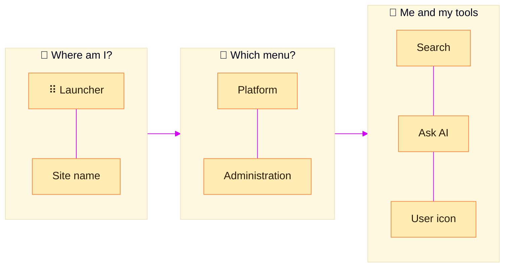

> [!TIP]
> **In one line:** Left side tells you *where you are*. Middle chooses *which menu*. Right side is *you and your tools*.

Open any page of your JFrog site and the same strip sits across the top. Read it left to right and it answers three questions: where am I, what kind of work am I doing, and who am I?

# Left to right

| # | What you see | What it is | Read more |
|:-:|---|---|---|
| 1 | ⠿ **Nine-dot grid** | The **launcher**. It opens a drawer listing your subscriptions and sites. Admin users have it.[^docs-interface] | [The launcher](/platform-navigation/the-launcher.md) |
| 2 | 🏷️ **A name, then a `\|` divider** | The **site** you are on right now. A site is one JFrog Platform Deployment (JPD). | [Subscriptions, sites and JPDs](/platform-navigation/subscriptions-sites-and-jpds.md) |
| 3 | 🟦 **Platform** | The everyday menu: repositories, packages, Release Bundles and projects.[^docs-interface] | [Platform or Administration?](/platform-navigation/platform-and-administration.md) |
| 4 | 🟧 **Administration** | The set-up menu: configuration and service settings for this site.[^docs-interface] | [Platform or Administration?](/platform-navigation/platform-and-administration.md) |
| 5 | 📁 **Project list** | Pick one project and the main pane shows only that project. Pick **All Projects** to see everything.[^docs-interface] | [What is a JFrog Project?](/projects/what-is-a-project.md) |
| 6 | 🔎 **Search** | Responsive search: it follows what the main pane is showing.[^docs-interface] | |
| 7 | ✨ **Ask AI** | Consults the JFrog AI assistant.[^docs-interface] | |
| 8 | 👤 **User icon** | Your account: generate an access token or change your settings.[^docs-interface] | |

There is also a **?** icon that opens the Help Center.[^docs-interface]

# The three zones

| Zone | Question it answers | Why it matters |
|---|---|---|
| 📍 **Launcher + site name** | *Where am I?* | Companies often have several sites, such as dev and prod. Check the name before you change anything. |
| 🧭 **Platform / Administration** | *Am I using things or setting things up?* | The two menus hold completely different options. |
| 👤 **Right-hand tools** | *Who am I, and how do I find things?* | Your token, your settings, search and help. |

# Why you might not see everything

What appears on your screen can vary with three things.[^docs-working]

| It depends on | For example |
|---|---|
| 🧾 Your organization's **subscription** | Some features only exist on higher plans |
| 🖥️ The **interface** you are in | MyJFrog, a SaaS site and a self-managed site differ |
| 🎭 Your **role and permissions** | The launcher is for admin users; a developer may not have it |

> [!NOTE]
> The picture above is a simplified drawing, not a screenshot. Exact positions and styling on your screen may differ between releases.

# Related

- [The launcher](/platform-navigation/the-launcher.md)
- [Platform or Administration?](/platform-navigation/platform-and-administration.md)
- [What is a JFrog Project?](/projects/what-is-a-project.md)

[^docs-interface]: JFrog documentation, "JFrog Platform Interface".
[^docs-working]: JFrog documentation, "Working with JFrog".

---

📚 [Topic index](/platform-navigation/index.md) · [Subscriptions, sites and JPDs](/platform-navigation/subscriptions-sites-and-jpds.md) ➡️
