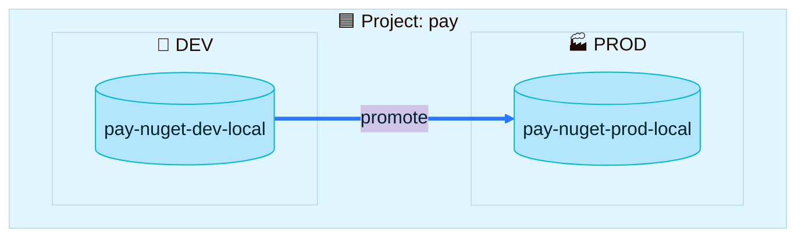

> [!TIP]
> **In one line:** A project owns repositories and builds, sorts them into environments, has a storage budget, and can lend repositories to other projects.

A project's resources are the things its members work with: repositories, builds and Pipelines resources.[^docs-resources]


# Repositories in a project

| Rule | Detail |
|---|---|
| 🏷️ **The project key becomes a prefix** | A repository created inside a project gets the project key added to the front of its name.[^docs-resources] |
| 👑 **Who can add them** | Platform Admins can create new repositories and assign existing ones. Project Admins can only create new ones.[^docs-resources] |
| 🌍 **One environment each** | Every repository is assigned to a single environment. If none is chosen, it goes to DEV.[^docs-resources] |
| 🤝 **They can be shared** | Local and remote repositories created in one project can be shared with others.[^docs-resources] |

## Examples

In a project with the key `pay`, the repositories from the [.NET walkthrough](/repository-management/set-up-dotnet-repositories.md) would look like this:

```text
pay-nuget-dev-local      ← local, DEV environment
pay-nuget-prod-local     ← local, PROD environment
pay-nugetorg-remote      ← remote
pay-nuget-dev            ← virtual: the URL the team uses
```

This is why JFrog's naming convention starts with the team: in a project, the first part of the name is the project key.[^docs-best]

# Environments

An environment groups a project's resources so they are easier to manage. Administrators can define environments globally for all projects, or for one specific project.[^docs-terminology]



Because roles are assigned per environment, the same person can be free to write in DEV and read-only in PROD. See [roles and members](/projects/project-roles-and-members.md).

# Builds

Build information can be associated with a project, and members get build-related roles to act on it.[^docs-resources]

| Fact | Detail |
|---|---|
| 🗃️ **A build-info repository is created for you** | Every new project automatically gets one, named `<project>-build-info`. It cannot be deleted.[^docs-resources] |
| 1️⃣ **One project per build** | A single build is uploaded to a single project at a time.[^docs-resources] |

# Storage quota

A storage quota is a budget for the total size of the repositories assigned to a project. Only Platform Admins can set it, and by default it is unlimited.[^docs-quota]

| Usage | What you see |
|---|---|
| 🟢 Under 75% | A green bar |
| 🟠 75% to 95% | An orange bar and a warning |
| 🔴 100% | A red bar and a critical warning |

> [!IMPORTANT]
> **On JFrog SaaS the quota is a signal, not a wall.** In a cloud environment, a Platform Admin sets the limit for informational purposes; in a self-hosted environment it can limit the space available for uploads.[^docs-quota] JFrog's best-practice guide describes quotas as notification triggers that do not block actions.[^docs-best]

# Sharing a repository between projects

Some repositories hold things many teams need, such as approved base images or an internal SDK. Copying them into every project is wasteful and hard to maintain, so a Platform Admin can **share** a repository instead. The receiving projects use the content without owning it.[^docs-share]

| | 🔗 Direct sharing | 🪪 Project-aware sharing |
|---|---|---|
| How it works | Members of the receiving project access the shared repository directly | The receiving project connects through an internal remote repository, so each request carries that project's identity |
| See which projects consume the content | No | Yes |
| Attribute downloads for chargeback | No | Yes |
| Receiving project applies its own Xray and Curation policies | No | Yes |
| Extra setup in the receiving project | None | A one-time connection step |
| Best for | Low-risk content used by a few trusted projects | Anything governed, billed or audited |

JFrog recommends project-aware sharing for governed environments. It is on a gradual rollout for SaaS.[^docs-share]

# Related

- [What is a JFrog Project?](/projects/what-is-a-project.md)
- [Repository naming conventions](/repository-management/repository-naming-conventions.md)
- [Virtual repositories](/repository-management/virtual-repositories.md)

[^docs-terminology]: JFrog documentation, "Basic Projects Terminology".
[^docs-resources]: JFrog documentation, "Assign Resources to a Project".
[^docs-quota]: JFrog documentation, "Manage Storage Quotas".
[^docs-share]: JFrog documentation, "Share Repositories Across Multiple Projects".
[^docs-best]: JFrog documentation, "Projects Setup Best Practices".

---

⬅️ [Project roles and members](/projects/project-roles-and-members.md) · 📚 [Topic index](/projects/index.md) · [Walkthrough: create a project](/projects/set-up-a-project.md) ➡️
