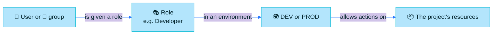

> [!TIP]
> **In one line:** You do not give people permissions on repositories. You give them a role in a project, and the role does the rest.

Projects are built on role-based access control (RBAC). Roles replace the older idea of permission targets, and there are three categories: **Platform**, **Global** and **Project** roles.[^docs-roles]

# The three levels

| Level | Who | Scope | Typical jobs |
|---|---|---|---|
| 🟡 **Platform Admin** | The administrators of the whole platform | Everything | Create projects, set quotas, define global roles, share repositories |
| 🔵 **Project Admin** | People the Platform Admin puts in charge of a project | One project | Manage members, create repositories, define project roles |
| 🟢 **Project member** | Any user or group with a role in the project | What the role allows | Build, publish, review, release |

By default, every Platform Administrator is automatically a Project Admin.[^docs-terminology]

# Becoming a member

A user or group becomes a project member the moment it is given at least one global or project role in that project.[^docs-role-types]

# Global roles and project roles

| | 🌐 Global role | 📁 Project role |
|---|---|---|
| Defined by | The Platform Admin | A Project Admin |
| Applies to | All projects | One project |
| Best for | Roles every team needs, defined once | A team's special case |

Predefined global roles cannot be renamed or deleted, but the actions assigned to them can be customized. From Artifactory 7.77, custom global roles can also be created.[^docs-role-types]

# The predefined global roles

Six global roles come ready-made.[^docs-global-roles]

| Role | Think of them as |
|---|---|
| 👑 **Project Admin** | The team lead for the project |
| 👩‍💻 **Developer** | Someone who builds and publishes |
| ✍️ **Contributor** | Someone who adds to the project's work |
| 👀 **Viewer** | Someone who needs to look, not touch |
| 🚀 **Release Manager** | Someone who moves releases forward |
| 🛡️ **Security Manager** | Someone who owns policies and scans |

The one-line descriptions are a plain-language guide. What each role can actually do is the set of actions a Platform Admin enables for it.

# What a role is made of: actions

A role is a bundle of actions. These are some of the actions that can be switched on for a role.[^docs-global-roles]

| Area | Actions |
|---|---|
| 📦 **Artifacts** | Read (download and read metadata), Write (upload), Delete (delete or overwrite) |
| 🏗️ **Builds** | Delete builds |
| 🚀 **Releases** | Promote Release Bundle (Enterprise+) |
| ⚙️ **Pipelines** | Trigger pipelines, Manage pipelines |
| 🛡️ **Security (Xray)** | Trigger security scan, Manage Xray data, Manage reports, Manage Watches and Policies, Read policies |

# Environments add a second dimension

A project runs in one or more environments, and roles can be assigned per environment. That gives one more layer of control.[^docs-role-types]

| Person | In DEV | In PROD |
|---|---|---|
| 👩‍💻 A developer | Read, write, delete | Read only |
| 🚀 A release manager | Read | Read, write, promote |
| 👀 A viewer | Read | Read |

> [!NOTE]
> The table is an example of how a team might set things up, not a built-in default.

# What a Project Admin can do

The Project Admin is a global role, equivalent to the Platform Admin but at the level of one project. What they can actually do depends on the privileges the Platform Admin grants.[^docs-project-admin]

| Privilege granted | The Project Admin can |
|---|---|
| 👥 **Manage Members** | Add and remove the project's users and groups |
| 📦 **Manage Resources: Repositories** | Create, update and delete local, remote and virtual repositories, as allowed per repository type |
| 🧰 **Manage Resources: Others** | Manage builds, OpenID Connect identity mappings and retention policies |
| 🔎 **Index Resources** | Choose which resources Xray indexes and scans |
| 🛡️ **Security Manager role** | Create and manage project-level Policies, Watches and Reports |

From Artifactory 7.146.0, the create/update and delete permissions can be granted separately for each repository type.[^docs-create]

# Related

- [What is a JFrog Project?](/projects/what-is-a-project.md)
- [Project resources, environments and quotas](/projects/project-resources.md)
- [Access management in Artifactory](/jfrog-introduction/access-management.md)

[^docs-terminology]: JFrog documentation, "Basic Projects Terminology".
[^docs-roles]: JFrog documentation, "Project Roles and Members Concepts".
[^docs-role-types]: JFrog documentation, "Global and Project Role Types".
[^docs-global-roles]: JFrog documentation, "Global Roles for Projects".
[^docs-project-admin]: JFrog documentation, "Project Admin Role".
[^docs-create]: JFrog documentation, "Create a Project".

---

⬅️ [What is a JFrog Project?](/projects/what-is-a-project.md) · 📚 [Topic index](/projects/index.md) · [Project resources, environments and quotas](/projects/project-resources.md) ➡️
