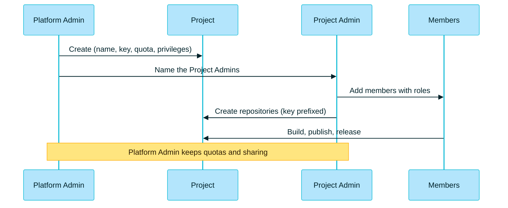

> [!TIP]
> **In one line:** A Platform Admin opens **Administration → All Projects → + Create New**, fills in one dialog, then adds people and repositories.

This walkthrough creates a working project in JFrog SaaS from nothing: the project itself, its people, and its first repositories.


# Who can do this?

> [!IMPORTANT]
> **Only a Platform Administrator can create a project.**[^docs-create] A Project Admin can run a project once it exists, but cannot create a new one. If you do not see **+ Create New**, you are not a Platform Admin on this site.

| Task | Platform Admin | Project Admin | Developer |
|---|:-:|:-:|:-:|
| Create a project | ✅ | ❌ | ❌ |
| Add members to a project | ✅ | ✅ | ❌ |
| Create repositories in a project | ✅ | ✅ (if granted) | ❌ |
| Assign existing repositories to a project | ✅ | ❌ | ❌ |

The last row matters: Platform Admins can create new repositories and assign existing ones, while Project Admins can only create new ones.[^docs-resources]

# Before you start

Decide these four things first. Two of them are hard to change later.

| Decide | Guidance | Can you change it later? |
|---|---|:-:|
| 🏷️ **Project key** | Short and meaningful, such as `pay`. 2 to 32 lowercase letters, digits and hyphens, starting with a letter.[^docs-create] | ❌ No. It is immutable.[^docs-best] |
| 📛 **Project name** | A readable name, such as `Payments Team` | ✅ Yes |
| 👑 **Project Admins** | Which users or groups will run it | ✅ Yes |
| 💾 **Storage quota** | Unlimited, or a size in GB | ✅ Yes |

Also check that you have room: the number of projects is capped by subscription, at 3 for Pro, 30 for Enterprise and 300 for Enterprise+.[^docs-subscription]

# Part 1: create the project 🔵


1. On the top bar, click **Administration**.
2. Make sure the project list is set to **All Projects**. The first tab is then called *All Projects Overview*, and it carries the create control.[^docs-view]
3. Click **+ Create New**. The *Create New Project* dialog opens.[^docs-create]
4. On the **Configure Project** tab, fill in the fields:

| Field | What to enter | Tip |
|---|---|---|
| **Project Name** | `Payments Team` | What people will see in the project list |
| **Project Key** | `pay` | Mandatory. It is added as a prefix to resources created in the project.[^docs-create] |
| **Description** | One sentence on what the project is for | It helps the next person understand the scope |
| **Storage Quota** | Leave **Unlimited**, or pick **Notify When Reaching** and enter a size in GB | The quota covers the total size of the repositories assigned to the project[^docs-create] |

5. Under **Project Admin privileges**, tick what this project's admins may do without you:[^docs-create]

| Privilege | What it allows |
|---|---|
| ☑️ **Manage Resources → Repositories** | Create, update and delete local, remote and virtual repositories. *Create/Update* and *Delete* can be set separately for each repository type. |
| ☑️ **Manage Resources → Others** | Manage builds, OpenID Connect identity mappings and retention policies |
| ☑️ **Manage Members** | Add and remove the project's users and groups |
| ☑️ **Index Resources** | Choose which repositories, builds and Release Bundles are indexed for scanning |

6. In the **Project Admins** area, select the users and groups who will be Project Admins.[^docs-create]
7. *(Optional)* Open the **Assign Repositories** tab to hand existing repositories to the project.[^docs-create]
8. *(Optional, Enterprise+)* Open the **Add Destinations** tab to add distribution targets.[^docs-create]
9. Click **Create**.

> [!NOTE]
> **How much to delegate?** Ticking every privilege makes the team self-sufficient. Leaving *Repositories* unticked keeps repository creation with you while the team still manages its own members.

# Part 2: add the people 🟢

A Project Admin or a Platform Admin can do this.[^docs-members]

1. Click **Administration**, and in the project list select your new project.
2. Either scroll to the bottom of the **Members and Roles** area on the Project Overview and click **+ Add Members**, or go to **User Management → Members → + Add Members**.
3. In the *Add Members* dialog, choose the **users** or **groups**, and pick the **role** for each.
4. Click **Done**.

Users and groups must already exist on the platform before you can add them.[^docs-members] For what each role means, see [roles and members](/projects/project-roles-and-members.md).

> [!TIP]
> **Add groups, not individuals,** where you can. When someone joins or leaves the team, you change the group once and every project follows.

# Part 3: give it repositories 🟠

There are two routes.

| Route | Who | What happens to the name |
|---|---|---|
| 🆕 **Create new**, with the project selected | Platform Admin, or Project Admin with the privilege | The project key is added as a prefix automatically[^docs-resources] |
| 📥 **Assign existing** | Platform Admin only | The repository keeps its name and now belongs to the project |

To create new ones, select the project in the project list, then follow the [.NET walkthrough](/repository-management/set-up-dotnet-repositories.md). With the key `pay`, you end up with:

```text
pay-nuget-dev-local      ← local
pay-nugetorg-remote      ← remote
pay-nuget-dev            ← virtual: give this URL to the team
```

Each repository belongs to one environment. If you do not choose one, it goes to **DEV**.[^docs-resources]

# Part 4: check that it worked ✅

| Check | What you should see |
|---|---|
| 📁 Open the project list | Your project is listed |
| 🏠 Select it, under Administration | The first tab is now **Project Overview**, with the project's details and edit controls[^docs-view] |
| 🗃️ Look at its repositories | A build-info repository named `<project>-build-info` was created automatically[^docs-resources] |
| 👩‍💻 Ask a member to sign in | With the project selected, they see only this project's resources |

# The whole flow



# On JFrog SaaS, note these

| Point | Detail |
|---|---|
| 💾 **The quota informs, it does not block** | In a cloud environment, a Platform Admin sets the limit for informational purposes; in a self-hosted environment it can limit the space available.[^docs-quota] |
| 🚦 **Watch the color** | The storage bar is green under 75%, orange from 75% to 95%, and red at 100%.[^docs-quota] |
| 🔢 **Mind the project limit** | It is counted across your whole subscription.[^docs-subscription] |

# Prefer automation?

Projects can also be created through the REST API.[^docs-api]

## Examples

```bash
curl -X POST "https://company.jfrog.io/access/api/v1/projects" \
  -H "Authorization: Bearer <admin-token>" \
  -H "Content-Type: application/json" \
  -d '{
        "project_key": "pay",
        "display_name": "Payments Team",
        "description": "Repositories and builds for the payments team",
        "admin_privileges": {
          "manage_members": true,
          "manage_resources": true,
          "index_resources": true
        }
      }'
```

The endpoint is from JFrog's documentation. The request body shown is a typical one; check the Create Project API reference for the full list of fields before relying on it.

# JFrog's recommended practices

| Practice | Why |
|---|---|
| 👥 **Team = Project** | Treating a project as one team's workspace lets developers use a single virtual repository URL for all their package management.[^docs-best] |
| 🏷️ **A meaningful project key** | The prefix appears on every repository, which makes resources easy to search, filter and identify.[^docs-best] |
| 💾 **Set a storage quota at creation** | It stops a single team quietly using up shared storage.[^docs-best] |
| 🎭 **Use roles, not per-repository permissions** | Permissions are managed through project roles, not assigned repository by repository.[^docs-best] |
| 📦 **Project-scoped repositories** | Dedicated repositories per project perform better, avoid name clashes between teams and let each team manage its own retention.[^docs-best] |
| 🟣 **A virtual repository in every project** | It bundles the project's locals, shared repositories and remotes into one URL for developers.[^docs-best] |

# Common stumbles

| ❌ The mistake | ✅ Do this instead |
|---|---|
| A cryptic or throwaway project key | A short, meaningful key. You will see it on every repository, forever |
| One huge project for the whole company | One project per team |
| Giving everyone Project Admin | Give the role people need: Developer, Viewer and so on |
| Looking for **+ Create New** with one project selected | Switch the project list to **All Projects** first |
| Expecting the quota to stop uploads on SaaS | Treat it as an alert, and act on the orange bar |

# Related

- [What is a JFrog Project?](/projects/what-is-a-project.md)
- [Project roles and members](/projects/project-roles-and-members.md)
- [Platform or Administration?](/platform-navigation/platform-and-administration.md)
- [Walkthrough: set up .NET repositories](/repository-management/set-up-dotnet-repositories.md)

[^docs-create]: JFrog documentation, "Create a Project".
[^docs-members]: JFrog documentation, "Assign Members to a Project".
[^docs-resources]: JFrog documentation, "Assign Resources to a Project".
[^docs-view]: JFrog documentation, "View Projects in the JFrog Platform".
[^docs-quota]: JFrog documentation, "Manage Storage Quotas".
[^docs-subscription]: JFrog documentation, "Projects Subscription Allocation".
[^docs-api]: JFrog documentation, "Dedicated Project REST APIs".
[^docs-best]: JFrog documentation, "Projects Setup Best Practices".

---

⬅️ [Project resources, environments and quotas](/projects/project-resources.md) · 📚 [Topic index](/projects/index.md)
