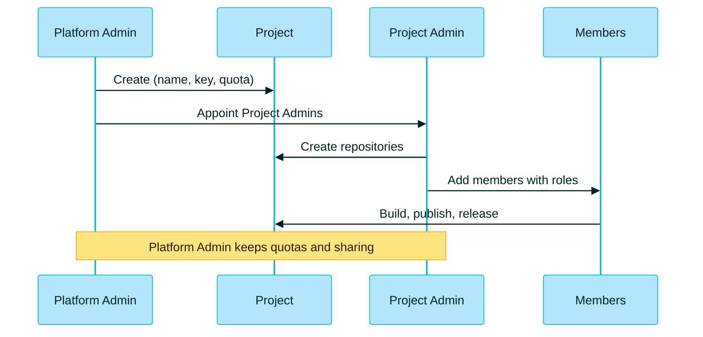

> [!TIP]
> **In one line:** Create it, staff it, equip it, run it. And make one project per team.

# Before you start

| You need | Detail |
|---|---|
| 🔑 **To be a Platform Administrator** | Only a Platform Admin can create a project.[^docs-create] |
| 🏷️ **A project key in mind** | It cannot be changed later and it prefixes every repository in the project.[^docs-best] |
| 👥 **Users and groups ready** | You will pick the Project Admins from them. |

# Step 1: create the project 🔵

1. Go to **Administration → All Projects → + Create New**.
2. Fill in the **Configure Project** tab:

| Field | What to enter |
|---|---|
| **Project Name** | A readable name, such as `Payments Team` |
| **Project Key** | 2 to 32 lowercase letters, digits and hyphens, starting with a letter, such as `pay` |
| **Description** | What the project is for |
| **Storage Quota** | Unlimited by default. To set one, choose *Notify When Reaching* and enter a size in GB |
| **Project Admin privileges** | Tick what Project Admins may do: *Manage Resources*, *Manage Members*, *Index Resources* |

These are the fields and rules JFrog documents for the dialog.[^docs-create]

> [!WARNING]
> **Choose the project key with care.** It is an immutable identifier and a mandatory prefix on every repository created in the project.[^docs-best]

# Step 2: staff it 🟢

3. In the **Project Admins** area, select the users and groups who will run the project.[^docs-create]

Once the project exists, its admins add the other members and give each a role. See [roles and members](/projects/project-roles-and-members.md).

# Step 3: equip it 🟠

4. *(Optional)* In the **Assign Repositories** tab, assign existing repositories to the project.[^docs-create]
5. *(Optional, Enterprise+)* In the **Add Destinations** tab, add distribution targets.[^docs-create]
6. Click **Create**.

From here, Project Admins can create the project's own repositories. Follow the [.NET walkthrough](/repository-management/set-up-dotnet-repositories.md) from inside the project, and the project key is added to each name automatically.

# Step 4: run it 🟣

| Ongoing task | Who | Where to read more |
|---|---|---|
| 📊 Watch storage against the quota | Platform Admin, Project Admin | [Resources and quotas](/projects/project-resources.md) |
| 👥 Add and remove members as the team changes | Project Admin | [Roles and members](/projects/project-roles-and-members.md) |
| 🤝 Share repositories other projects need | Platform Admin | [Resources and quotas](/projects/project-resources.md) |

# The whole flow

# JFrog's recommended practices

| Practice | Why |
|---|---|
| 👥 **Team = Project** | Treating a project as one team's workspace lets developers use a single virtual repository URL for all their package management.[^docs-best] |
| 🏷️ **A meaningful project key** | The prefix appears on every repository, which makes resources easy to search, filter and identify.[^docs-best] |
| 💾 **Set a storage quota at creation** | It stops a single team quietly using up shared storage.[^docs-best] |
| 🎭 **Use roles, not per-repository permissions** | Permissions are managed through project roles, not assigned repository by repository.[^docs-best] |
| 📦 **Project-scoped repositories** | Dedicated repositories per project perform better, avoid name clashes between teams and let each team manage its own retention.[^docs-best] |
| 🚦 **One local repository per technology per stage** | DEV, QA and PROD each keep a single source of truth.[^docs-best] |
| 🟣 **A virtual repository in every project** | It bundles the project's locals, shared repositories and remotes into one URL for developers.[^docs-best] |

# Common stumbles

| ❌ The mistake | ✅ Do this instead |
|---|---|
| One huge project for the whole company | One project per team |
| A cryptic or throwaway project key | A short, meaningful key you will be happy to see on every repository |
| Giving everyone Project Admin | Give the role people need: Developer, Viewer and so on |
| Copying a shared repository into each project | Share it from one owning project |

# Related

- [What is a JFrog Project?](/projects/what-is-a-project.md)
- [Walkthrough: set up .NET repositories](/repository-management/set-up-dotnet-repositories.md)
- [When to use a virtual repository](/repository-management/virtual-repositories.md)

[^docs-create]: JFrog documentation, "Create a Project".
[^docs-best]: JFrog documentation, "Projects Setup Best Practices".

---

⬅️ [Project resources, environments and quotas](/projects/project-resources.md) · 📚 [Topic index](/projects/index.md)
