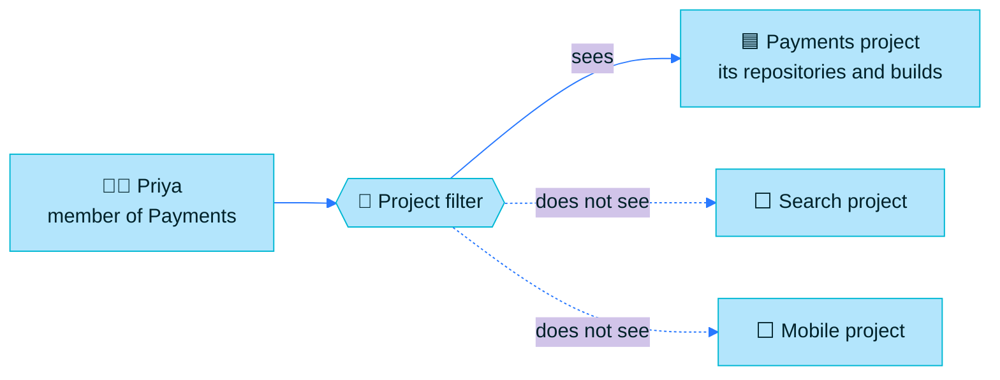

> [!TIP]
> **In one line:** A Project is one team's own workspace inside the JFrog Platform: their repositories, their people, their rules.

A **Project** is an organizational management entity in the JFrog Platform. It hosts your resources, such as repositories, builds and Release Bundles, and associates users and groups with it as members with specific entitlements.[^docs-terminology]

# The problem Projects solve

Picture one JFrog Platform shared by twenty teams, with no Projects.

| Without Projects | With Projects |
|---|---|
| 😵 Every team sees every repository | 🎯 Each person sees only what belongs to their projects |
| 🧑‍💼 One platform admin sets up everything for everyone | 🤝 Each team has its own admin for day-to-day work |
| 🔐 Permissions are set repository by repository | 🎭 People get a role, and the role decides what they can do |
| 💸 Nobody knows which team is using the storage | 📊 Each project has its own storage figure and quota |
| 🐢 Onboarding a new joiner takes a ticket per repository | ⚡ Add them to the project with a role and they are ready |

# What a Project gives you

JFrog describes four benefits.[^docs-projects]

| Benefit | What it means day to day |
|---|---|
| 🤝 **Delegate management** | Platform Admins hand part of their daily work to the teams, which removes a DevOps bottleneck. |
| 🧱 **Define roles and enhance compliance** | Teams, departments or customer products are kept apart inside one platform. |
| 🔭 **Improve visibility** | Stakeholders can see efficiency, scale, cost and security per project. |
| 🚀 **Simplify onboarding** | New members get access through a role, not a list of individual permissions. |

# A Project is a filter, not a place

This is the idea that trips people up. Projects as an entity are not something users browse to. A Project works as a **filter**: users see and reach the resources of the projects they belong to, according to their roles.[^docs-resources]

In the interface you switch between your projects with the project selector. Pick one and everything on screen narrows to that project.

# The building blocks

| Building block | What it is |
|---|---|
| 🏷️ **Project key** | A unique key that identifies the project and groups its resources. It is added as a prefix to resources created in the project.[^docs-terminology] |
| 👥 **Project members** | Users or groups that have been given a role in the project.[^docs-terminology] |
| 📦 **Resources** | Entities such as repositories, builds and Pipelines that belong to the project.[^docs-terminology] |
| 🌍 **Environments** | Groupings such as DEV and PROD that organize resources. Roles can differ per environment.[^docs-terminology] |
| 🎭 **Roles** | Named sets of actions. They decide what each member may do.[^docs-terminology] |
| 💾 **Storage quota** | A limit on the total size of the project's repositories. |

Read more: [roles and members](/projects/project-roles-and-members.md) and [resources, environments and quotas](/projects/project-resources.md).

# Assigned and unassigned resources

The Platform separates resources that belong to a project (**assigned**) from those that do not yet (**unassigned**). When a Platform is upgraded to a version with Projects, everything starts as unassigned until someone assigns it.[^docs-terminology]

> [!NOTE]
> This is why you may see repositories that sit outside every project. They are not broken; they simply have not been assigned yet.

# How many projects can you have?

The number depends on the subscription.[^docs-subscription]

| Subscription | Projects |
|---|---|
| Pro / Pro X | Up to 3 |
| Enterprise | Up to 30 |
| Enterprise+ | Up to 300, extendable in buckets of 100 |

Projects are not supported on Artifactory Edge nodes.[^docs-subscription]

# Does this apply to my version?

Projects have been available on all subscriptions since Artifactory 7.31.10.[^docs-subscription] On a current release such as Artifactory Cloud 7.173, every feature in this chapter is present:

| Feature | Arrived in |
|---|---|
| Projects on all subscriptions | 7.31.10 |
| Two-character project keys | 7.42.1 |
| Custom global roles | 7.77 |
| Storage usage shown for all projects | 7.89 |
| Separate create/update and delete permissions per repository type | 7.146.0 |

One exception: project-aware repository sharing is on a gradual rollout for SaaS, so it may not be switched on for your account yet.[^docs-share]

# Related

- [Project roles and members](/projects/project-roles-and-members.md)
- [Project resources, environments and quotas](/projects/project-resources.md)
- [Set up a project](/projects/set-up-a-project.md)
- [Access management in Artifactory](/jfrog-introduction/access-management.md)

[^docs-projects]: JFrog documentation, "Get Started with Projects".
[^docs-terminology]: JFrog documentation, "Basic Projects Terminology".
[^docs-subscription]: JFrog documentation, "Projects Subscription Allocation".
[^docs-resources]: JFrog documentation, "Assign Resources to a Project".
[^docs-share]: JFrog documentation, "Share Repositories Across Multiple Projects".

---

📚 [Topic index](/projects/index.md) · [Project roles and members](/projects/project-roles-and-members.md) ➡️
