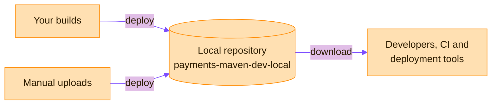

> [!TIP]
> **In one line:** A local repository is the home for artifacts your own organization produces.

A local repository stores and manages the artifacts your organization uploads or creates internally, often called first-party artifacts. It gives you a central location for your internal binaries.[^docs-local]



# Addressing an artifact

```text
http://<HOST>:<PORT>/artifactory/<LOCAL_REPOSITORY_NAME>/<ARTIFACT_PATH>
```

| Part | Meaning |
|---|---|
| `<LOCAL_REPOSITORY_NAME>` | The repository key of the local repository |
| `<ARTIFACT_PATH>` | The path to the artifact inside the repository |

# Examples

```text
http://company.jfrog.io:8081/artifactory/payments-maven-dev-local/com/acme/app/1.0/app-1.0.jar
```

# Settings worth knowing

| Setting | Rule |
|---|---|
| Package type | Chosen when the repository is created. It cannot be changed afterwards. |
| Repository key | Mandatory and unique. It cannot begin with a number or contain spaces or special characters. |
| Repository layout | How modules are stored and identified. A layout matching the package type is suggested. |
| Include / exclude patterns | Ant-like patterns that filter which artifact paths the repository serves. Excludes (default: none) are subtracted from includes (default: all). They apply to regular users, not admins. |

# Creating one

In the **Administration** module, select **Repositories**, click **Create a Repository**, choose **Local**, then pick the package type. A local repository can also be created through the REST API.[^docs-local]

# Best practices

- **Name it consistently**, as `<team>-<tech>-<maturity>-<locator>`. See [repository naming conventions](/repository-management/repository-naming-conventions.md).
- **Separate repositories per team or business unit.** This gives clear security boundaries and prevents cross-team interference, without complex folder-level permissions.[^docs-local]

# Related

- [Repository types in Artifactory](/repository-management/repository-types.md)
- [Virtual repositories](/repository-management/virtual-repositories.md) - how developers usually reach a local repository.

[^docs-local]: JFrog Artifactory documentation - Local Repositories.

---

⬅️ [Repository types in Artifactory](/repository-management/repository-types.md) · 📚 [Topic index](/repository-management/index.md) · [Remote repositories](/repository-management/remote-repositories.md) ➡️
