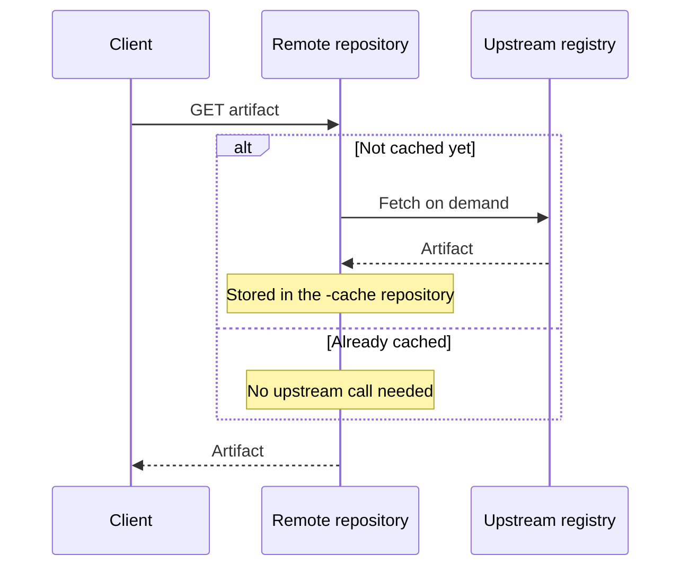

> [!TIP]
> **In one line:** A remote repository fetches from upstream only when asked, keeps what it fetched, and never accepts deployments.

A remote repository is a caching proxy for a repository managed at a remote URL.[^docs-remote] The [introduction](/jfrog-introduction/remote-repositories.md) covers why this matters; this page covers how it behaves.



# Proxy, not mirror

Artifacts are not fetched in advance. An artifact is pulled from upstream and stored in the cache only when a client first requests it.[^docs-remote]

| Consequence | Detail |
|---|---|
| A new remote repository is empty | Its cache fills only as clients start making requests. |
| Uncached artifacts are flagged | Until fetched, an artifact shows the warning "This artifact is not cached". |
| You cannot deploy into it | You can remove artifacts from the cache, but not deploy a new artifact to a remote repository. |

# Kinds of remote repository

| Kind | Upstream |
|---|---|
| External | An external registry. This includes [Smart Remote repositories](/repository-management/smart-remote-repositories.md), whose upstream is another JFrog Platform instance. |
| Internal | A repository shared from another project in the same JFrog Platform instance. |

The upstream URL of an external remote repository must be HTTP or HTTPS.

# Addressing an artifact

```text
http://<host>:<port>/artifactory/<remote-repository-name>/<artifact-path>
```

This returns the artifact and caches it if it is not cached yet. To read only what is already cached, for example to avoid remote update checks, add `-cache` to the repository name:

```text
http://<host>:<port>/artifactory/<remote-repository-name>-cache/<artifact-path>
```

# Examples

```text
http://company.jfrog.io/artifactory/dockerhub-remote/library/nginx
```

# Not supported

Pointing a remote repository at a third-party product that itself relies on Artifactory for caching, while that product intervenes in package manager protocols or applies its own gateway, proxy or routing logic. Artifactory may block such configurations.[^docs-remote]

# Related

- [Repository naming conventions](/repository-management/repository-naming-conventions.md) - including the reserved `-cache` suffix.
- [Virtual repositories](/repository-management/virtual-repositories.md)
- [Repository types in Artifactory](/repository-management/repository-types.md)

[^docs-remote]: JFrog Artifactory documentation - Remote Repositories.

---

⬅️ [Local repositories](/repository-management/local-repositories.md) · 📚 [Topic index](/repository-management/index.md) · [Smart Remote repositories](/repository-management/smart-remote-repositories.md) ➡️
