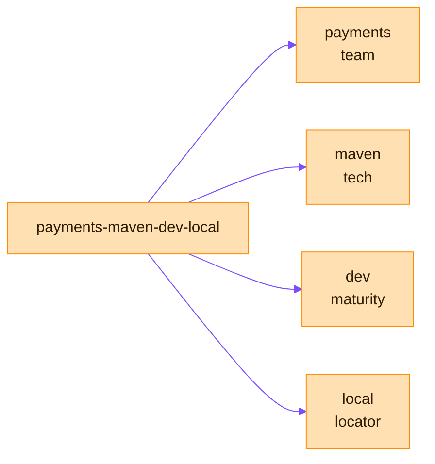

> [!TIP]
> **In one line:** Name every repository team, technology, maturity, locator, so its owner, contents and stage are obvious from the key.

A consistent naming scheme makes repositories predictable and gives each team a clear boundary. JFrog recommends a four-part structure and adapts it per repository type.



# The four parts

```text
<team>-<tech>-<maturity>-<locator>
```

| Part | Meaning | Examples |
|---|---|---|
| `<team>` | The team or product | `payments` |
| `<tech>` | The technology or package type | `docker`, `maven` |
| `<maturity>` | The stage of the artifact | `dev`, `qa`, `prod` |
| `<locator>` | The physical site or type | `local`, `us-east` |

# Pattern by repository type

| Repository type | Pattern | Example |
|---|---|---|
| [Local](/repository-management/local-repositories.md) | `<team>-<tech>-<maturity>-<locator>` | `payments-maven-dev-local`[^docs-local] |
| [Remote](/repository-management/remote-repositories.md), public registry | `<registry>-remote` | `dockerhub-remote`, `npmjs-remote`[^docs-remote] |
| [Remote](/repository-management/smart-remote-repositories.md), another Artifactory site | The source repository's name, with `<locator>` changed to the origin | `payments-mvn-dev-local` at the London site becomes `payments-mvn-dev-london`[^docs-remote] |
| [Virtual](/repository-management/virtual-repositories.md) | `<team>-<tech>-<maturity>` (no locator) | `payments-maven-dev`[^docs-virtual] |

A virtual repository drops the locator because it is the developers' entry point and aggregates across locations.

# Hard rules

- A repository key is unique, and cannot begin with a number or contain spaces or special characters.
- A remote repository name cannot end in `-cache`. Artifactory adds `-cache` itself to name the remote repository's internal cache.[^docs-remote]

# Naming as governance

Create separate repositories for different teams or business units. The team name in the key then marks a clear security boundary, and you avoid cross-team interference without complex folder-level permissions.[^docs-local]

# Related

- [Repository types in Artifactory](/repository-management/repository-types.md)
- [Access management in Artifactory](/jfrog-introduction/access-management.md)

[^docs-local]: JFrog Artifactory documentation - Local Repositories.
[^docs-remote]: JFrog Artifactory documentation - Remote Repositories.
[^docs-virtual]: JFrog Artifactory documentation - Virtual Repositories.

---

⬅️ [Virtual repositories](/repository-management/virtual-repositories.md) · 📚 [Topic index](/repository-management/index.md) · [Why the package type matters](/repository-management/why-package-type-matters.md) ➡️
