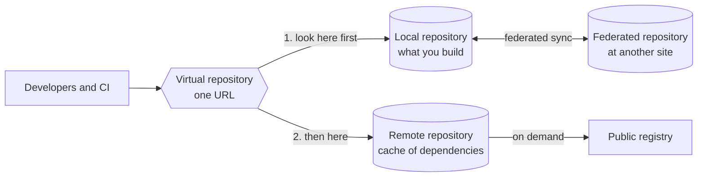

> [!TIP]
> **In one line:** Local holds what you build, remote caches what you depend on, virtual puts both behind one URL, and federated keeps sites in sync.

In Artifactory, a repository is a place to organize artifacts into a cohesive group by application and project. Artifactory hosts four repository types.[^docs-repo-mgmt]

# The four types

| Type | What it holds | Typical use |
|---|---|---|
| [Local](/repository-management/local-repositories.md) | Artifacts your organization uploads or creates itself | Build outputs, binaries and other packages you generate |
| [Remote](/repository-management/remote-repositories.md) | A cache of artifacts proxied from a remote URL, such as a public registry | Your project's external dependencies |
| [Virtual](/repository-management/virtual-repositories.md) | Nothing of its own: it aggregates local and remote repositories | One controlled entry point for searching and resolving artifacts |
| Federated | Contents synchronized with other federated repositories at remote sites in the same Federation | Sharing the same artifacts across sites |

# How they fit together

- **Local** is where what you build goes in.
- **Remote** is where what you depend on comes in from outside.
- **Virtual** sits in front of both, so tools talk to a single URL.
- **Federated** keeps repositories at different sites in step with each other.

A [Smart Remote repository](/repository-management/smart-remote-repositories.md) is a remote repository whose upstream is another Artifactory instance.

# One more type, by subscription

With an Enterprise+ subscription and JFrog Distribution, there are also Release Bundle repositories. They collect a signed group of artifacts and protect them from changes, so distribution to targets is consistent.[^docs-repo-mgmt]

# Related

- [Repository naming conventions](/repository-management/repository-naming-conventions.md)
- [Deployment options and federation](/jfrog-introduction/deployment-and-federation.md) - the introduction-level view of federation.

[^docs-repo-mgmt]: JFrog Artifactory documentation - Repository Management.

---

📚 [Topic index](/repository-management/index.md) · [Local repositories](/repository-management/local-repositories.md) ➡️
