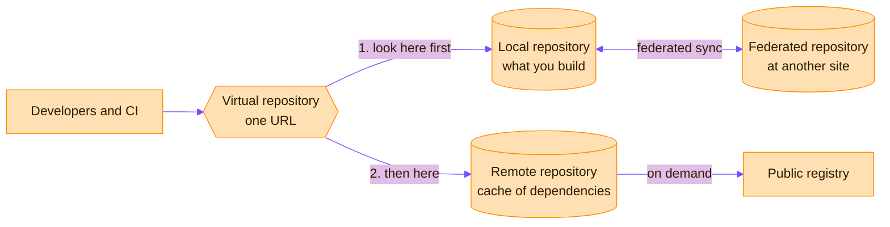
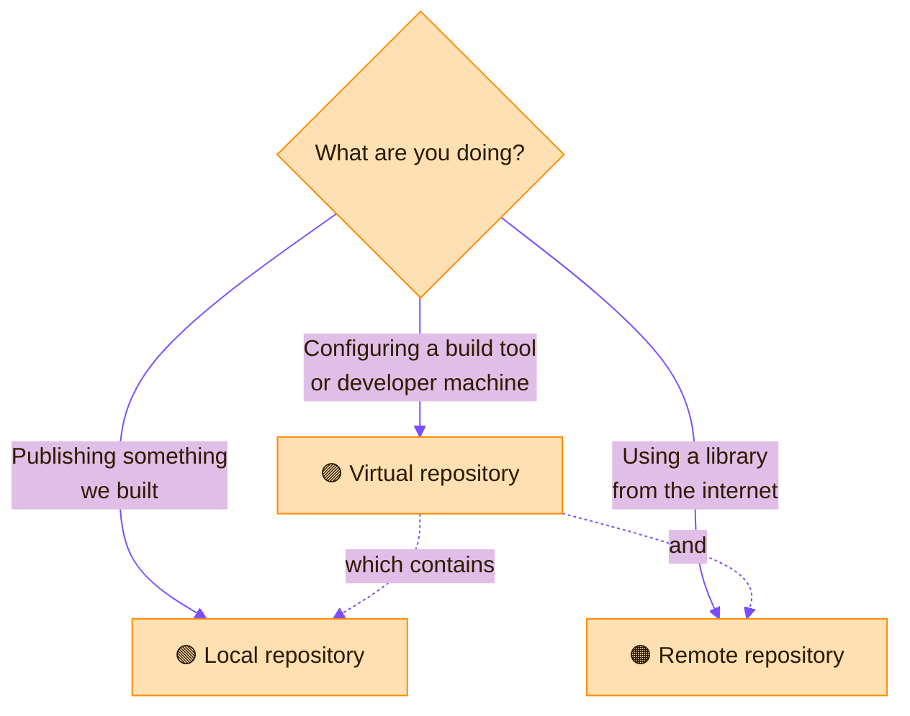

> [!TIP]
> **In one line:** Local holds what you build, remote caches what you depend on, virtual puts both behind one URL, and federated keeps sites in sync.

In Artifactory, a repository is a place to organize artifacts into a cohesive group by application and project. Artifactory hosts four repository types.[^docs-repo-mgmt]

# The three you will use every day

Almost everything you do in Artifactory touches one of three repository types. Learn these three and the rest follows.

| | 🟢 Local | 🟠 Remote | 🟣 Virtual |
|---|---|---|---|
| **In one phrase** | Upload = local repository | Proxy + cache for external dependencies | One URL in front of both |
| **Direction** | You push artifacts **in** | It pulls artifacts **in from outside** | It **routes** requests to the others |
| **Holds** | What your organization builds | Cached copies of what you depend on | Nothing of its own |
| **Typical contents** | Your organizational artifacts, internal packages, microservice artifacts, client-specific builds | Packages from Maven Central, the npm registry, PyPI, or another Artifactory instance | A list of local and remote repositories |
| **Can you upload to it?** | ✅ Yes | ❌ No | ↪️ Yes, it forwards to a default local |
| **Who uses it** | CI pipelines publishing builds | Builds resolving third-party dependencies | Every developer and pipeline, as their single address |
| **Deep dive** | [Local repositories](/repository-management/local-repositories.md) | [Remote repositories](/repository-management/remote-repositories.md) | [Virtual repositories](/repository-management/virtual-repositories.md) |

## A picture for each

**🟢 Local: your own shelf.** If your organization made it, it lives here.

**🟠 Remote: fetch once, keep a copy.** The first request goes out to the internet; every later one is answered from the cache.

**🟣 Virtual: the front desk.** One address for everyone, whatever sits behind it.

## An everyday analogy

| Repository | Think of it as | Because |
|---|---|---|
| 🟢 Local | Your own bookshelf | It holds the books you wrote yourself. |
| 🟠 Remote | A photocopy of a library book | You fetched it once from elsewhere and kept a copy, so you never need to go back. |
| 🟣 Virtual | The front desk | You ask one person; they know which shelf to check, and in what order. |

> [!NOTE]
> **Who sets these up?** Administrators. Creating a repository needs Admin or Project Admin permission and is done from the **Administration** area. Developers and pipelines then use what was created. The [.NET walkthrough](/repository-management/set-up-dotnet-repositories.md) shows who can do what.

## Which one do I need?

> [!IMPORTANT]
> **The golden rule:** people and pipelines talk to the **virtual** repository. Locals and remotes do the work behind it.
>
> This is the one to get right. Read [when to use a virtual repository](/repository-management/virtual-repositories.md) before you configure a single tool.

# The full list: four types

| Type | What it holds | Typical use |
|---|---|---|
| [Local](/repository-management/local-repositories.md) | Artifacts your organization uploads or creates itself | Build outputs, binaries and other packages you generate |
| [Remote](/repository-management/remote-repositories.md) | A cache of artifacts proxied from a remote URL, such as a public registry | Your project's external dependencies |
| [Virtual](/repository-management/virtual-repositories.md) | Nothing of its own: it aggregates local and remote repositories | One controlled entry point for searching and resolving artifacts |
| Federated | Contents synchronized with other federated repositories at remote sites in the same Federation | Sharing the same artifacts across sites |

# How they fit together

- **Local** is where what you build goes in.
- **Remote** is where what you depend on comes in from outside.
- **Virtual** sits in front of both, so tools talk to a single URL.
- **Federated** keeps repositories at different sites in step with each other.

A [Smart Remote repository](/repository-management/smart-remote-repositories.md) is a remote repository whose upstream is another Artifactory instance.

# One more type, by subscription

With an Enterprise+ subscription and JFrog Distribution, there are also Release Bundle repositories. They collect a signed group of artifacts and protect them from changes, so distribution to targets is consistent.[^docs-repo-mgmt]

# Related

- [Repository naming conventions](/repository-management/repository-naming-conventions.md)
- [Deployment options and federation](/jfrog-introduction/deployment-and-federation.md) - the introduction-level view of federation.

[^docs-repo-mgmt]: JFrog Artifactory documentation - Repository Management.

---

📚 [Topic index](/repository-management/index.md) · [Local repositories](/repository-management/local-repositories.md) ➡️
