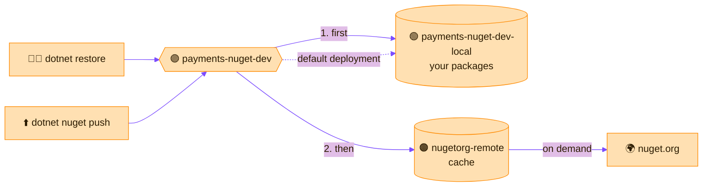

> [!TIP]
> **In one line:** Local first, remote second, virtual third, then point `dotnet` at the virtual URL.

This walkthrough sets up everything a .NET team needs in JFrog SaaS. NuGet is the package manager for .NET, so every repository here has the package type **NuGet**.[^docs-nuget]


# Who can do this?

> [!IMPORTANT]
> **Creating repositories is an administrator's job.** You need **Admin** or **Project Admin** permission. In the interface it is done from the **Administration** area, and if you do not have the permission the option is simply not shown.[^docs-nuget] Developers *use* repositories; administrators *create* them. If you cannot see **Administration → Repositories**, ask your Platform Admin or your Project Admin.

| You are a... | Can you create repositories? | Where |
|---|---|---|
| 👑 **Platform Admin** | ✅ Yes, anywhere | **Administration → Repositories** |
| 🔵 **Project Admin** (with the *Manage Resources* privilege) | ✅ Yes, inside your project | The same screen, with your project selected |
| 👩‍💻 **Developer** or other member | ❌ No | You use the repositories an admin created |

The same permission applies whichever route is used: the manual steps below, the Quick Repository Creation wizard, or the REST API.

# Why this order?

Yes: **local, then remote, then virtual.**

| Order | Repository | Why it comes here |
|:-:|---|---|
| 1️⃣ | 🟢 Local | It stands alone. Nothing else needs to exist first. |
| 2️⃣ | 🟠 Remote | It also stands alone. It only needs the address of nuget.org. |
| 3️⃣ | 🟣 Virtual | It is a list of other repositories, so those must exist before you can add them. |

Steps 1 and 2 can be swapped. Step 3 must come last.

# Before you start

| You need | Detail |
|---|---|
| 🔑 **Permission** | Admin or Project Admin. See *Who can do this?* above. |
| 🌐 **Your SaaS address** | It looks like `https://company.jfrog.io` |
| 🏷️ **Names decided** | This walkthrough uses the names below, following the [naming conventions](/repository-management/repository-naming-conventions.md) |

| Role | Name used here |
|---|---|
| 🟢 Local | `payments-nuget-dev-local` |
| 🟠 Remote | `nugetorg-remote` |
| 🟣 Virtual | `payments-nuget-dev` |

# Step 1: create the local repository 🟢

This is where your own team's packages will live.

1. Open the **Administration** tab and click **Repositories**.
2. Click **Create a Repository** and choose **Local**.
3. In the *Select Package Type* window, click **NuGet**.
4. Enter the repository key: `payments-nuget-dev-local`.
5. Click **Create Repository**.

> [!WARNING]
> Step 3 is the one that cannot be undone. The package type is permanent. See [why the package type matters](/repository-management/why-package-type-matters.md).

# Step 2: create the remote repository 🟠

This brings in public packages from nuget.org and caches them.

1. **Administration** → **Repositories** → **Create a Repository** → **Remote**.
2. Select the package type **NuGet**.
3. Enter the repository key: `nugetorg-remote`.
4. Check the **URL** of the remote registry. It should point at the public NuGet gallery.[^docs-nuget]
5. Click **Create Repository**.

The repository starts empty. It fills as your builds ask for packages.

# Step 3: create the virtual repository 🟣

This is the one address everyone will use.

1. **Administration** → **Repositories** → **Create a Repository** → **Virtual**.
2. Select the package type **NuGet**.
3. Enter the repository key: `payments-nuget-dev`.
4. Add the repositories to include, **in this order**:
   1. `payments-nuget-dev-local`
   2. `nugetorg-remote`
5. Set the **Default Deployment Repository** to `payments-nuget-dev-local`, so pushes to the virtual URL land there.[^docs-virtual]
6. Click **Create Repository**.

Local goes first for the fastest access to your own builds; the remote goes last because it needs an external call.[^docs-virtual]



# Step 4: connect the .NET client 🔵

Add the **virtual** repository as a package source:[^docs-nuget]

```bash
dotnet nuget add source https://company.jfrog.io/artifactory/api/nuget/v3/payments-nuget-dev/index.json \
  --name artifactory --username <your-user> --password <your-token>
```

Note the shape of the URL: `api/nuget/v3/<repository>/index.json`.

# Examples

Restore a project's dependencies. Your own packages and public ones both arrive through the one source:[^docs-nuget]

```bash
dotnet restore
```

Publish a package your team built. It goes to the virtual URL and lands in the local repository:

```bash
dotnet nuget push MyLib.1.2.0.nupkg --source artifactory
```

Pushing works for local and virtual repositories. It is not applicable to remote repositories.[^docs-nuget]

# Check that it worked

| Check | What you should see |
|---|---|
| ✅ After `dotnet restore` | Public packages appear in `nugetorg-remote`: they are now cached. |
| ✅ After `dotnet nuget push` | `MyLib.1.2.0.nupkg` appears in `payments-nuget-dev-local`. |
| ✅ In a fresh project | Adding a reference to `MyLib` restores it from Artifactory, with no extra source configured. |

# The shortcut: Quick Repository Creation

JFrog SaaS can create all three in one go.[^docs-get-started]

1. In the user menu, select **Quick Repository Creation**.
2. Select the package type: **NuGet**.
3. Click **Next**.
4. Enter a prefix for the repository names (up to 20 characters).
5. Click **Create**.

You get a local, a remote and a virtual repository, ready to connect. Do the manual steps once anyway: knowing what the wizard builds makes everything else easier to follow.

# Common stumbles

- ❌ **Choosing Maven or Generic in the package type window.** `dotnet` will not be able to use the repository. It cannot be changed afterwards.
- ❌ **Giving developers the `-local` URL.** They lose nuget.org packages. Always hand out the virtual URL.
- ❌ **Skipping the default deployment repository.** Pushes to the virtual URL then fail.
- ❌ **Leaving out `/index.json`.** The NuGet v3 source URL needs it.

> [!NOTE]
> **The same recipe works for every stack.** Swap NuGet for npm, PyPI or Maven and the three steps are identical: only the package type, the upstream registry and the client command change.

# Related

- [Why the package type matters](/repository-management/why-package-type-matters.md)
- [When to use a virtual repository](/repository-management/virtual-repositories.md)
- [Repository types in Artifactory](/repository-management/repository-types.md)

[^docs-nuget]: JFrog documentation - NuGet Repositories.
[^docs-get-started]: JFrog documentation - Get Started with Repositories.
[^docs-virtual]: JFrog documentation - Virtual Repositories.

---

⬅️ [Repository naming conventions](/repository-management/repository-naming-conventions.md) · 📚 [Chapter 03 index](/repository-management/index.md) · [Next chapter: Projects](/projects/index.md) ⏭️
