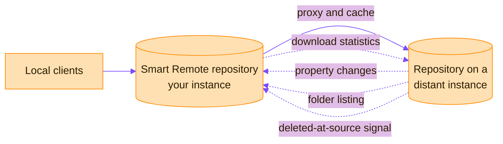

> [!TIP]
> **In one line:** Point a remote repository at another Artifactory instance and the two sides stay aware of each other.

A Smart Remote repository is a [remote repository](/repository-management/remote-repositories.md) that proxies a local, remote or federated repository from another Artifactory instance or an Edge node. It has all the usual benefits of a remote repository, plus four more.[^docs-smart-remote]



# What "smart" adds

| Feature | What it does | Why it helps |
|---|---|---|
| Reported download statistics | Tells the distant instance each time a cached artifact is downloaded locally. | The distant instance knows the artifact is still in use and does not clean it up by mistake. |
| Synchronized properties | Propagates later changes to an artifact's properties from the distant instance to your cached copy. | Your cached copy does not carry out-of-date properties. |
| Remote repository browsing | With **List Remote Folder Items** checked, lets you navigate the distant repository's contents even for artifacts not yet cached. | You can browse remote files as if they were local. |
| Source absence detection | Shows, on a cached artifact, when the original has been deleted at the distant instance. | You can copy the artifact from the cache to a local repository to keep it. |

# Caveats

- Download statistics are reported only from the time the option is set, so counts can differ between the two instances.
- Docker Smart Remote repositories do not synchronize properties for pulls resolved by digest.

# Configuring one

Create a remote repository and set its URL to a repository in another JFrog Platform instance. Many package types need the prefix `api/<package_type>` in the URL:

```text
https://<jfrog_platform_url>/artifactory/api/<package_type>/<repository_key>
```

# Which repository to point at

| Endpoint type | Guidance |
|---|---|
| Local or remote | Recommended. |
| Virtual | Not recommended: it can behave inconsistently. The exception is Go, where a virtual repository must be the endpoint. |

# Related

- [Repository naming conventions](/repository-management/repository-naming-conventions.md) - how to name a remote that points at another site.
- [Repository types in Artifactory](/repository-management/repository-types.md)

[^docs-smart-remote]: JFrog Artifactory documentation - Smart Remote Repositories.

---

⬅️ [Remote repositories](/repository-management/remote-repositories.md) · 📚 [Topic index](/repository-management/index.md) · [Virtual repositories](/repository-management/virtual-repositories.md) ➡️
