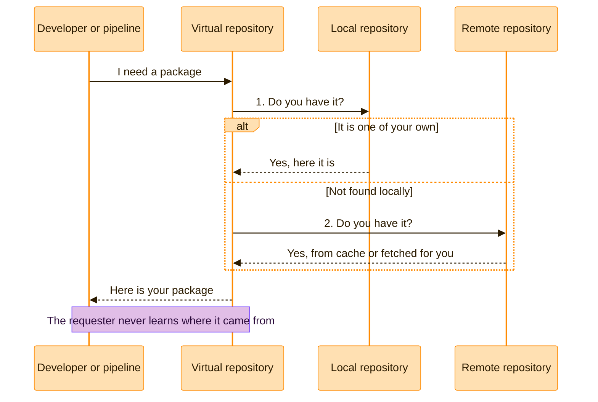

> [!TIP]
> **In one line:** If someone or something needs to download an artifact, give them a virtual repository URL. Always.

A virtual repository is a collection of local, remote and other virtual repositories of the same package type, accessed through a single logical URL.[^docs-virtual]


# ⭐ When to use a virtual repository

> [!IMPORTANT]
> **The short answer: whenever a person or a pipeline needs to get artifacts.** If you are typing a repository URL into a build tool, a CI job or a developer's machine, it should be a virtual repository's URL. This is the single most useful habit in Artifactory.


## Use one when...

| # | Your situation | Why a virtual repository is the answer |
|:-:|---|---|
| 1 | 🧑‍💻 **You are setting up a developer machine or a build tool** | Developer tools should point to a virtual repository, not a local one. Administrators can then change the storage behind it without anyone updating their configuration.[^docs-virtual] |
| 2 | 🧩 **A build needs your own artifacts *and* open source ones** | One virtual repository aggregates local and remote repositories behind a single URL, so the build has one place to ask.[^docs-virtual] |
| 3 | 🔄 **You expect to add, replace or move repositories** | The underlying repositories and their access rules can change with no client-side change.[^docs-virtual] |
| 4 | 🚦 **You separate dev, QA and production** | Give each stage its own virtual repository, such as `payments-maven-dev`. Each one exposes only the repositories that stage may use. |
| 5 | 🛡️ **You want to control what can be resolved, and from where** | Include and exclude patterns on a virtual repository decide which requests go where. For example, they can stop requests for your internal artifacts from ever reaching a remote source.[^docs-virtual] |
| 6 | ⬆️ **You want one URL for downloads *and* uploads** | Set a default deployment repository, and uploads sent to the virtual URL land in the right local repository.[^docs-virtual] |
| 7 | ⚡ **You want the fastest safe resolution** | Order matters inside a virtual repository: locals first for speed, the remote source last because it needs an external call.[^docs-virtual] |

## The 10-second test

Not sure which repository URL to use? Ask one thing: **who is asking, and what for?**


| Who is asking | What they want | Give them |
|---|---|---|
| 👩‍💻 A developer, a build tool or a pipeline | To **download** something | 🟣 The **virtual** URL |
| 🚀 A pipeline or a developer | To **upload** what they built | 🟣 The **virtual** URL. It lands in the default local repository. |
| 🛠️ An administrator | To maintain **one specific** repository | That local or remote repository, directly |

> [!TIP]
> **If in doubt, use the virtual URL.** You will be right far more often than wrong.

# How it works behind the URL

A virtual repository stores nothing. It keeps an ordered list of other repositories and knows where to look.



| Step | What happens |
|:-:|---|
| 1️⃣ | The request arrives at the virtual repository's single URL. |
| 2️⃣ | It checks its **local** repositories first. Your own artifacts are found here, fast. |
| 3️⃣ | If needed, it asks its **remote** repositories, which answer from cache or fetch from the internet. |
| 4️⃣ | It returns the artifact. |
| ⬆️ | An **upload** to the same URL is forwarded to the default deployment repository. |

> [!NOTE]
> **Order is a setting, and it matters.** List local repositories first for the fastest access to internal builds, and the remote source last because it needs an external network call.[^docs-virtual]

# Set one up in five steps

> [!IMPORTANT]
> **Admins only.** Repositories are created from the **Administration** area by a Platform Admin or a Project Admin. Everyone else uses the result. See [who can create repositories](/repository-management/set-up-dotnet-repositories.md).

| Step | Do this | Example |
|:-:|---|---|
| 1 | Create a 🟢 **local** repository for what you build | `payments-maven-dev-local` |
| 2 | Create a 🟠 **remote** repository for what you depend on | `mavencentral-remote` |
| 3 | Create a 🟣 **virtual** repository and add both, **local first** | `payments-maven-dev` |
| 4 | Set its **default deployment repository** to the local one | `payments-maven-dev-local` |
| 5 | Put the virtual URL, and only that URL, in every tool | `.../artifactory/payments-maven-dev` |

For a click-by-click version, follow the [.NET walkthrough](/repository-management/set-up-dotnet-repositories.md). The steps are the same for every technology.

# Examples

## Point your tools at it

One line per tool, and every URL names a **virtual** repository.

```bash
# npm: one registry for your own packages and public ones
npm config set registry https://company.jfrog.io/artifactory/api/npm/payments-npm-dev/

# pip: one index for internal and PyPI packages
pip config set global.index-url https://company.jfrog.io/artifactory/api/pypi/payments-pypi-dev/simple

# .NET: one source for internal and nuget.org packages
dotnet nuget add source https://company.jfrog.io/artifactory/api/nuget/v3/payments-nuget-dev/index.json --name artifactory
```

```xml
<!-- Maven settings.xml: send everything through one virtual repository -->
<mirror>
  <id>artifactory</id>
  <mirrorOf>*</mirrorOf>
  <url>https://company.jfrog.io/artifactory/payments-maven-dev</url>
</mirror>
```

Look at what is missing: no `-local`, no `-remote`. Developers never need those names.

## Keep internal names internal

A virtual repository can also act as a filter. Define one that contains your organization's remote repositories, and give it an exclude pattern matching your own group ID. Requests for your internal artifacts then never reach a remote source.[^docs-virtual]

# When to go direct instead

A virtual repository is the front door, not the only door.

| Situation | Go direct to | Why |
|---|---|---|
| 🧹 Maintaining one repository: cleanup, settings, replication | That local or remote repository | The task is about one specific store, not about finding artifacts. |
| 🔗 Choosing the endpoint for a Smart Remote repository | A local or remote repository | A virtual endpoint is not recommended there; Go is the exception. See [Smart Remote repositories](/repository-management/smart-remote-repositories.md). |
| 🔬 Checking exactly what one repository holds | That repository | A virtual view blends several sources together. |

# Mistakes to avoid

| ❌ The mistake | 💥 What goes wrong | ✅ Do this instead |
|---|---|---|
| Giving developers a `-local` URL | They cannot get third-party dependencies, and any change means reconfiguring everyone | Hand out the virtual URL only |
| Listing the remote before the local | Every request makes an external call first: slower and less reliable | Local first, remote last |
| One giant virtual repository for everything | Teams and stages lose their boundaries | One per team, technology and maturity |
| No default deployment repository | Uploads to the virtual URL have nowhere to go | Set it to the matching local repository |
| Expecting it to mix package types | A virtual repository only aggregates repositories of its own package type | One virtual repository per technology |

# Settings worth knowing

| Setting | What it does |
|---|---|
| 🔒 **Package type** | Chosen at creation and permanent. See [why the package type matters](/repository-management/why-package-type-matters.md). |
| 🏷️ **Repository key** | Mandatory and unique. It cannot begin with a number or contain spaces or special characters. |
| 📋 **Included repositories, in order** | The locals and remotes behind the URL, and the order they are searched in. |
| ⬆️ **Default Deployment Repository** | The repository that receives artifacts uploaded to the virtual URL. |
| 🚦 **Include / exclude patterns** | Ant-like patterns that control which artifact paths are resolved through this virtual repository. |
| 🌐 **Remote requests can retrieve remote artifacts** | When set, other Artifactory instances can fetch uncached artifacts through the aggregated remotes. When not set (the default), they get cached artifacts only. |

One exception on package type: a virtual repository of type **Generic** can aggregate repositories of any type, but it does not maintain any metadata.

> [!IMPORTANT]
> **Remember it like this:** locals and remotes are *where things are*. The virtual repository is *where you go*.

# Related

- [Local repositories](/repository-management/local-repositories.md)
- [Remote repositories](/repository-management/remote-repositories.md)
- [Repository naming conventions](/repository-management/repository-naming-conventions.md) - virtual names omit the locator.

[^docs-virtual]: JFrog Artifactory documentation - Virtual Repositories.

---

⬅️ [Remote repositories](/repository-management/remote-repositories.md) · 📚 [Chapter 03 index](/repository-management/index.md) · [Smart Remote repositories](/repository-management/smart-remote-repositories.md) ➡️
