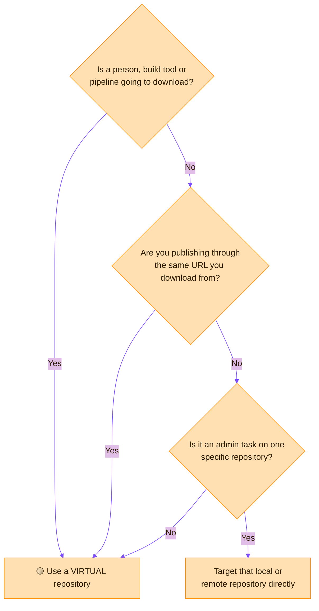
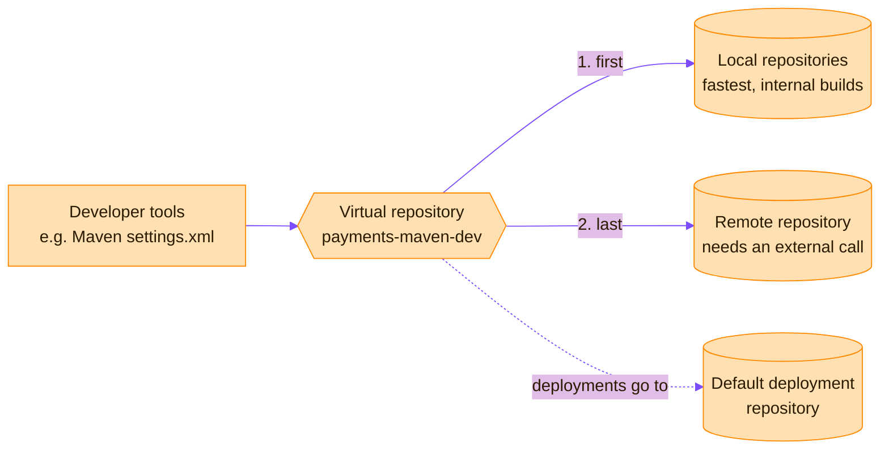

> [!TIP]
> **In one line:** If someone or something needs to download an artifact, give them a virtual repository URL. Always.

A virtual repository is a collection of local, remote and other virtual repositories of the same package type, accessed through a single logical URL.[^docs-virtual]


# ⭐ When to use a virtual repository

> [!IMPORTANT]
> **The short answer: whenever a person or a pipeline needs to get artifacts.** If you are typing a repository URL into a build tool, a CI job or a developer's machine, it should be a virtual repository's URL. This is the single most useful habit in Artifactory.


## Use one when...

| # | Your situation | Why a virtual repository is the answer |
|:-:|---|---|
| 1 | 🧑‍💻 **You are setting up a developer machine or a build tool** | Developer tools should point to a virtual repository, not a local one. Administrators can then change the storage behind it without anyone updating their configuration.[^docs-virtual] |
| 2 | 🧩 **A build needs your own artifacts *and* open source ones** | One virtual repository aggregates local and remote repositories behind a single URL, so the build has one place to ask.[^docs-virtual] |
| 3 | 🔄 **You expect to add, replace or move repositories** | The underlying repositories and their access rules can change with no client-side change.[^docs-virtual] |
| 4 | 🚦 **You separate dev, QA and production** | Give each stage its own virtual repository, such as `payments-maven-dev`. Each one exposes only the repositories that stage may use. |
| 5 | 🛡️ **You want to control what can be resolved, and from where** | Include and exclude patterns on a virtual repository decide which requests go where. For example, they can stop requests for your internal artifacts from ever reaching a remote source.[^docs-virtual] |
| 6 | ⬆️ **You want one URL for downloads *and* uploads** | Set a default deployment repository, and uploads sent to the virtual URL land in the right local repository.[^docs-virtual] |
| 7 | ⚡ **You want the fastest safe resolution** | Order matters inside a virtual repository: locals first for speed, the remote source last because it needs an external call.[^docs-virtual] |

## Ask yourself three questions



## Examples

The same pattern in three ecosystems. Every URL names a **virtual** repository.

```bash
# npm: one registry for your packages and public ones
npm config set registry https://company.jfrog.io/artifactory/api/npm/payments-npm-dev/

# pip: one index for internal and PyPI packages
pip config set global.index-url https://company.jfrog.io/artifactory/api/pypi/payments-pypi-dev/simple
```

```xml
<!-- Maven settings.xml: send everything through one virtual repository -->
<mirror>
  <id>artifactory</id>
  <mirrorOf>*</mirrorOf>
  <url>https://company.jfrog.io/artifactory/payments-maven-dev</url>
</mirror>
```

Notice what is missing: no `-local`, no `-remote`. Developers never see those names.

## Build your first one in five steps

| Step | Do this | Example |
|:-:|---|---|
| 1 | Create a **local** repository for what you build | `payments-maven-dev-local` |
| 2 | Create a **remote** repository for what you depend on | `mavencentral-remote` |
| 3 | Create a **virtual** repository and add both, **local first** | `payments-maven-dev` |
| 4 | Set its **default deployment repository** to the local one | `payments-maven-dev-local` |
| 5 | Put the virtual URL, and only that URL, in every tool | `.../artifactory/payments-maven-dev` |

## When to go direct instead

A virtual repository is the front door, not the only door.

| Situation | Go direct to | Why |
|---|---|---|
| 🧹 Administering one repository: cleanup, settings, replication | That local or remote repository | The task is about one specific store, not about resolving artifacts. |
| 🔗 Choosing the endpoint for a Smart Remote repository | A local or remote repository | A virtual endpoint is not recommended there and can behave inconsistently; Go is the exception. See [Smart Remote repositories](/repository-management/smart-remote-repositories.md). |
| 🔬 Checking exactly what one repository holds | That repository | A virtual view mixes several sources together. |

## Mistakes to avoid

- ❌ **Pointing developers at a `-local` repository.** They can no longer resolve third-party dependencies, and every future change means reconfiguring everyone.
- ❌ **Listing the remote before the local.** Every request makes an external call first, which is slower and less reliable.
- ❌ **One giant virtual repository for everything.** Stages and teams lose their boundaries. Prefer one per team, technology and maturity.
- ❌ **Forgetting the default deployment repository.** Uploads to the virtual URL then have nowhere to go.
- ❌ **Mixing package types.** A virtual repository aggregates repositories of the same package type.

> [!TIP]
> **Remember it like this:** locals and remotes are *where things are*. The virtual repository is *where you go*.

# What happens to a request

> [!NOTE]
> **One URL in front of both.** A virtual repository stores nothing. It knows where to look.

| Step | What the virtual repository does |
|:-:|---|
| 1️⃣ | Receives the request at its single URL. |
| 2️⃣ | Looks in its **local** repositories first: if it is one of your own artifacts, it is found here, fast. |
| 3️⃣ | If not found, asks its **remote** repositories, which answer from cache or fetch from the internet. |
| 4️⃣ | Returns the artifact. The developer never needed to know where it came from. |
| ⬆️ | An **upload** sent to the virtual URL is forwarded to its default deployment repository. |



# Why use one

- **One well-known URL.** Clients do not need the access details of the underlying repositories.
- **Change without disruption.** The underlying repositories and their access rules can change with no client-side change.

A virtual repository of package type Generic can aggregate repositories of any type, but it does not maintain any metadata.

# Resolution order

List the underlying repositories in this order, for performance and reliability:[^docs-virtual]

1. **Local repositories first**, for the fastest access to internal builds.
2. **The actual remote source last**, because it needs an external network call.

# Single entry point

Developer tools, such as Maven's `settings.xml`, should point to a virtual repository and not to a local one. Administrators can then change the physical storage or add mirrors without developers updating their configuration.[^docs-virtual]

# Settings worth knowing

| Setting | Rule |
|---|---|
| Package type | Chosen at creation. It cannot be changed afterwards. |
| Repository key | Mandatory and unique. It cannot begin with a number or contain spaces or special characters. |
| Default Deployment Repository | The repository that receives artifacts deployed to the virtual repository. |
| Include / exclude patterns | Ant-like patterns that control which artifact paths are resolved through this virtual repository. |
| Remote requests can retrieve remote artifacts | When set, other Artifactory instances can fetch uncached artifacts through the aggregated remote repositories. When not set (the default), they get cached artifacts only. |

# Examples

Keeping internal artifacts from being resolved remotely: define a virtual repository that contains your organization's remote repositories, and give it an exclude pattern matching your own group ID. Requests for your internal artifacts then never go to a remote source.[^docs-virtual]

# Related

- [Local repositories](/repository-management/local-repositories.md)
- [Remote repositories](/repository-management/remote-repositories.md)
- [Repository naming conventions](/repository-management/repository-naming-conventions.md) - virtual names omit the locator.

[^docs-virtual]: JFrog Artifactory documentation - Virtual Repositories.

---

⬅️ [Smart Remote repositories](/repository-management/smart-remote-repositories.md) · 📚 [Topic index](/repository-management/index.md) · [Repository naming conventions](/repository-management/repository-naming-conventions.md) ➡️
