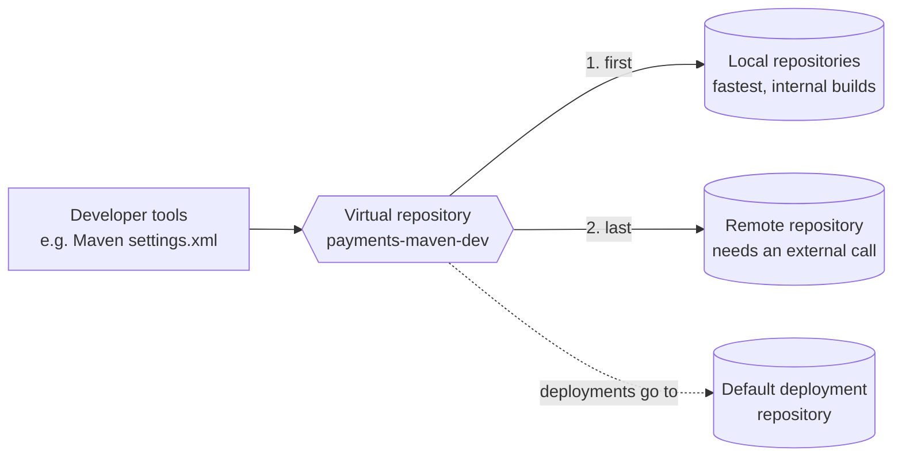

> [!TIP]
> **In one line:** Give developers one stable URL, and rearrange the repositories behind it whenever you need to.

A virtual repository is a collection of local, remote and other virtual repositories of the same package type, accessed through a single logical URL.[^docs-virtual]

# Why use one

- **One well-known URL.** Clients do not need the access details of the underlying repositories.
- **Change without disruption.** The underlying repositories and their access rules can change with no client-side change.

A virtual repository of package type Generic can aggregate repositories of any type, but it does not maintain any metadata.

# Resolution order

List the underlying repositories in this order, for performance and reliability:[^docs-virtual]

1. **Local repositories first**, for the fastest access to internal builds.
2. **The actual remote source last**, because it needs an external network call.

# Single entry point

Developer tools, such as Maven's `settings.xml`, should point to a virtual repository and not to a local one. Administrators can then change the physical storage or add mirrors without developers updating their configuration.[^docs-virtual]

# Settings worth knowing

| Setting | Rule |
|---|---|
| Package type | Chosen at creation. It cannot be changed afterwards. |
| Repository key | Mandatory and unique. It cannot begin with a number or contain spaces or special characters. |
| Default Deployment Repository | The repository that receives artifacts deployed to the virtual repository. |
| Include / exclude patterns | Ant-like patterns that control which artifact paths are resolved through this virtual repository. |
| Remote requests can retrieve remote artifacts | When set, other Artifactory instances can fetch uncached artifacts through the aggregated remote repositories. When not set (the default), they get cached artifacts only. |

# Examples

Keeping internal artifacts from being resolved remotely: define a virtual repository that contains your organization's remote repositories, and give it an exclude pattern matching your own group ID. Requests for your internal artifacts then never go to a remote source.[^docs-virtual]

# Related

- [Local repositories](/repository-management/local-repositories.md)
- [Remote repositories](/repository-management/remote-repositories.md)
- [Repository naming conventions](/repository-management/repository-naming-conventions.md) - virtual names omit the locator.

[^docs-virtual]: JFrog Artifactory documentation - Virtual Repositories.

---

⬅️ [Smart Remote repositories](/repository-management/smart-remote-repositories.md) · 📚 [Topic index](/repository-management/index.md) · [Repository naming conventions](/repository-management/repository-naming-conventions.md) ➡️
