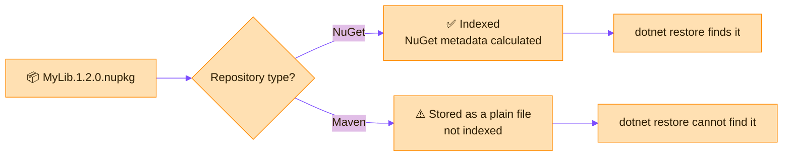

> [!TIP]
> **In one line:** The package type is what makes a repository *understand* its contents. The wrong type turns a smart package registry into a plain file folder.

When you create a repository you must pick a package type: Maven, NuGet, npm, Docker and so on. It is a fundamental characteristic of the repository and **cannot be changed later**.[^docs-get-started]

# What the package type actually does

Repositories of each package type have built-in logic for parsing metadata, creating index files and optimizing performance for packages of that specific type.[^docs-get-started]

| The package type decides... | Which means |
|---|---|
| 🧠 **How uploads are read** | Artifactory indexes each package and calculates its metadata, according to the repository's type.[^docs-get-started] |
| 🗣️ **Which client can talk to it** | A NuGet repository speaks the NuGet protocol to `dotnet` and `nuget`; a Maven repository speaks Maven to `mvn`. |
| 🗂️ **How things are laid out** | Each type has its own way of organizing packages and versions. |
| 🧲 **What it can be grouped with** | A virtual repository can only include repositories of the same type.[^docs-get-started] |
| 🔒 **Forever** | Once set, the type cannot be changed.[^docs-get-started] |

# What happens when the type is wrong

Artifactory will **not stop you** uploading a package of the wrong type. But if you do, it will not index the package or update the repository's metadata.[^docs-get-started]

| | ✅ NuGet package in a NuGet repository | ⚠️ NuGet package in a Maven repository |
|---|---|---|
| Is the file stored? | Yes | Yes |
| Is it indexed as a package? | Yes: NuGet metadata is calculated automatically when packages are added, moved, copied or removed.[^docs-nuget] | No: Artifactory does not index a wrong-type package or update the metadata.[^docs-get-started] |
| Can `dotnet restore` resolve it? | Yes, through the repository's NuGet feed URL | No. There is no NuGet feed to query |
| Can it join a NuGet virtual repository? | Yes | No. Virtual repositories only include the same type.[^docs-get-started] |
| Can you fix it by changing the type? | Not needed | No. The type is permanent.[^docs-get-started] |
| How do people fetch it? | By package name and version | By typing the exact file path |

> [!WARNING]
> Wrong-type uploads also hurt the repository itself. Content that is not in the proper package format can impact indexing and reduce performance.[^docs-get-started]

# "We use .NET, but our repositories are Maven"

This is a real and common situation. If it describes your company, here is how to read it.

## Why it happens

These are typical reasons. Check with your administrators which applies.

- 🕰️ **History.** Artifactory grew up in the Java world, and Maven was the natural default for early setups.
- 📋 **Copy and paste.** A setup script or template written for a Java team was reused for everyone.
- 📁 **Used as a file share.** Teams upload build outputs by path, so nobody noticed the type did not match.

## What it costs you

| You lose | Because |
|---|---|
| 🚫 `dotnet restore` straight from Artifactory | A Maven repository offers no NuGet feed |
| 🚫 One virtual URL for internal and nuget.org packages | A NuGet virtual cannot include Maven repositories |
| 🚫 Package search by name and version | The packages were never indexed as NuGet |
| 🚫 A clean developer setup | Teams fall back to download scripts and hand-copied DLLs |

## What is really in there? Two cases

| What you find in the Maven repository | The right home for it |
|---|---|
| 📦 `.nupkg` files | A **NuGet** repository |
| 🗜️ Loose `.dll` files, `.zip` archives, installers | A **Generic** repository. JFrog recommends uploading generic content to a Generic repository, not to a typed one.[^docs-get-started] |

## How to put it right

1. 🔎 **Look.** List the Maven repositories your .NET teams use, and note what file types they hold.
2. 🏗️ **Create** proper NuGet repositories: local, remote and virtual. Follow the [.NET walkthrough](/repository-management/set-up-dotnet-repositories.md).
3. 🚚 **Copy** the `.nupkg` files into the new NuGet local repository. NuGet metadata is calculated automatically when packages are copied in.[^docs-nuget]
4. 🔁 **Repoint** developers and pipelines to the new virtual repository URL.
5. 🧹 **Retire** the old repositories once nothing reads from them.

> [!NOTE]
> You cannot convert a repository from Maven to NuGet. The fix is always new repositories and a move.

# The rule to remember

> [!IMPORTANT]
> **Match the repository type to the package, not to habit.** `.nupkg` goes to NuGet, `.jar` to Maven, npm tarballs to npm, container images to Docker, and anything that is not a package to Generic.

# Related

- [Repository types in Artifactory](/repository-management/repository-types.md) - local, remote and virtual are about *role*; package type is about *content*.
- [Walkthrough: set up .NET repositories](/repository-management/set-up-dotnet-repositories.md)
- [Repository naming conventions](/repository-management/repository-naming-conventions.md) - the `<tech>` part of a name is the package type.

[^docs-get-started]: JFrog documentation - Get Started with Repositories.
[^docs-nuget]: JFrog documentation - NuGet Repositories.

---

⬅️ [Repository naming conventions](/repository-management/repository-naming-conventions.md) · 📚 [Topic index](/repository-management/index.md) · [Walkthrough: set up .NET repositories](/repository-management/set-up-dotnet-repositories.md) ➡️
